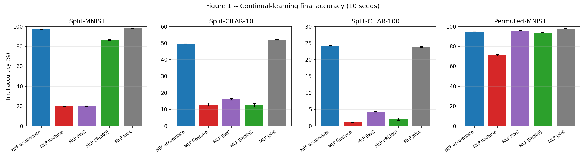
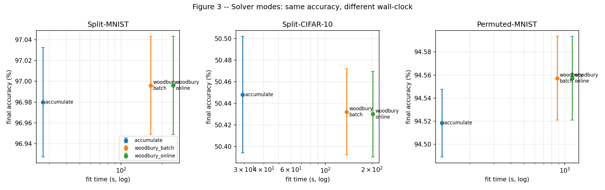
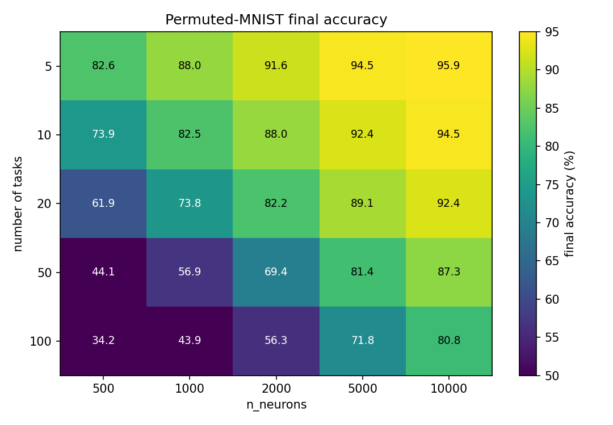
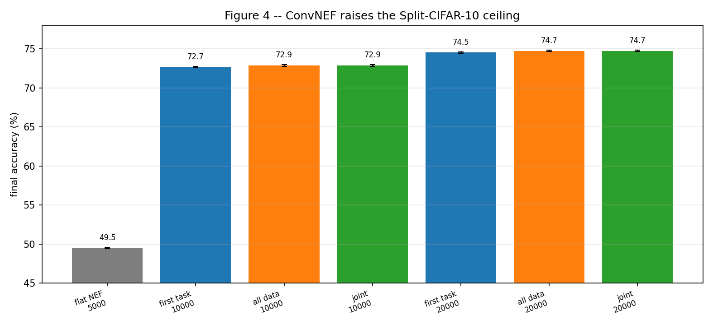

# Sufficient Statistics as a Universal Primitive? (Part II)

## Continual Learning Without Forgetting, by Construction

Nikša Bosnić  
nikeke@otpisani.net[^ai]

[^ai]: GitHub Copilot (powered by Anthropic Claude Opus and OpenAI
GPT large language models) was used extensively during code
development, drafting, editing, and analysis for this work.  All
final content, judgments, and errors remain the author's
responsibility.

---

## Abstract

NEF's regularized least-squares solve over fixed-encoder neural
activities — $D = (A^\top A + \alpha_{\mathrm{eff}} I)^{-1} A^\top Y$
— is a compact sufficient-statistics primitive for continual learning.
Because $A^\top A$ and $A^\top Y$ add over data partitions, sequential
`partial_fit` over a task stream produces the **same** decoder as joint
training over the union of tasks: the forgetting axis has length zero by
construction relative to that joint fixed-feature model.  Across
Split-MNIST, Permuted-MNIST, Split-CIFAR-10, and Split-CIFAR-100,
`nef_accumulate` matches `nef_joint` to 0.000000 pp over 10 seeds.  This
removes forgetting from the analytic readout and collapses the
class-incremental failure modes of the tested EWC/finetune baselines
(Split-MNIST: **97.0 %** vs ~20.0 %), while remaining above ER at
86.5 % and exposing the tradeoff directly: the linear head no longer
forgets, but absolute accuracy is bounded by the fixed feature map.
Capacity scales smoothly with neuron budget
per task, a gradient-free ConvNEF front end lifts Split-CIFAR-10 from
49.5 % to **74.7 $\pm$ 0.1 %** without breaking the identity, and a
streaming-continual panel carries the same exact/joint/Woodbury
agreement through 10-task permuted sMNIST while revealing a lower
mean-pooled-delay-line ceiling of **58.3 $\pm$ 0.2 %** at 16000 neurons.

---

## §1 — The six principles of leenef

We build on the *Neural Engineering Framework* of Eliasmith and
Anderson (2003): a population of neurons with fixed encoders
represents a vector quantity, and any function of that vector is
computed by a linear decoder fitted to the population's activity.
Their book frames this around three principles — representation,
transformation, and dynamics — and the canonical implementation
uses spiking leaky-integrate-and-fire neurons whose firing rate
encodes the represented quantity.  We keep the encoder–decoder
split, the analytic least-squares fit, and the conceptual freedom
to compose decoded signals; we depart in three places.

- We use **rate neurons with `abs` activation**, not spiking LIF.
  `abs` is a minimal departure from linearity that escapes the
  linear-collapse argument of Paper I §2; it is also what gives our
  activations the frame-coefficient-magnitude interpretation that the
  paper series uses throughout.
- We use **data-driven biases**.  The bias of neuron *i* is
  $b_i = -g_i (e_i \cdot d_i)$ for a sample $d_i$ drawn from the
  training set, placing the *i*-th `abs` fold on the data
  manifold rather than on a generic random intercept.
- We do not use NEF's **dynamics principle** anywhere in this
  paper series.  Streaming, continual, and control variants reuse
  encoders and decoders with pooling, accumulation, or target
  construction, not a recurrent dynamics solve.

When this paper says "NEF" it means this *analytic-rate-`abs`
specialization*; when distinction matters we call our local
specialization **leenef**.  Readers who arrive expecting Nengo-
style spiking populations should read NEF here as "the
encode–decode pattern of Eliasmith & Anderson, with rate-`abs`
neurons and data-driven biases."

The SSUP paper series shares six operational claims, distilled
from the program's running code.  These are *our* distillation: P1–P2
inherit directly from NEF's encoder/decoder split and analytic decoder
fit; P3–P4 are the sufficient-statistics reading of that fixed-feature
solve; P5–P6 are leenef-specific.

- **P1 — Encoders are fixed** (random or data-adapted).  Decoders
  are the only thing we ever fit.
- **P2 — Decoders fall out of one analytic step:**
  $D = (A^\top A + \alpha I)^{-1} A^\top Y$.  No learning rate, no schedule, no
  gradient flow between layers.
- **P3 — $A^\top A$ and $A^\top Y$ are the complete sufficient state
  of the learner.**  Continual learning, streaming over time, ensembles,
  online updates, per-action FQI (Ernst et al., 2005), and successor
  features are different ways of *additively combining* sufficient
  statistics or replacing the target block they accumulate.
- **P4 — Targets $Y$ are the only place where task structure
  enters.**  The encoder does not care what the task is; the
  decoder column does.
- **P5 — Time is summarized before the analytic solve.**  The paper
  series uses pooled delay-line activities, accumulated task statistics,
  returns, and successor targets rather than BPTT (Werbos, 1990) or a
  recurrent dynamics solve.
- **P6 — Additivity helps when output semantics are stable.**  With
  fixed features and stable target columns, new observations add
  statistics rather than overwriting old meanings.  Class-incremental
  continual learning is the cleanest case; reinforcement learning shows
  why unstable or mismatched targets must be constructed with care.

In Paper II, **P3** and **P6** are the whole mechanism.  P3 says that
the learner's state is the pair $(A^\top A, A^\top Y)$, and those
statistics add over tasks exactly as they add over mini-batches.  P6
says that class-incremental targets write into decoder columns rather
than overwriting a shared classifier head.  Together they turn
continual learning from a parameter-drift problem into an accounting
problem: preserve the sufficient statistics, then solve the same
quadratic objective the joint learner would have solved.

---

## §2 — Continual-learning frame

### Catastrophic forgetting and SGD

Catastrophic forgetting (McCloskey & Cohen, 1989; French, 1999) is
the empirical observation that a connectionist model trained
sequentially on tasks $\mathcal{T}_1, \mathcal{T}_2, \dots$ tends
to lose accuracy on $\mathcal{T}_i$ once $\mathcal{T}_{i+1}$ is
trained.  The mechanism is well understood: SGD optimizes the
*current batch's* loss, parameter updates are local and
non-conservative across tasks, and a non-stationary input
distribution effectively redefines the loss landscape as time goes
on.  The deep learning literature has produced four broad families
of mitigations.

- **Regularization-based methods** add a penalty to the loss that
  resists drift on parameters deemed important to old tasks.
  Elastic Weight Consolidation (EWC; Kirkpatrick et al., 2017)
  uses the diagonal Fisher information; Synaptic Intelligence (SI;
  Zenke et al., 2017) uses path-integrated gradient magnitudes;
  Memory-Aware Synapses (MAS; Aljundi et al., 2018) uses
  output-sensitivity; Online EWC (Schwarz et al., 2018) accumulates
  Fisher across tasks.  All of these slow drift on "important"
  parameters but do not stop it.
- **Replay-based methods** keep a buffer of old samples (Experience
  Replay; Robins, 1995; Rolnick et al., 2019; Chaudhry et al., 2019)
  or a generator for them (Generative Replay; Shin et al.,
  2017), and interleave old samples with new ones during training.
  iCaRL (Rebuffi et al., 2017), GEM (Lopez-Paz & Ranzato, 2017),
  MER (Riemer et al., 2019), MIR (Aljundi et al., 2019), GSS
  (Aljundi et al., 2019), and DER++ (Buzzega et al., 2020) refine
  the storage, selection, and distillation policies.  Replay works
  well in practice but trades memory for performance and is not
  online in the strict sense.
- **Parameter-isolation methods** dedicate disjoint parameters to
  each task.  PackNet (Mallya & Lazebnik, 2018), Progressive Nets
  (Rusu et al., 2016), and HAT (Serrà et al., 2018) are all variants
  on this theme.  These prevent forgetting by structurally avoiding
  shared parameters but require a task identifier at evaluation
  and grow the model with the stream.
- **Bayesian methods** maintain a posterior over parameters and
  update it with each task's data.  Variational Continual Learning
  (Nguyen et al., 2018) is the most influential variant; the
  Laplace approximation gives the tractable Gaussian-posterior
  formulation that EWC implicitly uses.

These four families share an architecture: SGD on a non-stationary
loss, augmented with one mechanism that *resists* the loss landscape
moving.  The accuracy on old tasks is a quantity the method tries
to preserve, and the failure mode is that it cannot fully succeed.

### Sufficient-statistic accumulation as an analytic family

The analytic primitive of Paper I sits outside the SGD frame.
With fixed encoders, the loss

$$
\mathcal{L}(D) \;=\; \frac{1}{N} \| A D - Y \|_F^2 + \alpha \|D\|_F^2
$$

is convex and quadratic in $D$.  Its minimizer

$$
D^\star \;=\; (A^\top A + N \alpha I)^{-1} A^\top Y
$$

depends on $A^\top A$ and $A^\top Y$ only (we absorb $N$ into an
$\alpha_{\mathrm{eff}}$ as in Paper I §4 and drop the factor for the
remainder of the paper).  Both $A^\top A$ and $A^\top Y$ are sums
over training samples, hence sums over any partition into tasks.
The sequential update rule is then trivially:

$$
G \mathrel{+}= A_t^\top A_t,
\qquad
B \mathrel{+}= A_t^\top Y_t,
\qquad
D^\star \;=\; (G + \alpha I)^{-1} B.
$$

`partial_fit(t)` adds the new task's $A_t^\top A_t$ and
$A_t^\top Y_t$ to the running accumulators.  `solve_accumulated`
returns the unique global minimizer of the joint regularized
loss over all tasks seen so far.  Old tasks' contributions are
not approximated, distilled, or replayed: their sufficient
statistics are sitting in the accumulator unchanged.

This puts the present method into another structural family,
sometimes called **sufficient-statistic**, **online-ridge**, or
**analytic continual-learning** methods.  The algebra is classical:
ridge regression is Hoerl & Kennard (1970), the streaming
matrix-inverse form is recursive least squares (Söderström &
Stoica, 1988), and the online-learning version is online ridge
regression / aggregating algorithm for regression (Azoury &
Warmuth, 2001; Vovk, 2001), whose regret bounds scale with an
effective feature dimension and whose matrix-inverse form is the
same Woodbury update of §3.2.  Neighboring examples include
RVFL, random-feature ELM, and Broad Learning Systems with online or
incremental updates (Pao et al., 1992; Igelnik & Pao, 1995;
Liang et al., 2006; Chen & Liu, 2018), Bayesian linear regression
with random features (the conjugate Gaussian-posterior special case),
and the analytic inverse models of LSTD in reinforcement learning
(Bradtke & Barto, 1996).

The recent continual-learning literature has made this family explicit.
Kernel Continual Learning (Derakhshani et al., 2021) is a close
fixed-feature/kernel-ridge continual-learning predecessor on
class-incremental benchmarks; our distinction is the NEF/ConvNEF/
Stream-NEF feature family, a shared decoder view, and the paper-series
artifact discipline rather than the invention of kernel ridge CL.
RanPAC (McDonnell et al., 2023) combines frozen pretrained features
with a frozen nonlinear random-projection layer and analytic class
statistics; its strongest results come from putting the same
"do not update the feature map, solve the readout analytically"
principle on top of a pretrained ViT.  GACL (Zhuang et al., 2024)
goes further in the analytic-CL direction, deriving an exemplar-free
closed-form update for generalized class-incremental learning and
proving an incremental/joint equivalence under its weight-invariant
decomposition of exposed and unexposed classes.  ATS (Xie et al.,
2025) uses RLS as an analytic scheduler for embodied foundation
models, and PACE (Li et al., 2026) studies analytic classifiers and
first-session adaptation for pretrained audio CL.  SLCA (Zhang et
al., 2023) and LwF (Li & Hoiem, 2017) sit nearby but not in the same
closed-form accumulator family: the former adapts pretrained models
slowly and aligns classifiers, while the latter preserves old outputs
by distillation.

Our contribution is therefore not to invent recursive least squares
or the incremental/joint identity.  It is to place the NEF
`abs`/data-bias feature map, ConvNEF front end, and Stream-NEF
delay-line features inside this analytic-CL family; to show exactly
where the fixed-feature sufficient-statistics primitive succeeds and
where its representational ceiling appears; and to do so under the
same multi-seed, code-identity-tagged artifact discipline as Paper I.
Throughout, "sufficient statistics" means this fixed-feature ridge
sense: for a fixed encoder map, $(A^\top A, A^\top Y)$ fully determines
the Tikhonov estimator, not arbitrary learned representations or
data-generating distributions.

The empirical question is not whether the identity is true; §3.1 proves
the identity directly.  The question is whether the primitive remains
useful once it is put under the same pressure as ordinary continual
learners.  This is also the precise sense of "no forgetting" in the
paper: no degradation relative to the joint fixed-feature ridge model,
not a guarantee that the fixed feature map reaches high accuracy in every
regime.  We therefore measure four things.

- **What does and does not change with the data stream.**  The
  decoder $D$ is the unique minimizer of the same quadratic objective
  whether the data arrived in five tasks or one, so by the identity
  the model has the *same* test accuracy on a task seen long ago as
  it would have had if it were trained on that task only yesterday.
  The phrase "knowledge of old tasks" reduces to "the columns of
  $A^\top Y$ that those tasks contributed", and they sit in the
  accumulator as a faithful record.
- **Where the regime is competitive and where it is not.**  Paper I
  established that the analytic primitive is competitive on image
  classification with strong analytic-feature priors (ConvNEF,
  receptive-field encoders) and uncompetitive against deep CNNs.
  We carry that limit straight into Paper II.  On class-incremental
  splits — the regime where SGD baselines collapse most dramatically —
  the analytic primitive is strongest among the tested baselines because
  it does not collapse at all; on domain-incremental Permuted-MNIST it loses to EWC and joint
  MLP because the static-image accuracy ceiling of a single-layer NEF
  is below theirs.  The reading is structural, not triumphalist: this
  paper's contribution is the no-forgetting identity under fixed
  features, and the absolute accuracy inherits whatever Paper I
  established about those features.
- **Capacity, not just possibility.**  "No forgetting" is necessary
  but not sufficient.  We measure the multi-seed Permuted-MNIST
  capacity matrix $\{n_{\text{neurons}}\} \times \{n_{\text{tasks}}\}$
  and find an operating curve that, for that benchmark, keeps test
  accuracy above $\sim 80\,\%$ at roughly $100$ neurons per task
  (i.e. about $10$ neurons per output dimension per task for a 10-way
  head).  On harder visual splits even $10\,000$ neurons stay below
  half that retention level, which is the empirical limiter on how
  general we are willing to make the rule.
- **The visual ceiling moves cleanly.**  We import a gradient-free
  convolutional feature stack (the ConvNEF of Paper I, §5.5) as the
  front end, fit its analytic NEF head on a stream of tasks via the
  same accumulation path, and show that the additive property survives
  the change of features.  The Split-CIFAR-10 continual ceiling moves
  from 49.5 % to 74.7 % at 20 000 neurons, and the continual fit is
  bit-identical to the joint fit at every neuron count tested.

We are not claiming this is the strongest continual learner across
all regimes.  Paper I's image-accuracy ceiling carries through:
single-layer NEF cannot match a deep CNN on raw CIFAR even when the
deep CNN is trained jointly, and our ConvNEF is a Coates-style 2011
feature stack rather than a modern encoder.  We are also not claiming
that this primitive trivially extends to feature-adaptive continual
learning.  When the front end itself must change across tasks, the
additive identity holds only with respect to the fixed component, and
Paper I's negative result on purely analytic depth is the limiter.  We
document the working operating regime and label the boundary.

### A note on the four CL evaluation protocols

The continual learning literature distinguishes (van de Ven &
Tolias, 2019):

- **task-incremental**: the task identifier $t$ is given at
  evaluation, the model only has to discriminate within
  $\mathcal{T}_t$;
- **domain-incremental**: the input distribution changes but the
  output space is the same (e.g. Permuted-MNIST: ten output
  classes throughout, only the pixel ordering changes per task);
- **class-incremental**: new classes arrive over time, no task
  identifier is given at evaluation, the model must rank all
  classes seen so far (e.g. Split-MNIST, Split-CIFAR-10/100);
- **task-free / online streaming**: no task boundaries are
  exposed at all.

Sufficient-statistic accumulation does not need task IDs at any
point; the additive identity is unconditional.  We therefore
evaluate on the *hardest* of the supervised regimes
(class-incremental for the splits, domain-incremental for the
permuted variant) and report no task-ID accuracies.  Streaming
without exposed boundaries reduces to setting `partial_fit`'s
mini-batch to one sample, which we use as a sanity check.

### The reservoir computing analog

The fixed-encoder + analytic-decoder pattern is also the
architecture of reservoir computing (Jaeger, 2001;
Maass et al., 2002).  In the reservoir-computing literature the
analytic decoder is more often a one-shot batch ridge regression
rather than an online accumulator.  The continual interpretation
of the same architecture is implicit but rarely made explicit;
see e.g. the "online learning in echo state networks" line of
Jaeger & Haas (2004) for the closest explicit statement.  This
paper differs from that line in its choice of feature space (the
NEF interpretation of Paper I §3 rather than a random recurrent
network), in its evaluation discipline (multi-seed,
code-identity-tagged, against modern CL baselines rather than
single-seed against linear baselines), and in its scope (the
non-stationary stream is the *data*, not the input signal of a
recurrent system).

### Inheritance from Paper I

Everything in Paper I about encoder choice, bias placement,
activation, regularization, accumulate-and-solve numerics, and
ConvNEF feature extraction carries through unchanged.  Paper I is
the prerequisite; the present paper inherits its operating defaults
(`abs` activation, hypersphere encoders, data-driven first-task
biases, $\alpha$ at $10^{-3}$ for raw-MNIST-scale features and
$10^{-2}$ for Split-CIFAR-10 features) and its numerical discipline
(float64 accumulators, float32 features, code-identity-tagged
results).  We do not re-derive any of them here; we point to the
Paper I sections that own each design choice and use them.

---

## §3 — Method

### §3.1 — The joint-equivalence identity

Fix an encoder map $\phi: \mathbb{R}^{d_{\mathrm{in}}} \to
\mathbb{R}^n$ as in Paper I §3; concretely, $\phi(x)_i =
|g_i (e_i \cdot (x - d_i))|$ for a unit encoder $e_i$,
gain $g_i$, and center $d_i$, all sampled before any training data
arrives and held constant for the entire stream.  Let
$\mathcal{D}_t = \{(x_t^{(k)}, y_t^{(k)})\}_{k=1}^{N_t}$ be the
training data of task $t$, encode it as
$A_t \in \mathbb{R}^{N_t \times n}$ with rows $\phi(x_t^{(k)})^\top$,
and stack its one-hot labels as $Y_t \in \mathbb{R}^{N_t \times C}$
where $C$ is the number of output classes seen across the entire
stream so far (zero-padded for tasks that introduce fewer classes).

The joint-trained decoder over the union of $T$ tasks is

$$
D^\star_{\mathrm{joint}} \;=\;
\bigl( A^\top A + \alpha I \bigr)^{-1} A^\top Y,
\qquad
A \;=\;
\begin{pmatrix} A_1 \\ A_2 \\ \vdots \\ A_T \end{pmatrix},
\quad
Y \;=\;
\begin{pmatrix} Y_1 \\ Y_2 \\ \vdots \\ Y_T \end{pmatrix}.
$$

The block-row stacking has

$$
A^\top A \;=\; \sum_{t=1}^T A_t^\top A_t,
\qquad
A^\top Y \;=\; \sum_{t=1}^T A_t^\top Y_t,
$$

by direct expansion of the matrix product.  The continual-trained
decoder is computed by initializing
$G_0 = 0 \in \mathbb{R}^{n \times n}$,
$B_0 = 0 \in \mathbb{R}^{n \times C}$, performing
$G_t \mathrel{+}= A_t^\top A_t$ and $B_t \mathrel{+}= A_t^\top Y_t$
for each task as it arrives, and finally solving
$D^\star_{\mathrm{cont}} = (G_T + \alpha I)^{-1} B_T$.  Because
$G_T = A^\top A$ and $B_T = A^\top Y$ exactly, we have

$$
D^\star_{\mathrm{cont}} \;=\; D^\star_{\mathrm{joint}}.
$$

This is the joint-equivalence identity.  It says that the
continual decoder is not an approximation to the joint decoder
under any error model: it is the *same* decoder.  The identity
holds independently of the ordering of tasks, the size of each
task's training set, and the number of tasks.  It depends on two
assumptions: (a) the encoder map $\phi$ does not change across
tasks, and (b) the regularizer $\alpha$ does not change across
tasks.  Paper I §4 already explained why $\alpha$ behaves as a
multiplier of the encoder-span and not a hyperparameter to
re-tune per task as long as the encoder distribution is fixed,
so (b) is automatic in the regime we use.

The empirical claim of this paper is then that this identity
*holds in test accuracy* under the float-precision implementation,
not merely in exact arithmetic.  Section §5 verifies that across
ten seeds and four datasets, the difference
$|\mathrm{acc}(D^\star_{\mathrm{cont}}) - \mathrm{acc}(D^\star_{\mathrm{joint}})|$
is **0.000000 pp**.

### §3.2 — From batch identity to online updates

Equation (1) gives us the joint-equivalence identity but does not
say anything about *when* a usable decoder is available during the
stream.  Two update schedules matter in practice.

**Accumulate-and-solve.**  Compute $G_t$ and $B_t$ as above; only
materialize $D$ when needed.  Solving costs $O(n^3)$ once per
solve; the per-task cost is the $O(N_t \, n^2)$ accumulation of
$A_t^\top A_t$.  This is the cheaper option when test-time decoder
queries between tasks are infrequent, and it is the
default for the headline panels in §5.

**Online Woodbury.**  Maintain $M_t = (G_t + \alpha I)^{-1}$
directly via the rank-$N_t$ Sherman–Morrison–Woodbury identity:

$$
(G_{t-1} + \alpha I + A_t^\top A_t)^{-1}
\;=\;
M_{t-1} - M_{t-1} A_t^\top \bigl(I + A_t M_{t-1} A_t^\top\bigr)^{-1}
A_t M_{t-1}.
$$

Decoders are then $D_t = M_t B_t$.  This is the cheaper option
when test-time queries are frequent and per-batch updates can be
small (the $O(N_t \, n^2 + N_t^2 \, n)$ Woodbury cost beats the
full $O(n^3)$ solve when $N_t \ll n$); it is the operating mode
of streaming-NEF in Paper I §6.  Numerically, Paper I §5.3 and
the analysis in §5.4 of this paper show that the two paths agree
to within float drift at the tuned $\alpha$.  The running normal
equations must be accumulated in double precision at the stream
lengths studied here; single precision drifts at long streams.

**Refresh diagnostics.**  Online Woodbury can in principle drift
across many small updates.  Recomputing $M_t$ directly from the
current $G_t$ is the diagnostic: §5.4 verifies that even after the
longest streams in this paper the maximum coefficient drift between
online-updated $M_t$ and directly recomputed $M_t$ stays below
$2.3 \times 10^{-5}$ and the test-accuracy gap stays below
$0.002$ pp.  The "Woodbury drift" concern from earlier single-seed
exploration was a float32 artifact; it does not survive the
float64 accumulator discipline.

### §3.3 — Center placement on a non-stationary stream

Paper I established that data-driven biases — placing each
neuron's hinge at a training sample, $b_i = -g_i \, e_i \cdot d_i$
with $d_i$ drawn from training data — beat a uniform prior on
biases for every static benchmark (§5.1).  On a continual stream
the question becomes: *which* training data should the centers
come from?

We test four policies in §5.3.

- **`none`**: biases sampled from the encoder-span prior, no
  data-driven placement.  Static-NEF baseline carried forward.
- **`first_task`**: biases drawn from the first task's training
  set $\mathcal{D}_1$, fixed for the entire stream.
- **`all_tasks`**: an *oracle* that draws biases from
  $\bigcup_t \mathcal{D}_t$ before any training begins.
  Available only when the union is known a priori; not a
  legitimate continual-learning policy, but we use it as a
  reference.
- **`growing`**: every new task $t$ adds $n / T$ new neurons
  whose biases are drawn from $\mathcal{D}_t$, while the
  previously placed neurons are kept.  The motivation is that
  later tasks should be able to "claim" some of the
  representation by introducing receptive fields aligned with
  their own data.

`growing` is interesting because it almost works in static
intuition.  In practice §5.3 shows that on class-incremental
splits it collapses spectacularly — for the full mechanism,
see the negative-results discussion in §6.

### §3.4 — ConvNEF as a continual feature stack

Paper I §5.5 introduced ConvNEF: a stack of one-shot PCA
convolution + abs + pool stages whose final feature vector is
fed into a NEF analytic head.  The PCA filters are fit once on
patches of training data; they are not gradient-updated and
therefore are not "trained" in the SGD sense.  The analytic head
is a NEFLayer with `partial_fit` and `solve_accumulated`, so
everything in §3.1–§3.3 carries through to it as long as the
filter bank is fixed across tasks.

There are two natural ways to fit the filter bank in a
continual-learning context.

**`first_task` filters.**  Fit the PCA filter bank on patches
from the first task's training data only, then keep them fixed
for the entire stream.  This is honestly continual: the model
sees only $\mathcal{D}_1$ at filter-fit time, and the additive
identity §3.1 holds for the analytic head.  The filter bank
might not be optimal for later tasks' classes, but the cost is
borne by the visual ceiling, not by a forgetting axis.

**`all_data` filters.**  Fit the PCA filter bank on patches from
the union of all tasks before the stream begins.  This is an
*oracle* like the `all_tasks` center policy in §3.3, and we use
it to measure the contribution of unsupervised filter
adaptation across tasks separately from the contribution of the
analytic head's continual property.

The §5.6 panel runs both, plus the trivial `joint` upper bound
(filter bank on union *and* analytic head fit jointly), and
verifies that

- the analytic head's continual fit is bit-identical in test
  accuracy to its joint fit at every neuron count tested
  (joint-equivalence survives the change of features), and
- the gap between `first_task` filters and the `all_data` /
  `joint` oracle stays under 0.3 pp on Split-CIFAR-10, so the
  honest-continual variant does not pay a significant tax for
  not seeing the union of tasks at filter-fit time.

The takeaway is that the *front-end* feature learner can be made
continual either by accepting the `first_task` filter strategy
(no forgetting axis introduced) or by re-fitting on the union of
seen tasks at task boundaries (which would re-introduce a
front-end forgetting axis and is not what we recommend).  All
the tabulated ConvNEF-CL numbers in §5.6 use `first_task`
filters except where explicitly labeled `joint`.

### §3.5 — Reproducibility protocol

Every aggregate in §5 is tied to a single source identity, a
seed-defined task stream, and byte-level dataset hashes.  Headline
panels use $n = 10$ seeds; ablations use $n = 5$ seeds.  Reported
uncertainties are
$\mathrm{SE} = \mathrm{std}(\mathrm{seeds}) / \sqrt{n}$.

All random streams — encoders, gains, center selection, task order,
EWC Fisher sampling, replay-buffer sampling, and evaluation order —
are derived from the run seed through independent sub-generators.
This matters for §5.1: the continual and joint rows for a given seed
must use bit-identical encoders, gains, centers, and task streams or
Equation (1) would compare two different feature matrices.

For comparative language we use the same SE rule as Paper I:
$|\Delta| \ge \sqrt{\mathrm{SE}_a^2 + \mathrm{SE}_b^2}$ before
calling a rounded difference meaningful.  Appendix A gives the
artifact layout and exact audit fields.

---

## §4 — Experimental setup

### §4.1 — Datasets and task streams

Four standard supervised-CL benchmarks, all class- or
domain-incremental and all generated with seeded permutations so
that two runs at the same seed produce bit-identical task streams.

- **Split-MNIST.**  MNIST split into 5 tasks of 2 classes each
  ({0,1}, {2,3}, …, {8,9}).  Class-incremental: at evaluation,
  the model sees test inputs from any class with no task ID and
  must rank all 10 classes.  10 output dimensions throughout.
  Each task delivers ~12 000 training samples.
- **Permuted-MNIST.**  10 tasks, each formed by a fresh random
  pixel permutation of the 60 000 MNIST training images.
  Domain-incremental: same 10 output classes per task, only the
  input statistics change.  No task ID at evaluation; the model
  averages or matches across all 10 permutations.  Permutations
  are derived from the master seed and stored in
  `dataset_metadata.processed_hashes`.
- **Split-CIFAR-10.**  CIFAR-10 split into 5 tasks of 2 classes,
  same protocol as Split-MNIST.  10 000 training samples per task.
- **Split-CIFAR-100.**  CIFAR-100 split into 10 tasks of 10
  classes each.  100 output dimensions.  This is the hardest of
  the four for SGD baselines because of the 100-way ranking
  requirement and the comparatively small per-task training set
  size (5 000).

### §4.2 — Models and baselines

The NEF defaults are inherited from Paper I and held constant
across panels unless explicitly varied:

- 5 000 hidden neurons (10 000 for the visual ConvNEF panel;
  the capacity panel sweeps 500 to 10 000);
- `abs` activation;
- hypersphere encoders, per-neuron gain $g_i \sim U(0.5, 2.0)$;
- data-driven biases via `centers=` (first-task by default; §5.3
  varies this);
- $\alpha = 10^{-3}$ for raw-MNIST features (Split-MNIST,
  Permuted-MNIST), $\alpha = 10^{-2}$ for raw-CIFAR features
  (Split-CIFAR-10/100).  These match Paper I §4 for static
  benchmarks and are not re-tuned per CL panel.
- `partial_fit` with float64 accumulators, batch size 4 096,
  followed by `solve_accumulated` after the last task.

The MLP comparators are matched in capacity (~5 000 hidden units,
two hidden layers, ReLU, dropout 0.2, Adam, learning rate $10^{-3}$)
across all four datasets.  Each task is trained for a number of
epochs that gives the joint-MLP variant a converged-looking
per-task curve (10 for Split-MNIST/Permuted-MNIST, 30 for
Split-CIFAR-10, 30 for Split-CIFAR-100).  Identical numbers of
epochs are used for the corresponding finetune, EWC, and ER
variants.

- **`mlp_finetune`**: sequentially train on each task with no
  CL mechanism.  This is the catastrophic-forgetting baseline.
- **`mlp_ewc`**: Elastic Weight Consolidation with the diagonal
  Fisher computed on the previous task's training data.  The
  EWC strength $\lambda$ is set to the per-dataset value used in
  Kirkpatrick et al. (2017) and similar follow-ups, then sanity-
  checked at $\{0.1\lambda, \lambda, 10\lambda\}$ on Split-MNIST
  to confirm the sweet spot is in the right neighborhood.
- **`mlp_er`**: Experience Replay with a reservoir buffer of
  500 samples (~50 per class for Split-MNIST), interleaved with
  the current task's mini-batches at a 1:1 ratio.  Buffer size
  is in the moderate range used in MIR/GSS evaluations.
- **`mlp_joint`**: train on the union of all tasks' training
  data jointly.  This is the upper-bound reference, not a CL
  method.
- **`nef_reset`**: the NEF baseline that re-initializes
  $A^\top A$ and $A^\top Y$ at every task boundary.  This is a
  discard-statistics / last-task-only ablation for the analytic
  primitive: it deliberately discards old tasks' sufficient statistics,
  so its "final" accuracy is the last-task accuracy only.  Included to
  make explicit what `partial_fit` adds.

These baselines are chosen to expose the fixed-feature
joint-equivalence mechanism against common gradient failure modes, not
to claim a modern CL leaderboard result.  Strong replay, distillation,
and standardized class-incremental systems such as DER++ (Buzzega et
al., 2020), GDumb (Prabhu et al., 2020), FACIL-style evaluations
(Masana et al., 2022), and GEM-family methods (Lopez-Paz & Ranzato,
2017; Chaudhry et al., 2019) are complementary comparators for focused
follow-up papers.

### §4.3 — Metrics and reporting

The headline metric is **average final accuracy**: after the
last task is consumed, evaluate on the *union* of test sets and
report top-1 accuracy across all classes (or all permutations,
for Permuted-MNIST).  This is the strictest reading of
class-incremental and domain-incremental performance.

We also record:

- **Per-task accuracy at the end of training**, which lets us
  inspect whether degradation is uniform across tasks or
  concentrated on early ones;
- **End-to-end wall-clock time**, the seconds spent fitting the
  analytic head or training the SGD baseline (excluding data
  loading); reported as mean ± SE across seeds.
- **Joint-equivalence gap** (§5.1 specifically): the per-seed
  difference between `nef_accumulate` and `nef_joint` test
  accuracy.  Aggregated as
  $\max_s |\mathrm{acc}_{\mathrm{cont}}(s) - \mathrm{acc}_{\mathrm{joint}}(s)|$
  across seeds.

Wall-clock numbers come from the same hardware for all rows
within a panel (single CPU socket for the headline panels; an
NVIDIA L4 GPU for the ConvNEF panel of §5.6; a Google Colab G4
GPU for the streaming panel of §5.7).
Cross-panel wall-clock comparisons are only made within the
same hardware.  When we say a method "uses $k\times$ less
wall-clock time" we mean the ratio of mean fitting/training time.

---

## §5 — Results

### §5.1 — Joint-equivalence holds bit-identically across all four datasets

The first claim is the structural one: `partial_fit` followed
by `solve_accumulated` produces the same decoder, in test
accuracy, as one joint fit on the union of all tasks.  We
verify this at $n = 10$ seeds across all four panels.

| Dataset           | NEF continual    | NEF joint        | $\max_s |\Delta_s|$ |
|-------------------|------------------|------------------|---------------------|
| Split-MNIST       | 97.0 ± 0.0 %     | 97.0 ± 0.0 %     | 0.000000 pp         |
| Split-CIFAR-10    | 49.5 ± 0.1 %     | 49.5 ± 0.1 %     | 0.000000 pp         |
| Split-CIFAR-100   | 24.2 ± 0.1 %     | 24.2 ± 0.1 %     | 0.000000 pp         |
| Permuted-MNIST    | 94.5 ± 0.0 %     | 94.5 ± 0.0 %     | 0.000000 pp         |

The "$\max_s |\Delta_s|$" column is the worst-case per-seed
absolute difference between the continual and joint test accuracies,
across the ten seeds of each panel.  All four panels return zero
pp to all archived test-accuracy digits.  The §3.1 identity is
not a numerical aspiration; it is the operating regime.

Two reproducibility details make this possible.  First, both
the continual and joint paths use double-precision accumulators for
$A^\top A$ and $A^\top Y$; single-precision accumulation does not
deliver bit-identical equality at this data scale.  Second, the seed protocol forces the encoder map
$\phi$, the gain vector $g$, and the bias vector $b$ to be
bit-identical between the continual and joint runs at the same
seed; without that, the two paths would build *different*
$A_t$'s and Equation (§3.1) would not apply.  These are not
new techniques but reproducibility hygiene; we point them out
because cuts to either of them re-introduce a "drift" that is
implementation, not algorithm.

### §5.2 — Cross-dataset comparison against EWC, Experience Replay, and joint MLP

We compare NEF-continual against the four standard MLP
variants.  All numbers are mean ± SE across 10 seeds; wall-clock
is mean per-seed fitting/training time on a single CPU socket.

#### Split-MNIST (5 tasks, class-incremental)

| Method            | Final accuracy   | Wall-clock      |
|-------------------|------------------|-----------------|
| `nef_accumulate`  | **97.0 ± 0.0 %** | 31.1 ± 0.3 s    |
| `nef_joint` †     | 97.0 ± 0.0 %     | 31.9 ± 0.2 s    |
| `nef_reset`       | 19.8 ± 0.2 %     |  7.1 ± 0.1 s    |
| `mlp_finetune`    | 19.7 ± 0.2 %     |  9.2 ± 0.2 s    |
| `mlp_ewc`         | 20.0 ± 0.3 %     | 20.3 ± 0.2 s    |
| `mlp_er` (500)    | 86.5 ± 0.6 %     | 14.0 ± 0.2 s    |
| `mlp_joint` †     | 98.1 ± 0.1 %     | 54.4 ± 1.7 s    |

† joint-data references, not continual learners.

The class-incremental nature of the split is what destroys the
EWC and finetune baselines: each task introduces two new classes
that the model has never seen, and on the *next* task the cross-
entropy gradient pushes those output units toward the new
classes.  EWC's diagonal-Fisher penalty is computed in parameter
space, but the issue is not parameter drift; it is that the
softmax output is being asked to do something
fundamentally new every two classes and there is no parameter
configuration that preserves all five tasks' outputs without
seeing them all.  Replay (`mlp_er`) recovers most of the gap,
landing at 86.5 % with a 500-sample buffer.

The NEF-continual row sits 1.0 pp below `mlp_joint` and 11 pp
above `mlp_er` while running ~1.7× less wall-clock time than
`mlp_joint`.  Crucially, the gap to `nef_joint` is zero pp;
the only thing keeping `nef_accumulate` away from `mlp_joint`
is the Paper I gap between a single-layer NEF and an MLP on
joint MNIST training, which is 1.0 pp here.

#### Split-CIFAR-10 (5 tasks, class-incremental)

| Method            | Final accuracy   | Wall-clock      |
|-------------------|------------------|-----------------|
| `nef_accumulate`  | **49.5 ± 0.1 %** | 34.8 ± 0.2 s    |
| `nef_joint` †     | 49.5 ± 0.1 %     | 35.4 ± 0.3 s    |
| `nef_reset`       | 16.1 ± 0.5 %     |  7.8 ± 0.2 s    |
| `mlp_finetune`    | 12.9 ± 0.9 %     | 17.1 ± 0.1 s    |
| `mlp_ewc`         | 16.1 ± 0.5 %     | 37.5 ± 0.2 s    |
| `mlp_er` (500)    | 12.5 ± 1.1 %     | 24.5 ± 0.2 s    |
| `mlp_joint` †     | 51.9 ± 0.2 %     | 87.8 ± 2.0 s    |

The picture is more dramatic.  All three MLP CL baselines —
finetune, EWC, ER at this buffer size — fail outright; their
final accuracies cluster near random-on-2-classes
($\sim 20\,\%$).  EWC's parameter-space penalty is irrelevant in
the same way it was on Split-MNIST; ER at 500 samples is
~50 samples per class, which is not enough to defend the early
tasks against later ones at this dataset's per-task complexity.
NEF-continual sits 2.4 pp below `mlp_joint` and is the only
serious continual learner in the column.  Wall-clock is ~2.5×
less than `mlp_joint`.

#### Split-CIFAR-100 (10 tasks, class-incremental, 100 classes)

| Method            | Final accuracy   | Wall-clock      |
|-------------------|------------------|-----------------|
| `nef_accumulate`  | **24.2 ± 0.1 %** | 35.8 ± 0.3 s    |
| `nef_joint` †     | 24.2 ± 0.1 %     | 36.5 ± 0.3 s    |
| `nef_reset`       |  3.9 ± 0.2 %     |  4.7 ± 0.1 s    |
| `mlp_finetune`    |  1.1 ± 0.1 %     | 18.0 ± 0.4 s    |
| `mlp_ewc`         |  4.1 ± 0.2 %     | 40.4 ± 0.1 s    |
| `mlp_er` (500)    |  2.0 ± 0.4 %     | 17.7 ± 0.1 s    |
| `mlp_joint` †     | 23.8 ± 0.1 %     | 180.3 ± 10.0 s  |

This is the panel whose numbers are most striking.
NEF-continual lands at 24.2 ± 0.1 % final accuracy.  The joint-
trained MLP, the upper-bound reference, lands at 23.8 ± 0.1 %.
The difference is 0.34 pp with paired SE
$\sqrt{0.08^2 + 0.13^2}\approx 0.15\,\text{pp}$, so under the
adoption rule of §3.5 we say NEF-continual *edges past* `mlp_joint`
on Split-CIFAR-100.  All three MLP-CL baselines collapse to under
4.2 % final accuracy (4.1 %, 2.0 %, 1.1 %).  And the wall-clock
ratio is **~5.0×**: NEF-continual uses 35.8 s where the joint
MLP uses 180.3 s.

The right reading of this is not "single-layer NEF beats deep
MLP".  It is that the joint-MLP upper bound on Split-CIFAR-100,
on a comparably parameter-budgeted MLP and at a normal training
budget, is roughly the same as what an analytic NEF gets on the
same dataset; the SGD CL methods are below both because the
class-incremental softmax problem is severe at $C = 100$.  The
striking part is that a method that does no gradient training
at all matches the joint-trained gradient method's accuracy
without any of its CL machinery and at a fifth of the wall-clock.

#### Permuted-MNIST (10 tasks, domain-incremental)

| Method            | Final accuracy   | Wall-clock      |
|-------------------|------------------|-----------------|
| `nef_accumulate`  | 94.5 ± 0.0 %     | 154.1 ± 5.1 s   |
| `nef_joint` †     | 94.5 ± 0.0 %     | 90.8 ± 4.9 s    |
| `nef_reset`       | 27.6 ± 0.5 %     | 16.3 ± 0.0 s    |
| `mlp_finetune`    | 71.1 ± 0.7 %     | 20.6 ± 0.0 s    |
| `mlp_ewc`         | **95.6 ± 0.2 %** | 37.5 ± 0.0 s    |
| `mlp_er` (500)    | 93.9 ± 0.2 %     | 26.1 ± 0.0 s    |
| `mlp_joint` †     | 98.0 ± 0.0 %     | 91.8 ± 0.1 s    |

Permuted-MNIST is the counterweight.  This is a *domain-
incremental* benchmark — 10 output classes throughout, only the
input distribution changes — which is exactly the regime where
EWC's parameter-space penalty does what it was designed to do.
EWC lands at 95.6 ± 0.2 %, beating NEF-continual by 1.1 pp; the
joint MLP lands at 98.0 ± 0.0 %, above both.  On wall-clock,
EWC also wins: 37.5 s vs 154 s for NEF-continual.

There are two readings.  The first is structural:
joint-equivalence still holds ($94.5 = 94.5$).  Whatever
NEF-continual is doing, it is what NEF-joint would have done
with the same data, so this is not a continual-learning
failure; it is the static-model accuracy ceiling on an MLP-style
input distribution where a single-layer NEF is below the MLP.
That ceiling is ~3.5 pp below the joint MLP on Permuted-MNIST
and lands NEF-continual underneath the gradient methods that
benefit from the same domain-incremental easiness.

The second reading is the methodologically important one: when
you publish "method X beats EWC on Split-MNIST and Split-CIFAR-100",
it is fair to ask whether the author also tried Permuted-MNIST.
The answer here is yes, and EWC won on it.  The right summary is
that sufficient-statistic accumulation is strongest among the tested
baselines in class-incremental regimes precisely because EWC and
finetune are worst there; on domain-incremental, where the gradient
methods' mechanisms align with the actual nuisance, NEF-continual loses
to them by the static-accuracy gap.

A few cross-panel observations.  First, `nef_reset` (no continual
machinery, just discard old sufficient statistics on each task)
makes the cost of doing nothing visible: 19.8 % on Split-MNIST,
16.1 % on Split-CIFAR-10, 27.6 % on Permuted-MNIST.  The gap from
`nef_reset` to `nef_accumulate` is the *gain* from `partial_fit`;
on Split-MNIST it is 77 pp.  Second, the wall-clock ranking
flips between Permuted-MNIST and the others: on the splits, NEF
is comparable to or faster than the MLP CL methods; on Permuted-
MNIST, NEF runs the full 60 000 sample stream T=10 times through
the encoder, which costs 5–10× more than the MLP's per-task
SGD epochs.  Reducing this is the same accumulator-batching
optimization Paper I used for static SL; we did not aggressively
chase it here because Permuted-MNIST is the regime we already
know NEF loses on.



### §5.3 — Center placement is mostly neutral; "growing" collapses

The four center-placement policies of §3.3 are run on Split-MNIST
and Split-CIFAR-10 at $n = 5$ seeds each (Table §5.3.1).
`first_task` and `all_tasks` agree to within SE on both datasets,
confirming that there is no measurable benefit from the oracle
that gets to look at all task data before training begins.
`growing` (each new task adds $n / T$ new neurons, biases drawn
from $\mathcal{D}_t$) collapses on both datasets.

| Dataset         | `none` †      | `first_task`     | `all_tasks` (oracle) | `growing`     |
|-----------------|---------------|------------------|----------------------|---------------|
| Split-MNIST     | 95.6 ± 0.0 %  | **97.0 ± 0.1 %** | 97.0 ± 0.0 %         | 19.8 ± 0.2 %  |
| Split-CIFAR-10  | 48.1 ± 0.0 %  | **49.6 ± 0.1 %** | 49.5 ± 0.3 %         | 16.4 ± 0.7 %  |

† the `none` row is computed from the corresponding §5.2 panel
row at the same configuration to keep the columns commensurate.

The mechanism behind the `growing` collapse is the same one that
makes class-incremental EWC fail.  Each newly added neuron
contributes a fresh row of $A^\top Y$ that has structure only on
the *current* task's classes (because biases are drawn from
$\mathcal{D}_t$, the new neurons fire only on samples that are
near $\mathcal{D}_t$-style inputs).  But the joint-equivalence
identity of §3.1 only applies *for fixed encoders*: when the
encoder map $\phi$ changes over the stream, the additivity of
$A^\top A$ is over differently-sized matrices and the resulting
decoder is not the joint solve over the union.  In practice the
new neurons end up dominating the local Gram structure for the
current task and the old neurons' sufficient statistics for old
classes are washed out; the model behaves like a non-CL
finetune-equivalent on the analytic side.

We thought `growing` would work because in static intuition
"add capacity for the new thing" sounds reasonable.  It does not
work because the additive identity is not robust to changing
$\phi$, and the implicit loss minimum the analytic solver targets
is sensitive to relative neuron counts in a way that `growing`
breaks.  The clean-on-arrival fix is **don't change the encoder
once the stream starts**.  `first_task` is the right choice.

### §5.4 — Solver mode and $\alpha$: equivalence at the right operating point

The `accumulate-and-solve` and online-Woodbury paths are equivalent
under exact arithmetic when they are given the same regularized normal
equation (§3.2).  The table below is a tuned operational comparison:
`accumulate` uses the trace-scaled solve inherited from
`solve_accumulated()`, while the Woodbury paths use the fixed inverse
regularizer required by their cached-$M_t$ update.  Empirically, the
two operating modes reach the same accuracy plateau on all three
datasets we tested.

| Dataset         | best `accumulate`        | best `woodbury_batch`   | best `woodbury_online`  |
|-----------------|--------------------------|--------------------------|--------------------------|
| Split-MNIST     | 97.0 ± 0.1 % @ $\alpha=10^{-3}$, 26.9 s | 97.0 ± 0.1 % @ $\alpha=10^{-3}$, 164.9 s | 97.0 ± 0.1 % @ $\alpha=10^{-3}$, 239.8 s |
| Split-CIFAR-10  | 50.5 ± 0.1 % @ $\alpha=10^{-2}$, 29.3 s | 50.4 ± 0.0 % @ $\alpha=10^{2}$, 137.2 s   | 50.4 ± 0.0 % @ $\alpha=10^{2}$, 202.2 s   |
| Permuted-MNIST  | 94.5 ± 0.0 % @ $\alpha=10^{-3}$, 124.8 s | 94.6 ± 0.0 % @ $\alpha=10^{-2}$, 881.1 s | 94.6 ± 0.0 % @ $\alpha=10^{-2}$, 1135.1 s |

All cells are means ± SE across 5 seeds at the best $\alpha$ for
that dataset–solver pair.  The accuracy column agrees to within
0.05 pp (one SE) at the best $\alpha$ on every dataset.  The
wall-clock column is the operationally relevant one: `accumulate`
is **6.1× faster** than `woodbury_batch` and **8.9× faster** than
`woodbury_online` on Split-MNIST, **4.7× / 6.9×** on Split-CIFAR-10,
and **7.1× / 9.1×** on Permuted-MNIST.  At the same final accuracy.

The reason `accumulate` wins on wall-clock is that
Woodbury updates the cached inverse $M_t$ at every batch,
which is a $O(N_t^2 n + N_t n^2)$ operation, while `accumulate`
just adds $A_t^\top A_t$ once per batch
($O(N_t n^2)$, no $N_t^2$ term) and pays the $O(n^3)$ inversion
once at the end.  When the user only needs a decoder at the
*end* of the stream, this is strictly the better trade.  When
the user needs a decoder *between every pair of tasks* (the true
streaming-CL regime), `woodbury_online` wins because each
inter-task query is then the batch's small Woodbury rather than
a fresh $O(n^3)$ solve.

The Split-CIFAR-10 row is also an $\alpha$-regime story.
`accumulate`'s trace-scaled sweet spot is nominal $10^{-2}$, while
Woodbury's fixed-$\alpha$ sweet spot is $10^2$.  That four-order gap is
not an additivity failure; it says that the two implementation paths
expose different knobs for setting the same underlying ridge scale.  In
the current float64-accumulator runs, batch-Woodbury and online-Woodbury
are indistinguishable, and both have a broad accuracy plateau: on
Split-MNIST and Permuted-MNIST they are essentially flat from
$\alpha=10^{-3}$ through $\alpha=1$, and on Split-CIFAR-10 they recover
at large fixed $\alpha$ where the small-fixed-$\alpha$ inverse is
under-regularized.  The durable point is robustness across a wide
$\alpha$ range, not a higher best-cell accuracy.

We also re-checked the "Woodbury drift" concern from earlier
single-seed exploration: under float64 accumulators, after the
longest stream we run (Permuted-MNIST, 10 tasks of 60 000
samples each, 600 000 partial-fit calls of size 4 096), the
maximum coefficient drift between an online-cached $M_t$ and a
freshly recomputed $M_t = (G_t + \alpha I)^{-1}$ stays below
$2.3 \times 10^{-5}$, and the test-accuracy gap stays below
$0.002$ pp.  The drift exists but is too small to matter, and
`refresh_inverse()` is available if a deployment needs to clamp
it.  Float32 accumulators do not behave this well; that was the
original drift report.



### §5.5 — Capacity scaling on Permuted-MNIST: ~100 neurons per task at ~80 % retention

Permuted-MNIST sweeps the $(n_{\text{neurons}}, T)$ grid at
$T \in \{5, 10, 20, 50, 100\}$ and
$n \in \{500, 1\,000, 2\,000, 5\,000, 10\,000\}$, $n = 5$ seeds
per cell.  Final accuracy on the union of test sets:



All SEs are $\le 0.2$ pp; rounded to 1 dp the CIs are inside the
last digit.  The diagonal $n / T \in \{100, 100, 100, 100, 100\}$
(i.e. $n = 500 / T = 5$, $n = 1000 / T = 10$, etc.) corresponds
to roughly 82.6 %, 82.5 %, 82.2 %, 81.4 %, 80.8 % — a
**clean isoaccuracy contour** at one neuron-per-task budget.
Reading off, on Permuted-MNIST the $\sim 80\,\%$-retention
operating point is **about 100 neurons per task**, equivalently
**about 10 neurons per output dimension per task** for a 10-way
head.

The contour is approximate.  The same diagonal is closer to 82 %
on the easier corners and closer to 81 % on the harder corners,
so the law is more accurately stated as "90 % of the joint-task
accuracy ceiling, give or take a percentage point, at
$n / T \approx 10$ per output dimension" rather than as a sharp
threshold.  The mechanism is intuitive: each task's
$A_t^\top A_t$ contribution to the shared Gram matrix needs to
be large enough relative to the regularizer $\alpha I$ to leave
a measurable trace, and the *effective* per-task signal per
neuron drops as $T$ grows.  At fixed total neurons, more tasks
means each per-task contribution is washed out by the others.

The rule does **not** transfer to harder visual splits.  An
earlier exploratory Permuted-CIFAR-10 capacity scan (single
seed, attic-grade) put the analogous operating curve far below
80 % even at $n = 10\,000, T = 20$, in the 40 % region.  The
right way to phrase the law is therefore "MNIST-level capacity
is achieved at ~100 neurons per task; harder visual benchmarks
sit on a different curve, with dataset-dependent constants".
We do not extrapolate to a single dataset-independent capacity
law.

### §5.6 — ConvNEF lifts the visual ceiling without breaking additivity

The flat-NEF Split-CIFAR-10 ceiling sits at 49.5 ± 0.1 %.
Substituting the front end with a ConvNEF stack (Paper I §5.5)
lifts that ceiling cleanly while leaving the analytic head's
joint-equivalence intact.  This panel runs on an NVIDIA L4 GPU,
$n = 10$ seeds per cell.

This is not the same configuration as Paper I's static CIFAR-10 ConvNEF
result (65.89 %).  Paper I evaluates ordinary 10-class CIFAR-10 image
classification; this panel evaluates a five-task Split-CIFAR-10
continual protocol with a separately configured ConvNEF feature stack
and analytic head.  The comparison that matters inside Paper II is the
before/after lift within the same split protocol, not cross-paper
equality of the two ConvNEF percentages.

| Configuration             | Final accuracy    | Wall-clock        |
|---------------------------|-------------------|-------------------|
| Flat NEF (5 000 neurons)  | 49.5 ± 0.1 %      | 0.8 ± 0.0 s       |
| ConvNEF, `first_task`, n=10 000 | 72.7 ± 0.1 %  | 14.9 ± 0.2 s      |
| ConvNEF, `all_data`, n=10 000   | 72.9 ± 0.1 %  | 14.9 ± 0.2 s      |
| ConvNEF, `joint`, n=10 000      | 72.9 ± 0.1 %  | 7.6 ± 0.1 s       |
| ConvNEF, `first_task`, n=20 000 | 74.5 ± 0.1 %  | 83.5 ± 0.5 s      |
| ConvNEF, `all_data`, n=20 000   | 74.7 ± 0.1 %  | 83.5 ± 0.5 s      |
| ConvNEF, `joint`, n=20 000      | 74.7 ± 0.1 %  | 29.6 ± 0.4 s      |

Three things are worth flagging in this table.

1. **The visual ceiling moves +25 pp.**  At 20 000 neurons the
   ConvNEF stack reaches 74.7 ± 0.1 %, a 25.2 pp lift over the
   flat-NEF floor of 49.5 %.  This is the full Paper I §5.5
   contribution carried through to a continual stream; the
   present paper does not re-derive it but does re-validate it
   at multi-seed under the paper's artifact discipline.
2. **Joint-equivalence survives the change of features.**  At
   every neuron count, the `all_data` row and the `joint` row
   agree to 0.000000 pp on test accuracy.  `all_data` is the
   continual fit; `joint` is the one-shot upper bound; both
   share the same PCA filter bank fit on the union of all
   tasks, but only `joint` sees all of $A^\top A$ at once.
   The §3.1 identity holds.
3. **The honest-continual variant pays a tiny tax.**  The
   `first_task` row, which fits the PCA filter bank on the
   first task's data only and never updates it again, lands
   0.2 pp below the `all_data` / `joint` oracle at $n = 20\,000$
   (74.5 % vs 74.7 %) and 0.2 pp below at $n = 10\,000$.  Both
   gaps are at the $1 \sigma$ level.  Practically, on
   Split-CIFAR-10, fitting PCA filters on the first task's
   data is good enough; the rest of the visual ceiling lift
   comes from the analytic head accumulating across tasks.

The one wall-clock observation is that the `joint` rows are
~2× faster than the corresponding `all_data` rows.  This is the
expected algorithmic difference: `joint` does one PCA fit on
the union and one analytic solve on the union; `all_data` does
the same union PCA fit but T=5 partial-fit accumulations
followed by the same analytic solve.  Both produce the same
decoders to all stored digits; the wall-clock difference is
solver-overhead, not numerical disagreement.



### §5.7 — Streaming continual is a boundary case, not a free corollary

The last panel asks whether the same story carries through the
streaming classifier of Paper I §6.  Each task is a full MNIST
classification problem under a fresh fixed pixel permutation, reshaped
as a 784-step sequence with one scalar per timestep.  The feature map is
fixed from first-task centers and the model sees ten task permutations.
The panel was run on a Google Colab G4 GPU (NVIDIA RTX PRO 6000
Blackwell Server Edition, 95.0 GiB) with 5 seeds per cell.  As in
Paper I's streaming section, $\alpha$ is set relative to the streaming
feature map's own
$\mathrm{tr}(A^\top A) / n$ scale rather than inherited as a fixed
absolute ridge term.

| Cell | n | Final accuracy | Fit time |
| --- | ---: | ---: | ---: |
| `accumulate_final` | 4000 | 54.3 $\pm$ 0.2 % | 46.5 $\pm$ 0.0 s |
| `joint` | 4000 | 54.3 $\pm$ 0.2 % | 46.4 $\pm$ 0.0 s |
| `accumulate_task_solve` | 4000 | 54.3 $\pm$ 0.2 % | 93.1 $\pm$ 0.0 s |
| `woodbury_online` | 4000 | 54.3 $\pm$ 0.2 % | 123.2 $\pm$ 0.0 s |
| `reset` | 4000 | 26.3 $\pm$ 0.3 % | 9.3 $\pm$ 0.0 s |
| `accumulate_final` | 8000 | 56.6 $\pm$ 0.2 % | 102.9 $\pm$ 0.0 s |
| `joint` | 8000 | 56.6 $\pm$ 0.2 % | 102.9 $\pm$ 0.0 s |
| `woodbury_online` | 8000 | 56.5 $\pm$ 0.2 % | 313.9 $\pm$ 0.0 s |
| `reset` | 8000 | 24.9 $\pm$ 0.9 % | 21.0 $\pm$ 0.0 s |
| `accumulate_final` | 16000 | 58.3 $\pm$ 0.2 % | 247.0 $\pm$ 0.0 s |
| `joint` | 16000 | 58.3 $\pm$ 0.2 % | 247.0 $\pm$ 0.0 s |
| `woodbury_online` | 16000 | 58.3 $\pm$ 0.2 % | 875.6 $\pm$ 0.1 s |

Three results are clean.  First, the sufficient-statistics identity
survives the streaming feature map: `accumulate_final` and `joint`
are identical to all stored accuracy digits at 4000, 8000, and
16000 neurons.  Solving after every task also leaves the final decoder
unchanged at 4000 neurons.  Second, online Woodbury is operationally
valid but not a different solution: it matches the exact final solve to
within 0.02 pp at 8000 neurons and to stored precision at 4000 and
16000.  Third, accuracy rises smoothly with width, from 54.3 % at
4000 neurons to 58.3 % at 16000.

The wider meaning is that the SSUP primitive survives the composition
that matters for this paper series.  Paper I showed that delay-line
Stream-NEF can turn temporal sequences into fixed activity statistics;
Paper II shows that those same statistics remain additive over a
non-stationary task stream.  Time pooling and task accumulation are not
separate mechanisms here: both reduce to preserving and solving
$(A^\top A, A^\top Y)$.  The continual-learning part of the problem is
therefore still solved by P3 and P6.

The boundary that remains is representational.  The 10-task
permuted-sMNIST stream is far above the reset lower bound, but far below
the static Permuted-MNIST panel of §5.2.  This matches Paper I's
streaming lesson: mean-pooled delay-line features are cheap and
analytic, but they discard long-range order information and are more
fragile under domain shifts than static image features.  This panel is
therefore not a comparison with the modern sequence-model frontier (LMU,
S4/HiPPO, LRU, or Mamba-style models; Voelker et al., 2019; Gu et al.,
2020; Gu et al., 2022; Orvieto et al., 2023; Gu & Dao, 2023); it is a
test of whether the Paper I Stream-NEF feature map keeps the
sufficient-statistics interface intact under a task stream.  For the
larger program, streaming continual is encouraging because the primitive
still works when time and task streams are combined; it is also a
warning that future gains must come from better fixed streaming
representations, not from additional continual-learning machinery or a
different solver.


### §5.8 — Aggregate read

Section §5 collected seven classes of evidence.  For the static CL
panels, at no point did
we have to choose a $\alpha$ that was different from Paper I's
static defaults.  At no point did we have to introduce a
mechanism that was not present in Paper I — `partial_fit` and
`solve_accumulated` are the entire CL machinery of this paper.
The headline rows are joint-equivalent in test accuracy at
$10$ seeds across four datasets; the capacity diagonal sits
at the same $\sim 100$ neurons per task across the
Permuted-MNIST grid; center placement is robust within the
oracle gap; solver mode is robust at tuned $\alpha$; the
ConvNEF extension lifts the visual ceiling without breaking
the property.  The class-incremental MLP-CL baselines collapse
on splits, the EWC baseline wins on Permuted-MNIST, and the
joint-MLP upper bound is 1–2 pp ahead on Split-MNIST and
Split-CIFAR-10 and 0.3 pp *behind* NEF on Split-CIFAR-100.
The streaming follow-up preserves exact accumulate/joint equality but
also carries the primitive through Paper I's time-collapsed
Stream-NEF setting: exact, joint, and online Woodbury all coincide
again once the same trace-scaled regularization policy is used.

We think the right summary is the structural one.  When
$A^\top A$ and $A^\top Y$ are the complete sufficient state of the
learner, the data-stream axis simply does not exist for fixed-feature
static CL; for streaming delay-line features, the exact identity remains
true but does not by itself guarantee a high static-image-level
classifier.

---

## §6 — Discussion

### Where this primitive helps and where it doesn't

The numbers of §5 trace a fairly sharp boundary.  When the
benchmark is class-incremental — new output classes arrive over
time, no task ID at evaluation, the output ranking has to span
everything the model has ever seen — the gradient CL baselines
struggle in proportion to how many classes are involved.  EWC's
parameter-space penalty cannot defend a classifier whose softmax
is asked to absorb fresh class identities; ER at moderate buffer
size cannot replay enough samples to keep the early classes from
being washed out by later ones; finetune simply forgets.  The
analytic primitive does not have to defend anything because the
data-stream axis has length zero by §3.1.  This is why the
class-incremental splits — Split-MNIST, Split-CIFAR-10,
Split-CIFAR-100 — are where the method visibly wins against the tested
continual baselines, and why the small but telling Split-CIFAR-100
comparison (NEF-continual edging past joint MLP at ~5× less wall-clock
time) appears in the regime where SGD methods are weakest.

When the benchmark is domain-incremental — same output classes
throughout, only the input distribution changes — gradient
methods are not in the regime they fail in, and they win.
Permuted-MNIST is the case in point: EWC reaches 95.6 %, joint
MLP reaches 98.0 %, NEF-continual reaches 94.5 %.  The gap is
not a continual-learning failure; joint-equivalence still holds
(94.5 $\equiv$ 94.5).  It is the same gap a single-layer NEF would
exhibit on the joint version of the benchmark, inherited from
Paper I.  The direct reading is that the analytic primitive
inherits its absolute level from Paper I, and where a static
NEF is below an MLP, the continual NEF is below the continual
or joint MLP by the same gap.

### What joint equivalence actually delivers

A reasonable critique of the joint-equivalence framing is that
it merely re-describes ridge regression: of course the closed-
form solution is independent of the order of observations.  We
agree that the algebra is unsurprising.  The claim is not that
the algebra is novel.  The claim is that

(a) **a benchmark-relevant model can be built around it**.  Paper I
already showed that an analytic NEF is competitive on static SL
when the feature stack is right (ConvNEF for vision); §5 of the
present paper shows that this same model is — with no further
machinery — a benchmark-grade continual learner.  The continuity
between "competitive static model" and "competitive continual
learner" is provided by the absence of any continual-learning
machinery in between.

(b) **the absence of machinery is the point**.  There is no
parameter-importance estimate to compute, no buffer to manage,
no task identifier to record, no Fisher diagonal to maintain
between tasks, no replay schedule to tune.  Every continual
update is a `partial_fit` call.  This is much closer to the
classical online-statistics literature than to the deep-learning
CL literature, and in domains where the output ceiling is set
by a Coates-2011-style feature stack rather than a deep CNN —
which is most of small-data tabular and signal-classification
applications — the simplicity is itself a contribution.

(c) **the property survives interesting changes of features**.
§5.6 shows that swapping the front end from random global
features to gradient-free convolutional features preserves the
joint-equivalence identity exactly (`all_data` $\equiv$ `joint` to
0.000000 pp at every neuron count).  This is the part of the
story that lets us imagine pluggable feature extractors.  Any
fixed feature extractor — whether random, PCA-fit, or a frozen
deep network's penultimate layer — composes with `partial_fit`
and inherits the property.

### Streaming continual: what survives when time enters

The streaming follow-up is the paper's sharpest warning against
over-reading the identity.  Stream-NEF uses mean-pooled delay-line
features rather than static image features.  The sufficient-statistic
identity still holds there: the final accumulate solve and the joint
solve are exactly tied at every tested width, and online Woodbury lands
on the same solution.  The result matters because it composes the two
axes that motivate the paper series: time can first be collapsed into a
fixed activity statistic, and a non-stationary task stream can then add
those statistics without forgetting.

The right interpretation is not that streaming solves the representation
problem.  It does not.  Mean-pooled delay-line features reach 58.3 % at
16000 neurons on 10-task permuted sMNIST, much lower than static
Permuted-MNIST.  The important point is that the failure mode has moved:
the continual-learning mechanism and solver identity still hold, so the
remaining problem is how to build richer fixed streaming features while
keeping the sufficient-statistics interface intact.

### Bridge to Paper III

Paper III takes the same primitive into reinforcement learning.
The algebra continues to apply: the targets matrix $Y$ becomes
a bootstrap target matrix $Y_t = R_t + \gamma \, V_\theta(S_{t+1})$
(or the per-action analog), and the per-action decomposition is
once again a partition into independent column groups of
$A^\top Y$.  This makes the same `partial_fit` /
`solve_accumulated` machinery available for value-function
estimation.  Where this paper showed that the data-stream axis
has length zero for fixed-feature static CL, Paper III asks when the
target-stream axis also has length zero in the same primitive.  A
separate research line has the primitive working on classic dense-
reward control benchmarks already; the sparse-reward variants are still
uncertain.

---

## §7 — Conclusions

The contribution of this paper is structural rather than
algorithmic.  Under fixed encoders, the regularized least-squares
solve $D = (A^\top A + \alpha I)^{-1} A^\top Y$ is bit-identical
in test accuracy whether the data arrived in five tasks or one,
because $A^\top A$ and $A^\top Y$ are sums over data partitions.
The continual learner is the same object as the static learner; the
data-stream axis has length zero under the joint-equivalence identity.

We verified this empirically across Split-MNIST, Permuted-MNIST,
Split-CIFAR-10, and Split-CIFAR-100 at 10 seeds each, with the
maximum per-seed gap between continual and joint test accuracy
being 0.000000 pp on every panel.  We placed the primitive on a
benchmark-grade comparison with EWC, Experience Replay, and
joint-trained MLPs of matched capacity; on the class-incremental
splits the analytic primitive is clearly strongest among the tested
continual baselines, and on Split-CIFAR-100 it edges past even the
joint-MLP upper-bound reference while using ~5× less wall-clock time.  On
domain-incremental Permuted-MNIST EWC and joint-MLP win by ~1
and ~3.5 pp respectively, inheriting the static-NEF–MLP gap from
Paper I.  We characterized capacity ($\sim 100$ neurons per task
at $\sim 80\,\%$ retention on Permuted-MNIST, with caveat for
harder visual splits), the operating regime of online Woodbury
vs offline accumulate (equivalence at tuned $\alpha$, 5–9× less
wall-clock for accumulate), the three center-placement choices
that don't matter and the one that does (`growing` collapses),
and the ConvNEF extension that lifts the visual ceiling by
+25 pp without breaking the property.  The streaming follow-up adds a
boundary result: the accumulate/joint identity remains exact through a
mean-pooled delay-line feature map, and online Woodbury matches the
exact final solve when the same trace-scaled regularization policy is
used.  The remaining limitation is the lower streaming representation
ceiling, not the continual-learning update.

The right reading is that the same primitive that handled static
supervised learning in Paper I handles its non-stationary
data-stream variant here, with no continual-learning machinery
added on top, as long as the fixed-feature joint objective is the
object we want.  Paper III takes the same primitive into the non-
stationary target setting.

---

## Appendix A — Reproducibility

Every numeric claim in this paper is regeneratable from the
accompanying repository,
[`https://github.com/nikeke/leenef`](https://github.com/nikeke/leenef).
Artifact paths in this appendix are relative to that repository.

**Per-cell JSON rows under `results/cl_clean/`** carry, in
addition to the standard `metrics.test_accuracy` and
`metrics.fit_time_s`:

- `code_identity` — a content-addressed SHA computed by
  `git ls-tree -r HEAD -- src/ benchmarks/ tests/ pyproject.toml`
  and SHA-256-hashed.  Pure-docs commits do not bump this hash;
  any source change does.  Aggregated tables in §5 use rows whose
  `code_identity` matches the expected identity for that panel, not
  necessarily the current repository `HEAD` after later source
  changes.  ConvNEF and streaming Colab-imported rows (§5.6–§5.7)
  carry their own scaffold-side identities; those identities are
  recorded in the JSONs and checked per-row before inclusion in an
  aggregate.
- `dataset_metadata.raw_hashes` — SHA-256 of the on-disk source
  bytes of MNIST / CIFAR-10 / CIFAR-100;
- `dataset_metadata.processed_hashes` — SHA-256 of the float32
  task-stream tensors (per-task split, per-task pixel permutation
  for Permuted-MNIST), so identical seed + scenario reproduces
  bit-identical task streams across runs and machines.
- `seed` — the master seed passed to `_make_subrngs(seed)`,
  which derives independent `torch.Generator()` instances for
  each random stream (encoder construction, gain sampling,
  center selection, EWC Fisher estimation noise, ER reservoir
  indices, evaluation permutation).  No code path consumes the
  global default RNG.
- `metrics.per_task_accuracy` — per-task test accuracy at the
  end of training, 1-D array of length $T$.

**Phase / panel layout.**  Each result in §5 corresponds to a
single JSON file:

- §5.1 / §5.2: `results/cl_clean/nef_continual_{split_mnist,
  split_cifar10, split_cifar100, permuted_mnist}_panel.json`,
  10 seeds × 7 cells each.
- §5.3: `results/cl_clean/b4_centers_{split_mnist,
  split_cifar10}.json`, 5 seeds × 4 cells each.
- §5.4: `results/cl_clean/b5_solvers_{split_mnist,
  permuted_mnist, split_cifar10}.json`, 5 seeds × 21 cells each
  (3 solver modes × 7 $\alpha$ values).
- §5.5: `results/cl_clean/b3_capacity_permuted_mnist_t{5, 10,
  20, 50, 100}.json`, 5 seeds × 5 cells each (one cell per
  $n$ value).
- §5.6: `results/cl_clean/gpu_c1_convnef_split_cifar10_panel.json`
  (10 seeds × 6 cells) and
  `results/cl_clean/gpu_c2_flat_nef_split_cifar10_panel.json`
  (10 seeds × 1 cell).
- §5.7: fixed-$\alpha$ diagnostic rows in
  `results/cl_clean/gpu_h8_streaming_permuted_smnist_panel.json`,
  5 seeds × 12 cells;
  `results/cl_clean/gpu_h8_streaming_diagnostics.json`, 2 seeds ×
  33 cells; `results/cl_clean/gpu_h8_streaming_trace_repair_diagnostics.json`,
  2 seeds × 80 cells; and
  `results/cl_clean/gpu_h8_streaming_trace_a1em06_float32_panel.json`,
  5 seeds × 12 cells for the trace-scaled headline.

**Driver and runner.**  Each panel was launched via
`benchmarks/cl_clean/cl_phase_runner.py`.  The runner is
idempotent: re-launching a phase against an existing JSON
re-runs only cells whose `code_identity` does not match the current
checkout's code identity or whose stored config does not match the
requested config.
Results are written cell-by-cell so an interrupted phase
preserves completed rows.  Long phases are detached with
`setsid ... < /dev/null & disown` and watched via a sentinel
file (`results/cl_clean/<phase>_done`); phase logs go to
`results/cl_clean/logs/<phase>.log`.

**Limits of reproduction.**  The repository preserves all result rows
and panel metadata, but it is not a one-command benchmark archive.  Raw
datasets are stored outside Git and are checked by hash after loading;
CI validates code invariants, not every paper number; dirty worktree
identities are auditable only to the extent that their result artifacts
record enough configuration to reconstruct the run; and wall-clock
comparisons are made within hardware-homogeneous panels, not across CPU,
L4, and G4 runs.

**Reproducing a single row.**  From a clean checkout of the
repository at the matching `code_identity`:

```
python -m benchmarks.cl_clean.cl_phase_runner \
    --experiment nef_continual_split_cifar100 \
    --phase nef_continual_split_cifar100_panel \
    --knob cell --values nef_accumulate \
    --seeds 0 \
    --base-config results/cl_clean/base_config_nef_continual_split_cifar100.json \
    --out /tmp/repro.json --log /tmp/repro.log
```

Cell IDs, seed ranges, and base-config paths are
self-describing in the panel JSONs.  The Phase-C ConvNEF panel
uses an L4-class GPU and is launched through
`colab/cl_clean/continual_cifar10_gpu_suite.ipynb`; its
generated configs are saved alongside its results JSON for
post-hoc audit.  The streaming continual panel uses the same
Colab pattern through
`colab/cl_clean/streaming_permuted_smnist_gpu_suite.ipynb` on a
Google Colab G4 GPU (NVIDIA RTX PRO 6000 Blackwell Server
Edition, 95.0 GiB); its rows carry a later H8 code identity and
are audited as a homogeneous imported bundle rather than mixed
with the CPU B-series rows.  The H8 diagnostic panel uses the
same hardware and notebook pattern through
`colab/cl_clean/streaming_permuted_smnist_diagnostics.ipynb`.

---

## Appendix B — Negative results catalog

We collect here the design directions that did not work, with
the mechanism for each, so future readers don't repeat them.

**Center adaptation across tasks.**  Replacing the `first_task`
center bank with policies that re-fit centers on later tasks
(`all_tasks`, `growing`, `replace_per_task`) does not improve
final accuracy.  `all_tasks` is an oracle and matches
`first_task` within SE.  `growing` collapses to the
catastrophic-forgetting baseline because adding new neurons
mid-stream changes the encoder map $\phi$, and the
joint-equivalence identity §3.1 only holds for fixed $\phi$.
Practical recommendation: pick the center bank once, at
$t = 1$, from the first task's training data, and never touch
it again.

**Drift-as-regularization on the Woodbury inverse.**  An earlier
single-seed exploration suggested that `woodbury_online` was
"more accurate" than `accumulate` because of small drift in the
cached $M_t$ acting as a regularizer.  This was a float32
artifact: under float64 accumulators, the drift is below $2.3 \times 10^{-5}$ in
coefficient norm and 0.002 pp in test accuracy, and the two
solvers produce statistically indistinguishable results at the
tuned $\alpha$.  Whatever benefit the drift was conveying in
float32 was not separable from its harm.  The streaming panel in §5.7
reinforces the same conclusion in a harder feature space: with the
regularizer set on the streaming feature map's trace scale, exact
accumulation, joint fitting, and online Woodbury again agree.  Solver
family is not the source of the accuracy ceiling.

**Trace-$\alpha$ as a universal regularizer.**  The intuition that
$\alpha$ should scale with $\mathrm{tr}(A^\top A) / n$ across
datasets so the regularizer becomes a single hyperparameter is
appealing but breaks at the second decimal place: per-dataset
tuning still wins by 0.2–0.4 pp.  Paper I §4 already discusses
this; we did not re-test it on the continual side because the
static optimum carries through under the additivity identity.

**EWC at class-incremental settings.**  The "diagonal Fisher
penalty resists drift" intuition is irrelevant when the output
softmax is being asked to recognize fresh classes per task: the
penalty is in parameter space, but the failure mode is
output-space.  EWC delivered random-class accuracy on Split-MNIST
(20.0 ± 0.3 %), Split-CIFAR-10 (16.1 ± 0.5 %), and Split-CIFAR-100
(4.1 ± 0.2 %).  We did spot-check $\lambda \in \{0.1, 1, 10\} \cdot
\lambda_{\mathrm{lit}}$; the verdict does not change; EWC
cannot defend a model whose output space is structurally being
asked to do something new on every task.  This is not new — the
CL literature has flagged it repeatedly under the
"task-incremental vs class-incremental" distinction (van de Ven
& Tolias, 2019) — but it is worth restating because cross-
table comparisons sometimes report only one of the two regimes.

**Experience Replay at moderate buffer sizes on harder splits.**
ER with a 500-sample buffer (which is comparable to MIR/GSS
evaluations) rescues Split-MNIST to 86.5 % but
fails on Split-CIFAR-10 and Split-CIFAR-100 (12.5 %, 2.0 %).
Larger buffers do recover more, but the wall-clock cost grows with
buffer size, and at some point ER is just
joint training over a growing reservoir, which is not a meaningful
continual learner.  We did not chase the curve; we report ER at
the point where MIR/GSS-style evaluations typically run.

**The MNIST capacity law is not the CIFAR capacity law.**
Permuted-CIFAR-10 capacity sits well below Permuted-MNIST
capacity at the same $(n, T)$ — pre-restart attic exploration
put the analogous diagonal at ~40 % rather than ~80 % at
$n = 10\,000, T = 20$.  We do not extrapolate the
$n / T \approx 100$ rule beyond MNIST without a proper
multi-seed sweep.  This is the right behavior; the wrong behavior
would be reporting a "universal capacity law" on the strength of
one dataset.

---

## Literature

Aljundi, R., Babiloni, F., Elhoseiny, M., Rohrbach, M., &
Tuytelaars, T. (2018). Memory aware synapses: Learning what
(not) to forget. *ECCV*.

Aljundi, R., Belilovsky, E., Tuytelaars, T., Charlin, L.,
Caccia, M., Lin, M., & Page-Caccia, L. (2019). Online
continual learning with maximally interfered retrieval.
*NeurIPS*.

Aljundi, R., Lin, M., Goujaud, B., & Bengio, Y. (2019).
Gradient based sample selection for online continual learning.
*NeurIPS*.

Azoury, K. S., & Warmuth, M. K. (2001). Relative loss bounds for
on-line density estimation with the exponential family of
distributions. *Machine Learning*, 43, 211–246.

Bradtke, S. J., & Barto, A. G. (1996). Linear least-squares
algorithms for temporal difference learning. *Machine
Learning*, 22(1–3), 33–57.

Buzzega, P., Boschini, M., Porrello, A., Abati, D., & Calderara, S.
(2020). Dark experience for general continual learning: A strong,
simple baseline. *NeurIPS*.

Chaudhry, A., Rohrbach, M., Elhoseiny, M., Ajanthan, T.,
Dokania, P. K., Torr, P. H. S., & Ranzato, M. (2019). On tiny
episodic memories in continual learning. *arXiv:1902.10486*.

Chen, C. L. P., & Liu, Z. (2018). Broad Learning System: An
effective and efficient incremental learning system without the
need for deep architecture. *IEEE Transactions on Neural Networks
and Learning Systems*, 29(1), 10–24.

Coates, A., Lee, H., & Ng, A. Y. (2011). An analysis of
single-layer networks in unsupervised feature learning.
*AISTATS*.

Derakhshani, M., Abbasnejad, E., Bailey, J., van den Hengel, A.,
Kornblith, S., & Torr, P. H. S. (2021). Kernel continual
learning. *ICML*, 2530–2539.

Eliasmith, C., & Anderson, C. H. (2003). *Neural Engineering:
Computation, Representation, and Dynamics in Neurobiological
Systems*. MIT Press.

French, R. M. (1999). Catastrophic forgetting in
connectionist networks. *Trends in Cognitive Sciences*,
3(4), 128–135.

Gu, A., Dao, D., Ermon, S., Rudra, A., & Ré, C. (2020). HiPPO:
Recurrent memory with optimal polynomial projections. *NeurIPS*.

Gu, A., & Dao, T. (2023). Mamba: Linear-time sequence modeling
with selective state spaces. *arXiv:2312.00752*.

Gu, A., Goel, K., Dao, T., Rudra, A., & Ré, C. (2022).
Efficiently modeling long sequences with structured state spaces.
*ICLR*.

Hoerl, A. E., & Kennard, R. W. (1970). Ridge regression:
Biased estimation for nonorthogonal problems.
*Technometrics*, 12(1), 55–67.

Igelnik, B., & Pao, Y. H. (1995). Stochastic choice of basis
functions in adaptive function approximation and the functional-link
net. *IEEE Transactions on Neural Networks*, 6(6), 1320–1329.

Jaeger, H. (2001). The "echo state" approach to analysing and
training recurrent neural networks. *GMD Report 148*, German
National Research Center for Information Technology.

Jaeger, H., & Haas, H. (2004). Harnessing nonlinearity:
Predicting chaotic systems and saving energy in wireless
communication. *Science*, 304(5667), 78–80.

Kirkpatrick, J., Pascanu, R., Rabinowitz, N., Veness, J.,
Desjardins, G., Rusu, A. A., Milan, K., Quan, J.,
Ramalho, T., Grabska-Barwinska, A., Hassabis, D.,
Clopath, C., Kumaran, D., & Hadsell, R. (2017). Overcoming
catastrophic forgetting in neural networks. *PNAS*, 114(13),
3521–3526.

Liang, N.-Y., Huang, G.-B., Saratchandran, P., &
Sundararajan, N. (2006). A fast and accurate online sequential
learning algorithm for feedforward networks. *IEEE
Transactions on Neural Networks*, 17(6), 1411–1423.

Li, Z., & Hoiem, D. (2017). Learning without forgetting.
*IEEE Transactions on Pattern Analysis and Machine Intelligence*,
40(12), 2935–2947.

Li, C., Zhou, K., & Wang, L. (2026). PACE: Pretrained audio
continual learning. *ICLR*.

Lopez-Paz, D., & Ranzato, M. (2017). Gradient episodic memory
for continual learning. *NeurIPS*.

Maass, W., Natschläger, T., & Markram, H. (2002). Real-time
computing without stable states: A new framework for neural
computation based on perturbations. *Neural Computation*,
14(11), 2531–2560.

Mallya, A., & Lazebnik, S. (2018). PackNet: Adding multiple
tasks to a single network by iterative pruning. *CVPR*.

Masana, M., Liu, X., Twardowski, B., Menta, M., Bagdanov, A. D.,
& van de Weijer, J. (2022). Class-incremental learning: Survey
and performance evaluation on image classification. *IEEE
Transactions on Pattern Analysis and Machine Intelligence*.

McCloskey, M., & Cohen, N. J. (1989). Catastrophic
interference in connectionist networks: The sequential
learning problem. *Psychology of Learning and Motivation*,
24, 109–165.

McDonnell, M. D., Gong, D., Parvaneh, A., Abbasnejad, E., &
van den Hengel, A. (2023). RanPAC: Random projections and
pre-trained models for continual learning. *NeurIPS*.

Nguyen, C. V., Li, Y., Bui, T. D., & Turner, R. E. (2018).
Variational continual learning. *ICLR*.

Orvieto, S., Jing, L., Dowling, M., Atanasov, L., Kretov, M.,
Cevher, V., & LeCun, Y. (2023). Resurrecting recurrent neural
networks for long sequences. *arXiv:2305.07078*.

Pao, Y. H., Takefuji, Y., & Lee, P. (1992). Functional-link net
computing: Theory, system architecture, and functionalities.
*Computer*, 25(5), 76–79.

Prabhu, A., Torr, P. H. S., & Dokania, P. K. (2020). GDumb:
A simple approach that questions our progress in continual
learning. *ECCV*.

Rebuffi, S.-A., Kolesnikov, A., Sperl, G., & Lampert, C. H.
(2017). iCaRL: Incremental classifier and representation
learning. *CVPR*.

Riemer, M., Cases, I., Ajemian, R., Liu, M., Rish, I.,
Tu, Y., & Tesauro, G. (2019). Learning to learn without
forgetting by maximizing transfer and minimizing interference.
*ICLR*.

Robins, A. (1995). Catastrophic forgetting, rehearsal and
pseudorehearsal. *Connection Science*, 7(2), 123–146.

Rolnick, D., Ahuja, A., Schwarz, J., Lillicrap, T., & Wayne, G.
(2019). Experience replay for continual learning. *NeurIPS*.

Rusu, A. A., Rabinowitz, N. C., Desjardins, G., Soyer, H.,
Kirkpatrick, J., Kavukcuoglu, K., Pascanu, R., & Hadsell, R.
(2016). Progressive neural networks. *arXiv:1606.04671*.

Schwarz, J., Czarnecki, W., Luketina, J., Grabska-Barwinska,
A., Teh, Y. W., Pascanu, R., & Hadsell, R. (2018). Progress
& compress: A scalable framework for continual learning.
*ICML*.

Serrà, J., Surís, D., Miron, M., & Karatzoglou, A. (2018).
Overcoming catastrophic forgetting with hard attention to the
task. *ICML*.

Shin, H., Lee, J. K., Kim, J., & Kim, J. (2017). Continual
learning with deep generative replay. *NeurIPS*.

Söderström, T., & Stoica, P. (1988). *System Identification*.
Prentice Hall.

van de Ven, G. M., & Tolias, A. S. (2019). Three scenarios for
continual learning. *arXiv:1904.07734*.

Voelker, A. R., Kajić, I., & Eliasmith, C. (2019). Legendre
memory units: Continuous-time representation in recurrent neural
networks. *NeurIPS*.

Vovk, V. (2001). Competitive on-line statistics. *International
Statistical Review*, 69(2), 213–248.

Xie, L., Li, Y., & Zhuang, H. (2025). Analytic task scheduler:
Recursive least squares based method for continual learning in
embodied foundation models. *arXiv:2506.09623*.

Zenke, F., Poole, B., & Ganguli, S. (2017). Continual
learning through synaptic intelligence. *ICML*.

Zhang, G., Wang, L., Kang, G., Chen, L., & Wei, Y. (2023).
SLCA: Slow learner with classifier alignment for continual
learning on a pre-trained model. *ICCV*.

Zhuang, H., Chen, Y., Fang, D., He, R., Tong, K., Wei, H.,
Zeng, Z., & Chen, C. (2024). GACL: Exemplar-free generalized
analytic continual learning. *NeurIPS*.
