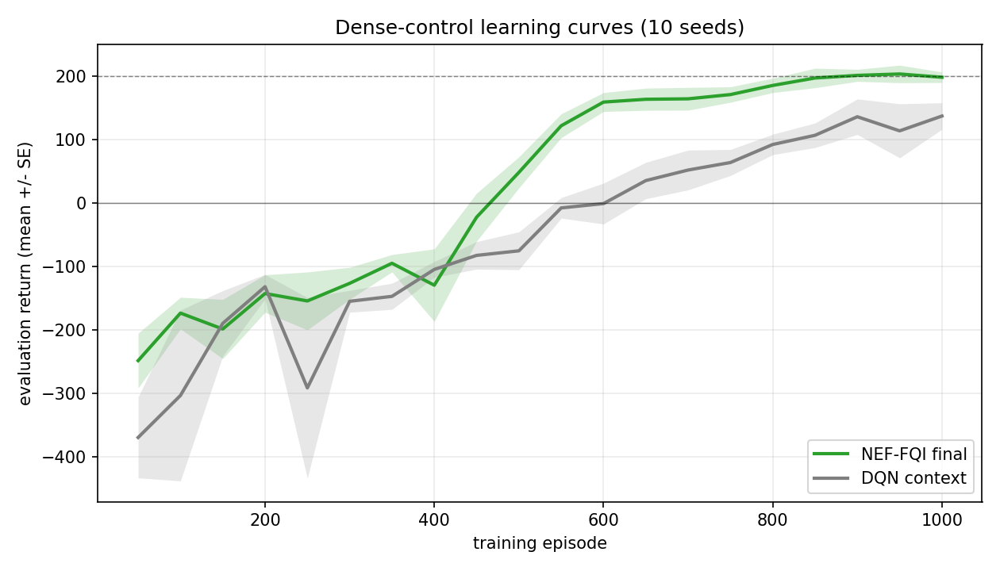
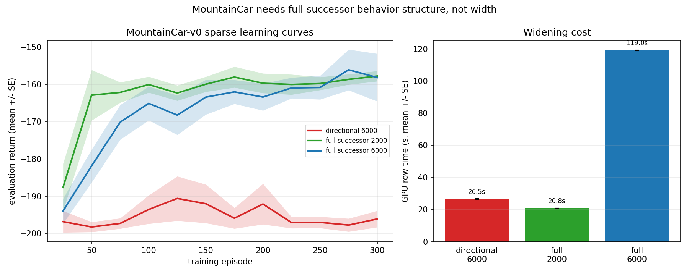

# Sufficient Statistics as a Universal Primitive? (Part III)

## Reinforcement Learning as Target Construction

Nikša Bosnić  
nikeke@otpisani.net[^ai]

[^ai]: GitHub Copilot (powered by Anthropic Claude Opus and OpenAI
GPT large language models) was used extensively during code
development, drafting, editing, and analysis for this work.  All
final content, judgments, and errors remain the author's
responsibility.

---

## Abstract

NEF's regularized least-squares solve over fixed-encoder neural
activities,
$D = (A^\top A + \alpha_{\mathrm{eff}} I)^{-1} A^\top Y$, can be used as
a compact sufficient-statistics primitive for reinforcement learning when
the target matrix $Y$ is constructed to match the control problem.  In
dense control, a non-bootstrapped $100$-step NEF action-value regression
(NEF-AVR) configuration reaches $201.3 \pm 9.8$ robust return on
LunarLander-v3 over 10 seeds, crossing the informal 200-return reference
line under the evaluation protocol used here; the same analytic control
path reaches near-perfect CartPole-v1 best
evaluation (`best_eval` $=499.4 \pm 0.6$).  A baseline DQN implementation
evaluated under the exact same protocol reaches $129.3 \pm 21.7$ on
LunarLander-v3.  In sparse
control, target construction is the result: a full-successor
random-direction mechanism breaks the flat MountainCar-v0 floor but does
not solve the environment, reaching $-158.8 \pm 1.4$ at 2000 neurons, and
a 6000-neuron directional known-goal readout gives a stable Acrobot-v1
signal ($-194.9 \pm 10.4$ robust, $-132.1 \pm 6.1$ best) when successor
statistics are retained slowly enough.  The boundary rows explain the
conditions rather than replacing the headline: one-step bootstrapped TD
collapses on LunarLander-v3 ($-123.8 \pm 13.1$), the cheaper directional
MountainCar readout stays flat ($-197.0 \pm 1.7$), and widening the full
MountainCar successor model to 6000 neurons costs $5.7\times$ more
without improving robust return.  The paper's claim is therefore not that
analytic fixed-feature RL is a universal control algorithm.  It is that
the same sufficient-statistics object can support successful control when
$Y$ is stable, informative, and matched to the task.

---

## §1 — The six principles of leenef

We build on the *Neural Engineering Framework* of Eliasmith and
Anderson (2003): a population of neurons with fixed encoders
represents a vector quantity, and any function of that vector is
computed by a linear decoder fitted to the population's activity.
Their book frames this around three principles — representation,
transformation, and dynamics — and the canonical implementation
uses spiking leaky-integrate-and-fire neurons whose firing rate
encodes the represented quantity.  We keep the encoder–decoder
split, the analytic least-squares fit, and the conceptual freedom
to compose decoded signals; we depart in three places.

- We use **rate neurons with `abs` activation**, not spiking LIF.
  `abs` is a minimal departure from linearity that escapes the
  linear-collapse argument of Paper I §2; it is also what gives our
  activations the frame-coefficient-magnitude interpretation that the
  paper series uses throughout.
- We use **data-driven biases**.  The bias of neuron *i* is
  $b_i = -g_i (e_i \cdot d_i)$ for a sample $d_i$ drawn from the
  training set, placing the *i*-th `abs` fold on the data
  manifold rather than on a generic random intercept.
- We do not use NEF's **dynamics principle** anywhere in this
  paper series.  Streaming, continual, and control variants reuse
  encoders and decoders with pooling, accumulation, or target
  construction, not a recurrent dynamics solve.

When this paper says "NEF" it means this *analytic-rate-`abs`
specialization*; when distinction matters we call our local
specialization **leenef**.  Readers who arrive expecting Nengo-
style spiking populations should read NEF here as "the
encode–decode pattern of Eliasmith & Anderson, with rate-`abs`
neurons and data-driven biases."

The SSUP paper series shares six operational claims, distilled
from the program's running code.  These are *our* distillation: P1–P2
inherit directly from NEF's encoder/decoder split and analytic decoder
fit; P3–P4 are the sufficient-statistics reading of that fixed-feature
solve; P5–P6 are leenef-specific.

- **P1 — Encoders are fixed** (random or data-adapted).  Decoders
  are the only thing we ever fit.
- **P2 — Decoders fall out of one analytic step:**
  $D = (A^\top A + \alpha I)^{-1} A^\top Y$.  No learning rate, no schedule, no
  gradient flow between layers.
- **P3 — $A^\top A$ and $A^\top Y$ are the complete sufficient state
  of the learner.**  Continual learning, streaming over time, ensembles,
  online updates, per-action FQI (Ernst et al., 2005), and successor
  features are different ways of *additively combining* sufficient
  statistics or replacing the target block they accumulate.
- **P4 — Targets $Y$ are the only place where task structure
  enters.**  The encoder does not care what the task is; the
  decoder column does.
- **P5 — Time is summarized before the analytic solve.**  The paper
  series uses pooled delay-line activities, accumulated task statistics,
  returns, and successor targets rather than BPTT (Werbos, 1990) or a
  recurrent dynamics solve.
- **P6 — Additivity helps when output semantics are stable.**  With
  fixed features and stable target columns, new observations add
  statistics rather than overwriting old meanings.  Class-incremental
  continual learning is the cleanest case; reinforcement learning shows
  why unstable or mismatched targets must be constructed with care.

Paper III is mostly about **P4**.  Papers I and II could treat $Y$ as a
given: labels in Paper I, stable task labels in Paper II.  Reinforcement
learning removes that comfort.  The same formula still exists, but $Y$
is no longer just data.  It is an object we have to build.

---

## §2 — Why reinforcement learning changes the problem

### §2.1 — The algebra still works

For a fixed feature map $\phi(s)$ and action set $\mathcal{A}$, fitted
Q-iteration (FQI; Ernst et al., 2005) can be written as one least-squares
problem per action.  Let $A_a$ be the activity matrix for states where
action $a$ was chosen, and let $Y_a$ be the scalar target for that action.
Then the action decoder is

$$
d_a = (A_a^\top A_a + \alpha_{\mathrm{eff}} I)^{-1} A_a^\top Y_a,
$$

and the action value is $Q(s,a) = \phi(s)^\top d_a$.  The sufficient
statistics are still exactly the objects used in the earlier papers:
$A_a^\top A_a$ and $A_a^\top Y_a$.  The per-action partition is just a
block structure over decoder columns.

This connects directly to older fixed-basis and least-squares RL methods:
FQI, LSTD (Bradtke and Barto, 1996), LSPE (Nedić and Bertsekas, 2003),
LSPI (Lagoudakis and Parr, 2003), recursive least-squares control, and
random-feature value approximation (for example Geramifard et al., 2013)
all exploit versions of the same normal-equation structure.  The claim
here is not that least-squares value fitting is new.  The claim is that
within the SSUP series, RL exposes the missing half of the primitive:
accumulating $A^\top A$ is easy; constructing a useful $A^\top Y$ is the
control problem.

### §2.2 — Bootstrapping makes $Y$ move

The usual one-step bootstrap target is

$$
Y_t = r_t + \gamma \max_{a'} Q_{\theta}(s_{t+1}, a').
$$

For SGD, a moving target can be tolerable because each update is small.
The network is never replaced by the exact minimizer of the current
target matrix.  The analytic solve is more abrupt: each solve asks for
the global ridge-regression optimum under the targets currently stored in
the buffer.  If those targets are themselves produced by the decoder that
is about to be replaced, the update can chase its own moving fixed point.

This is why the dense-control method in §3 uses completed-trajectory
targets rather than one-step TD targets.  Monte-Carlo and long
$n$-step returns are not magic; they are simply less self-referential
targets for a solver that likes stable regression problems.  Iterative
least-squares policy evaluation methods such as LSPE attack the related
fixed-point problem from the other direction: they keep the bootstrap
target structure but project the update iteratively rather than replacing
the value function with a single abrupt global solve.

### §2.3 — Sparse reward can make $Y$ absent

Sparse reward causes a different failure.  If a rollout never reaches a
rewarding event, then the return column is zero or nearly constant.  In
that case $A^\top Y$ accurately records the data and still contains
almost no useful control signal.  A bigger encoder does not solve a
missing target.

Successor features (Dayan, 1993; Barreto et al., 2017; Borsa et al.,
2018) are attractive in this setting because they move part of the
problem from immediate reward to predicted future occupancy.  For feature
vector $\phi(s)$, a successor target has the form

$$
\psi_t = \sum_{k=0}^{H-1} \gamma^k \phi(s_{t+k}),
$$

and a later reward or goal readout maps $\psi$ to action values.  Hindsight
experience replay (Andrychowicz et al., 2017) and intrinsic novelty
signals (for example Bellemare et al., 2016; Burda et al., 2019) address
the same broad need from different angles: they make data that would have
been uninformative for the original sparse target informative for a
related target.

The SSUP framing puts these ideas in one place.  The encoder is still
fixed.  The solver is still a regularized normal-equation solve.  What
changes is what gets accumulated into $A^\top Y$.

---

## §3 — Methods

### §3.1 — Fixed-feature NEF action-value regression

The dense-control agent uses a single fixed NEF activity map over states.
We call the headline dense variant **NEF action-value regression
(NEF-AVR)**: for each action $a$, it maintains sufficient statistics

$$
G_a = A_a^\top A_a,\qquad h_a = A_a^\top y_a.
$$

At solve time, it fits one decoder per action using the same
trace-scaled ridge policy as the rest of the library:

$$
\alpha_{\mathrm{eff}} =
\max\left(\alpha, \alpha\frac{\mathrm{tr}(G_a)}{n}\right),
$$

where $n$ is the neuron count.  The final dense configuration uses
6000 neurons, $\gamma = 0.98$, $\alpha = 0.1$, a solve every 10 episodes,
exponential sufficient-statistic retention with factor $0.999$, and
100-step returns.  Exploration is $\epsilon$-greedy with decay over 500
episodes.  The target is deliberately not one-step TD.

For a transition sequence, the $n$-step return target is

$$
Y_t^{(n)} = \sum_{k=0}^{n-1} \gamma^k r_{t+k},
$$

truncated at episode termination.  NEF-AVR shares the per-action fitted
value structure of FQI, but the headline target is a Monte-Carlo /
long-return variant rather than a standard one-step Bellman-backup target.
In this implementation we do not add a bootstrap term at the $n$-step
boundary for the headline dense row.  The point is to make $Y$ a
completed-return object rather than a moving function of the current
decoder.

### §3.2 — Dense-control comparators and closure checks

The dense result section includes four kinds of rows.

1. **CartPole sanity.**  A cheap dense-reward task verifies that the
   analytic control path passes an easier classic-control sanity check.
2. **Target-construction ablation.**  LunarLander rows compare one-step
   TD-style bootstrapping with Monte-Carlo and $n$-step non-bootstrap
   targets.
3. **Constrained DQN context.**  A matched-seed DQN row (Mnih et al.,
   2015) provides local context for the scale of the LunarLander result
   under this repository's runner and compute budget.  It is a small
   two-hidden-layer replay DQN, not a tuned external implementation and
   not a claim about all DQN implementations or hyperparameter budgets.
4. **Ensemble closure.**  Three-member Thompson and voting variants test
   whether the ensemble story from Paper I carries over to dense control.
   It mostly does not.

The main dense metric is `robust_eval`: the mean of the last three
evaluation points for a seed, then mean $\pm$ standard error across
seeds.  `best_eval` is reported as a diagnostic but is not the adoption
metric.

### §3.3 — Successor-feature sparse control

The sparse agent keeps the same fixed activities but changes the target.
For each action it accumulates successor targets, not scalar returns.  In
the full-successor form, the target matrix has feature dimension $n$:

$$
\Psi_a =
(A_a^\top A_a + \alpha_{\mathrm{eff}} I)^{-1}A_a^\top \Phi_a^{+},
$$

where $\Phi_a^{+}$ contains discounted future activity vectors.  A reward
or goal readout $w$ then gives

$$
Q(s,a) = \phi(s)^\top \Psi_a w.
$$

This is expressive but expensive: the persistent successor decoder scales
as $O(|\mathcal{A}|n^2)$, and the solve workspaces scale similarly.  That
quadratic cost is part of the result, not just an engineering detail.

The memory-reduced **directional** variant fits only the projected
successor readout needed for a known evaluation goal.  Instead of storing
all of $\Psi_a$, it stores a decoder for $\Psi_a w_g$.  The cost falls
from a full matrix per action to a vector per action, but the capability
also changes: the agent can no longer ask arbitrary post-hoc goal
questions from the same successor map.

### §3.4 — Hindsight goals and novelty

Sparse reward often gives too few positive reward samples for either FQI
or successor features to rank actions.  The sparse-control rows therefore
use three target-construction devices.

- **Hindsight goal conditioning.**  States reached during exploration can
  be treated as goals for auxiliary targets, so that the agent learns from
  trajectories even when the original task reward does not fire.
- **Evaluation-goal projection.**  At evaluation time, the task goal is
  expressed as a feature-space direction and used as the readout direction
  for successor predictions.
- **Leverage novelty.**  The normal matrix already tells us which regions
  are poorly covered.  The quadratic form
  $\phi^\top(A^\top A + \alpha I)^{-1}\phi$ can be used as an intrinsic
  signal without training an auxiliary neural network.

These mechanisms are not presented as universal improvements.  They are
ways of constructing an informative $Y$ when sparse reward otherwise
leaves the sufficient statistics empty.

### §3.5 — Evaluation protocol

All control rows are online-training rows with periodic frozen-policy
evaluation.  During training, agents act with their configured exploration
policy and update after each transition.  During evaluation, the policy is
greedy with respect to the current action values: no $\epsilon$ exploration
is used, and the evaluation episodes use deterministic seed offsets
separate from training and warmup seeds.  Dense LunarLander-v3 rows train
for 1000 episodes, evaluate every 50 episodes, and average 20 evaluation
episodes per evaluation point.  Sparse MountainCar-v0 and Acrobot-v1 rows
train for 300 episodes, evaluate every 25 episodes, and average 5
evaluation episodes per point.  The reported `robust_eval` metric is the
per-seed mean of the final three evaluation points, then mean $\pm$
standard error across seeds.

This protocol is useful for comparing the rows in this paper because every
method sees the same episode budget, evaluation seeds, and final-window
metric.  It is not a leaderboard protocol.  In particular, the DQN row is
a deliberately local comparator implemented in the same runner, not a
claim about what fully tuned DQN implementations can achieve on
LunarLander-v3.

---

## §4 — Dense-control results

### §4.1 — LunarLander is a target-stability result


Figure 1 is the central dense-control figure.  The one-step
bootstrapped target is strongly negative on LunarLander-v3:
`robust_eval` is $-123.8 \pm 13.1$ over 5 seeds.  Monte-Carlo and
non-bootstrapped $n$-step targets are still not the final agent in this
small ablation, but they move the problem out of the collapsed regime
($-67.7 \pm 32.3$ and $-38.4 \pm 18.0$ respectively).

The final NEF-AVR row, after matching target horizon and representation
capacity, reaches $201.3 \pm 9.8$ over 10 seeds, with final evaluation
$210.0 \pm 8.4$ and best evaluation $216.2 \pm 9.9$.  The result clears
the informal 200-return reference line on the robust metric.  This is the
dense-control headline: an analytic fixed-feature agent reaches this
reference region on a continuous-state dense-control task when the target
matrix is constructed as a stable return regression problem.

The constrained DQN context row reaches $129.3 \pm 21.7$ robust return,
$149.6 \pm 14.0$ final return, and $196.3 \pm 14.1$ best return.  We do
not treat this as a broad statement about DQN.  It says that within the
same runner, seed policy, episode budget, and evaluation protocol, the
final analytic configuration is the higher-return row in this local
comparison.

### §4.2 — Learning curves



The learning curves in Figure 2 show that the final NEF-AVR row is not a
single lucky peak.  Its mean evaluation return climbs to the 200-return
reference region and remains near or above it through the last
evaluations.  The constrained DQN row improves substantially but remains
lower and more variable late in training under this constrained local
protocol.

This matters because `best_eval` alone would be a poor metric for the
paper.  An RL run can briefly find a good policy and then lose it.  The
robust metric asks whether the agent is still good at the end of the run.
For the final NEF-AVR row, the answer is yes.  For the small target
ablation rows, the answer is not yet; for the bootstrapped TD row, the
answer is clearly no.

### §4.3 — CartPole sanity and ensembles

CartPole-v1 is not a headline task, but it is a useful sanity check.  The
NEF Monte-Carlo agent reaches robust evaluation $409.0 \pm 20.4$ over 10
seeds, final evaluation $428.4 \pm 19.0$, and best evaluation
$499.4 \pm 0.6$.  This passes an easier dense-control sanity check.

The ensemble rows are more useful as a boundary.  A three-member Thompson
ensemble reaches $200.0 \pm 12.8$ robust return over 3 seeds, essentially
matching but not improving the single final agent.  A voting ensemble is
brittle, with $64.5 \pm 81.4$ robust return and one catastrophic seed.
This is unlike the supervised-learning ensemble story in Paper I.  In
dense control, independent fixed-feature members do not automatically
make exploration and policy selection better.

### §4.4 — Dense-control read

The dense-control lesson is simple but important: in this global-solve
configuration, immediately self-referential bootstrap targets are harmful.
A closed form solve is a very strong optimizer of the regression problem
it is given.  If the target matrix is a moving bootstrap target, it can
optimize the wrong moving object.  If the target matrix is built from
completed long-horizon returns, the same machinery becomes competent on
the tested dense-control tasks.

---

## §5 — Sparse-control results

### §5.1 — Sparse reward as target absence

The sparse-reward results start from a negative observation.  In the
tested fixed-feature accumulator, plain fixed-feature action-value
regression can be perfectly faithful to the observed data and still learn
almost nothing when the reward rarely fires.  The sufficient statistic
$A^\top Y$ is then small, flat, or absent.  This does not exhaust sparse
RL difficulty: exploration and credit assignment still matter.  It says
where the SSUP primitive sees the problem.  In that regime, "more neurons"
is not the first answer.  The first answer is to make useful target
structure available.

The sparse experiments therefore evaluate successor features, hindsight
goals, evaluation-goal readouts, and novelty as target-construction
mechanisms.  They do not produce one universal sparse-control recipe.
They produce two positives and one important boundary.

### §5.2 — MountainCar and Acrobot need different readouts


MountainCar-v0 is the clearest example of sparse reward as target absence
in this accumulator.  The known-goal directional shortcut at 6000 neurons
remains almost flat: robust evaluation is $-197.0 \pm 1.7$ over 10 seeds.
The full-successor random-direction mechanism produces a non-flat control
signal: at 2000 neurons it reaches $-158.8 \pm 1.4$, with final evaluation
$-151.3 \pm 2.1$ and best evaluation $-149.4 \pm 3.3$.  Widening the
same full-successor mechanism to 6000 neurons gives essentially the same
robust return, $-158.4 \pm 4.8$, with higher variance.

Acrobot-v1 shows the complementary case.  The memory-reduced directional
readout is useful when the goal direction is known and the successor
statistics are retained slowly enough.  At 6000 neurons and retention
factor $0.9999$, robust evaluation is $-194.9 \pm 10.4$ over 10 seeds,
final evaluation is $-193.0 \pm 23.2$, and best evaluation is
$-132.1 \pm 6.1$.  The forget-factor scan explains why the retention
choice matters: at $0.999$ the robust return is $-296.6 \pm 28.5$ over 5
seeds, while $0.9995$ and $0.9999$ are near the stable regime
($-190.6 \pm 7.0$ and $-184.2 \pm 5.8$ in the five-seed scan).

The result is more interesting than a single leaderboard row.  These
sparse rows are diagnostic target-construction results, not competitive
sparse-RL benchmark claims.  Acrobot can use a known-goal directional
readout; MountainCar needs the richer full-successor random-direction
behavior.  Both statements are target construction statements.

### §5.3 — Widening is not the sparse answer



Figure 4 separates two questions that are easy to confuse.  The first is
whether the full-successor mechanism gives a non-flat MountainCar signal.
It does: both the 2000-neuron and 6000-neuron variants move far above the
flat directional row.  The second is whether increasing width is the right
way to improve the sparse result.  In this panel, it is not.  The
6000-neuron full-successor row takes $119.0$ seconds per seed on the GPU,
compared with $20.8$ seconds for the 2000-neuron row, and does not improve
the robust metric.

This is the operational boundary of full successor features.  The full
matrix readout preserves post-hoc goal flexibility, but it carries an
$O(|\mathcal{A}|n^2)$ memory and solve cost.  Directional readout removes
most of that cost, but also removes the arbitrary post-hoc successor map.
The choice is not a mere implementation preference; it changes the target
family the agent can represent.

### §5.4 — Sparse negatives are part of the result

The sparse line also produced useful negative results.

First, hindsight/evaluation-goal machinery is not a dense-control default.
Hindsight relabeling is designed for sparse goal-conditioned learning
(Andrychowicz et al., 2017), not as a substitute for an already shaped
dense return.  On dense LunarLander at 2000 neurons it hurts rather than
helps.  That is what the target-construction view predicts: if the task
already provides a shaped dense return, replacing it with sparse-goal
machinery is not obviously helpful.

Second, MiniGrid DoorKey-5x5 remained flat without a programmatic
goal-observation handle.  Under the observation wrapper and goal-vector
construction used here, the agent had no clean goal vector to project
onto, so the target-construction mechanism had no clear direction to use.

Third, toy sparse-chain diagnostics showed that evaluation-goal projection
can fail when action horizons differ enough for successor-vector magnitude
to dominate direction.  We tested the obvious alternative on MountainCar:
normalize either the full successor vector or the future increment
$\psi(s,a)-\phi(s)$ before the goal projection.  Both normalized readouts
were completely flat over 10 seeds ($-200.0 \pm 0.0$ robust return),
while the original dot-product readout reproduced the non-flat
$-158.8 \pm 1.4$ result.  Magnitude is therefore not merely a nuisance in
the working MountainCar mechanism; it carries task-relevant temporal
structure.

### §5.5 — Sparse-control read

The sparse-control story is not "successor features solve sparse RL."  It
is more conditional and more useful.  In the SSUP view, sparse reward
fails by leaving the target matrix uninformative unless exploration and
target construction expose usable signal.  Successor features, hindsight
goals, novelty signals, and evaluation-goal readouts can make the target
informative before extrinsic reward has propagated.  But the readout has
to match the task.  MountainCar needed full-successor random-direction
behavior.  Acrobot worked with known-goal directional readout and long
statistic retention.  MiniGrid still needs a constructed goal handle.
These are not exceptions to the SSUP story; they are exactly where the
story places the burden.

---

## §6 — Discussion

### §6.1 — What RL adds to the series

Paper I established that a fixed nonlinear NEF activity map plus an
analytic decoder can be a useful supervised-learning primitive.  Paper II
showed that when the output semantics remain stable, task streams add
into the same sufficient statistics and continual forgetting disappears
relative to the joint fixed-feature model.  Paper III asks what happens
when the target itself is induced by a policy.

The answer is that the target axis becomes load-bearing.  The data-stream
axis can still be additive: transitions, per-action statistics, and
successor targets all accumulate.  But additivity does not guarantee that
the accumulated target is worth fitting.  In dense control, target
stability matters.  In sparse control, target informativeness matters.

This gives a different reading of the SSUP question.  Sufficient
statistics are not a universal substitute for learning algorithms.  They
are a compact interface.  If a domain can express its learning problem as
stable additions to $A^\top A$ and $A^\top Y$, the analytic primitive can
be surprisingly strong.  If the domain cannot yet construct a good $Y$,
the primitive fails cleanly and tells us where to work.

### §6.2 — Relationship to prior RL methods

The dense-control agent is close in spirit to FQI, neural fitted
Q-iteration (NFQ; Riedmiller, 2005), least-squares value iteration with
fixed nonlinear bases, and random-feature value approximation.  Standard
deep-RL stabilizers such as target networks and replay (Mnih et al.,
2015), Double DQN (van Hasselt et al., 2016), prioritized replay (Schaul
et al., 2016), and dueling networks (Wang et al., 2016) address the same
moving-target pressure from a different direction.  The sparse-control
agent is close to successor features, goal-conditioned value functions
and UVFA (Schaul et al., 2015), hindsight relabeling, and intrinsic
exploration such as ICM (Pathak et al., 2017).  This paper does not claim
priority over those families.  The contribution is the unification inside
a single sufficient-statistics interface and the empirical accounting of
where that interface works or fails in our NEF implementation.

That unification is practically useful.  The same normal matrix that
fits action values also supports leverage-style novelty.  The same
per-action normal equations can fit scalar returns, successor vectors, or
directional successor readouts.  The same code-identity and seed-policy
discipline used for supervised and continual panels can be applied to RL
without changing the mathematical object being audited.

### §6.3 — Scope of the claims

The paper makes three positive claims.  First, fixed-feature analytic
control can reach dense-control reference regions when the return target
is stable enough for a global least-squares solve: LunarLander-v3 crosses
the informal 200-return reference line under the evaluation protocol used
here, and CartPole-v1 reaches near-perfect best evaluation as a sanity check.
Second, sparse-control progress is possible inside the same
sufficient-statistics interface when successor or goal-conditioned targets
make $A^\top Y$ informative before the sparse reward has propagated.
Third, the failures are diagnostic: they identify target instability,
target absence, insufficient goal handles, or an overly restrictive
successor readout.

The paper does not claim that fixed-feature analytic RL generally beats
deep RL.  The DQN row is a constrained local comparator, not a survey of
DQN practice or a tuned external baseline.  It does not claim that
successor features solve sparse reward in general.  MiniGrid remains
negative without a goal handle, and
MountainCar needed the more expensive full-successor/random-direction
variant.  It does not claim that widening fixed features automatically
helps sparse control.  On MountainCar, 6000 full-successor neurons cost
about $5.7\times$ the 2000-neuron row and did not improve robust return.
These are mechanism and target-construction results, not benchmark
leaderboard claims; tuned standard RL implementations are the appropriate
competitiveness reference for these classic-control environments and are
expected to solve or strongly improve them under ordinary protocols.

The positive claim and the boundary claim are the same claim viewed from
opposite sides: analytic fixed-feature control is a target-construction
program.  When the target is stable and informative, the primitive works;
when the target is moving, absent, or mismatched to the task, it does not.

### §6.4 — Engineering boundary

The dense NEF-AVR rows run comfortably on CPU.  The sparse successor rows
are different.  Full successor matrices scale quadratically in neuron
count and linearly in the number of actions.  A 6000-neuron
full-successor MountainCar row is feasible on a modern GPU, but the
result in §5 shows that feasibility is not the same as usefulness.

The directional readout is the main engineering compromise: much lower
memory and faster solves, at the cost of committing to a goal direction
before fitting.  In this paper that compromise is productive for
Acrobot and insufficient for MountainCar.  A natural next step is an
intermediate representation: low-rank successor decoders or normalized
goal-direction readouts that preserve more post-hoc flexibility without
storing all of $\Psi_a$.

### §6.5 — Follow-up directions

The most immediate open follow-up is **compressed successor
representation**.  Full
successor readouts preserve arbitrary post-hoc goals but scale as
$O(|\mathcal{A}|n^2)$; directional readouts are cheap but commit to one
goal direction.  Low-rank successor decoders, random projections of
successor space, or a small bank of learned goal directions could occupy
the useful middle ground.

The second follow-up is **continual RL**.  We have not run a paper-grade
continual-RL benchmark panel, so this paper does not claim a continual-RL
result.  What we do have is the mechanism that makes such a study
natural: per-action normal equations, exponential statistic retention,
and the Paper II result that compatible fixed-feature statistics add
cleanly across task partitions.  Natural experiments are task sequences
with changing reward maps, per-goal normal-equation blocks that can be
combined at decision time, conflict-aware decoder merging when new
events or goals appear, and separate reward-map statistics that can
forget faster than the slower successor backbone.

The third follow-up is **hybridization with existing RL machinery**.
Nothing in the sufficient-statistics interface requires the encoder to be
random forever.  A frozen deep representation, a ConvNEF-style visual
front end, model-generated rollouts, prioritized replay, or hindsight
relabeling could all feed the same $A^\top A$ and $A^\top Y$ objects.
The useful question is not whether those additions are "pure" enough; it
is whether they make the target matrix more stable or more informative
without losing the auditability of the analytic head.

Two more sparse-control extensions are natural but more environment-
dependent.  One is **explicit goal-handle construction** for image or
partially observed environments.  MiniGrid failed in the present evidence
because the agent had no clean goal observation to project onto; a direct
follow-up is to programmatically capture or construct a goal vector under
that wrapper and use it as the evaluation goal.  The other is **training-goal
augmentation**: mix the known evaluation-goal direction into the hindsight
goal buffer during training, rather than using it only at evaluation.  On
Acrobot this may reduce seed variance; on MountainCar it tests whether
the full-successor/random-direction requirement can be weakened.

Finally, the sparse work argues for better **failure diagnostics** before
large sweeps.  Future result rows should record first success episode,
success rate, action margins, Q-spread, reward-map calibration,
successor prediction error on held-out suffixes, novelty at frontier and
goal states, and per-seed evaluation-history summaries.  These diagnostics
separate "the agent never discovers reward" from "successor prediction is
good but the readout ranks actions badly," which lead to different next
experiments.

---

## §7 — Conclusions

The reinforcement-learning part of the SSUP series shows that the
analytic fixed-feature primitive can be used successfully for control.
With stable non-bootstrapped return targets, NEF-AVR crosses the informal
200-return reference line on LunarLander-v3 under the evaluation protocol
used here, reaching $201.3 \pm 9.8$ robust return over 10 seeds, and
reaches near-perfect best evaluation on CartPole-v1.  With successor and
goal-conditioned targets, the same sufficient-statistics interface
produces useful sparse-control signal: MountainCar-v0 breaks the flat
$-200$ floor but is not solved, and Acrobot-v1 improves under a
memory-reduced directional readout with slow statistic retention.

The conditions are as important as the positives.  Dense control works
when $Y$ is stable enough for a global least-squares solve; one-step
bootstrapped targets make $Y$ move and collapse in the tested
LunarLander-v3 setting.  Sparse control works when successor or
hindsight-style targets make $A^\top Y$ informative before reward is
common; it does not work by merely adding width, and it does not work
without a usable goal handle or a readout matched to the task.

Across the three papers, the same object keeps reappearing:
$A^\top A$ records the geometry induced by fixed activities, and
$A^\top Y$ records the task semantics those activities are asked to
decode.  Paper I showed that this is already a useful supervised-learning
primitive; Paper II showed that compatible task streams can add into the
same statistics without forgetting relative to the joint fixed-feature
model; Paper III shows that reinforcement learning is the case where the
target block itself becomes the main design object.  Supervised learning
supplies labels, continual learning preserves label semantics across a
stream, and reinforcement learning must construct the target it wants the
analytic solver to fit.  That is the series' bounded claim: sufficient
statistics are not a universal answer, but they are a compact and auditable
interface for asking exactly where the learning problem lives.

---

## Appendix A — Reproducibility

Every numeric claim in this paper is regeneratable from the accompanying
repository,
[`https://github.com/nikeke/leenef`](https://github.com/nikeke/leenef).
Artifact paths in this appendix are relative to that repository.

### A.1 — Result artifacts

Dense-control JSONs and logs are under `results/rl_paper/dense/`.  The
used files are [CartPole sanity](../results/rl_paper/dense/cartpole_sanity.json),
[LunarLander target ablation](../results/rl_paper/dense/bootstrap_lunar.json),
[final NEF-AVR](../results/rl_paper/dense/lunar_final.json),
[DQN context](../results/rl_paper/dense/lunar_dqn.json), and
[ensemble closure](../results/rl_paper/dense/ensemble_lunar.json).

Sparse-control GPU JSONs are under `results/rl_sparse/gpu/`.  The used
files are [MountainCar directional](../results/rl_sparse/gpu/mountaincar_directional_n6000.json),
[MountainCar full successor at 2000 neurons](../results/rl_sparse/gpu/mountaincar_full_random_direction_n2000.json),
[MountainCar full successor at 6000 neurons](../results/rl_sparse/gpu/mountaincar_full_random_direction_n6000.json),
[Acrobot directional](../results/rl_sparse/gpu/acrobot_directional_ff9999_n6000.json),
and the Acrobot retention scan at
[$0.999$](../results/rl_sparse/gpu/acrobot_directional_ff0p999_scan_n6000.json),
[$0.9995$](../results/rl_sparse/gpu/acrobot_directional_ff0p9995_scan_n6000.json),
and [$0.9999$](../results/rl_sparse/gpu/acrobot_directional_ff0p9999_scan_n6000.json).

The successor-readout geometry follow-up is under
`results/rl_sparse/geometry_gpu/`: [dot](../results/rl_sparse/geometry_gpu/mountaincar_dot_n2000.json),
[cosine](../results/rl_sparse/geometry_gpu/mountaincar_cosine_n2000.json),
and [future cosine](../results/rl_sparse/geometry_gpu/mountaincar_future_cosine_n2000.json).

The figure generator is
[docs/generate_paper_iii_figures.py](generate_paper_iii_figures.py), and
generated figures are under `docs/figures/`.

### A.2 — Metadata and identity

The dense and sparse headline rows in this draft share the same recorded
code identity (prefix `1238595`; full value in each JSON row).  JSON
artifacts record runner version, environment name, seed policy,
configuration, evaluation history, per-seed metrics, and hardware/device
context where available.  The dense rows also preserve logs under
`results/rl_paper/dense/logs/`.  Some Colab executions were preserved as JSON
without full cell-output logs; the statistical claims in this draft use
the JSON rows, not console-only output.

The artifacts record environment names and runner configuration, but they
do not preserve a full package lockfile.  The runners instantiate
Gymnasium environments by name with default environment parameters (for
example `gymnasium.make("LunarLander-v3")`, which uses the Box2D task
defaults for that installed Gymnasium version).

The seed policy follows the runner convention:

- training environment resets use `seed + episode`;
- warmup resets use `100000 + seed + episode`;
- evaluation resets use `10000 + episode`;
- action spaces are seeded with the reset seed when the environment
  supports it.

### A.3 — Reproducing representative rows

From a checkout with matching source identity and installed benchmark
dependencies, representative dense rows can be reproduced through the
dense paper runner and sparse rows through the sparse runner.  For
example, a single dense LunarLander final seed is:

```bash
python -u benchmarks/run_rl_paper_dense.py \
    --phase lunar_final \
    --seeds 0 \
    --parallel 1 \
    --output /tmp/lunar_final_seed0.json
```

A representative sparse MountainCar GPU row is:

```bash
python -u benchmarks/run_rl_sparse.py \
    --env MountainCar-v0 \
    --episodes 300 \
    --eval-every 25 \
    --eval-episodes 5 \
    --seeds 0 \
    --variants nef_sf_hindsight \
    --warmup-episodes 10 \
    --goal-horizon 25 \
    --goal-mode random_direction \
    --goal-action-mode commit \
    --eval-goal 0.5,0.0 \
    --config-override n_neurons=2000 \
    --config-override forget_factor=0.999 \
    --device cuda \
    --skip-agent-diagnostics \
    --output /tmp/mountaincar_seed0.json
```

Exact driver paths, launch scripts, and preserved logs are repository
artifacts rather than manuscript claims.  The important reproducibility
contract is that numeric claims are tied to code identity, seed policy,
configuration, and per-seed JSON rows.

The constrained DQN comparator configuration is preserved in
`benchmarks/run_rl_paper_dense.py` and in
`results/rl_paper/dense/lunar_dqn.json`.  The row uses a two-hidden-layer
replay DQN with hidden width 256, Adam at learning rate $10^{-3}$, replay
buffer size 50000, batch size 64, target-network update interval 10,
$\gamma = 0.98$, and the same 1000-episode / 20-evaluation-episode
LunarLander protocol as the final NEF-AVR row.

---

## Appendix B — Negative and boundary results

The main text includes the negative results needed to interpret the
headline claims.  This appendix collects them in one place.

### B.1 — Dense-control boundaries

- **One-step TD bootstrap on LunarLander-v3.**  The bootstrapped row
  reaches only $-123.8 \pm 13.1$ robust return over 5 seeds.  This is the
  main evidence that a global analytic solve needs a stable target matrix
  rather than a rapidly moving bootstrap target.
- **Monte-Carlo and small $n$-step ablations.**  Non-bootstrapped targets
  improve the target-stability problem but are not sufficient at the
  smaller 4000-neuron ablation setting: $-67.7 \pm 32.3$ for Monte-Carlo
  and $-38.4 \pm 18.0$ for the small $n$-step row.
- **Dense-control ensembles.**  Thompson exploration approximately
  matches the final single agent over 3 seeds, while voting exploration is
  brittle ($64.5 \pm 81.4$ robust return).  The supervised ensemble story
  therefore does not automatically transfer to policy selection.

### B.2 — Sparse-control boundaries

- **MountainCar-v0 without the full-successor/random-direction mechanism.**
  Earlier plain FQI, successor, novelty, and hindsight variants without
  the evaluation-goal handle stayed at the no-progress return; the
  6000-neuron directional known-goal row in this paper remains essentially
  flat at $-197.0 \pm 1.7$.
- **MountainCar-v0 widening.**  The 6000-neuron full-successor row costs
  about $5.7\times$ the 2000-neuron row and does not improve robust
  return.  Width is not the sparse-control answer in this panel.
- **Acrobot-v1 retention.**  The directional readout needs slow statistic
  retention.  At forget factor $0.999$, the five-seed robust return is
  $-296.6 \pm 28.5$, much worse than the $0.9995$ and $0.9999$ rows.
- **Dense LunarLander-v3 with sparse-goal machinery.**  Hindsight and
  evaluation-goal machinery hurt rather than help in the dense-reward
  setting we tested.  Sparse target construction is not a dense-control
  default.
- **MiniGrid DoorKey-5x5.**  Without a programmatic goal-observation
  handle under the observation wrapper and goal-vector construction used
  here, the random-direction sparse mechanism remains flat.  The method
  needs a target direction it can actually express.
- **SparseChain diagnostic.**  Successor-feature novelty helps the harder
  chain, but evaluation-goal projection can fail when successor-vector
  magnitude overwhelms direction.
- **MountainCar-v0 normalized successor readouts.**  The direct follow-up
  to the SparseChain diagnostic did not improve MountainCar.  Cosine and
  future-cosine readouts both stayed flat at $-200.0 \pm 0.0$ over 10
  seeds, while the original dot-product readout reproduced the non-flat
  $-158.8 \pm 1.4$ positive.  The working MountainCar readout uses
  successor magnitude as part of the signal.

---

## Literature

Andrychowicz, M., Wolski, F., Ray, A., Schneider, J., Fong, R.,
Welinder, P., McGrew, B., Tobin, J., Abbeel, P., & Zaremba, W. (2017).
Hindsight experience replay. *NeurIPS*.

Barreto, A., Dabney, W., Munos, R., Hunt, J. J., Schaul, T., van
Hasselt, H., & Silver, D. (2017). Successor features for transfer in
reinforcement learning. *NeurIPS*.

Bellemare, M. G., Srinivasan, S., Ostrovski, G., Schaul, T., Saxton, D.,
& Munos, R. (2016). Unifying count-based exploration and intrinsic
motivation. *NeurIPS*.

Borsa, D., Barreto, A., Quan, J., Mankowitz, D. J., van Hasselt, H.,
Munos, R., Silver, D., & Schaul, T. (2018). Universal successor features
approximators. *arXiv:1812.07626*.

Bradtke, S. J., & Barto, A. G. (1996). Linear least-squares algorithms
for temporal difference learning. *Machine Learning*, 22(1-3), 33-57.

Burda, Y., Edwards, H., Storkey, A., & Klimov, O. (2019). Exploration by
random network distillation. *ICLR*.

Dayan, P. (1993). Improving generalization for temporal difference
learning: The successor representation. *Neural Computation*, 5(4),
613-624.

Eliasmith, C., & Anderson, C. H. (2003). *Neural Engineering:
Computation, Representation, and Dynamics in Neurobiological Systems*.
MIT Press.

Ernst, D., Geurts, P., & Wehenkel, L. (2005). Tree-based batch mode
reinforcement learning. *Journal of Machine Learning Research*, 6,
503-556.

Geramifard, A., Walsh, T. J., Tellex, S., Chowdhary, G., Roy, N., & How,
J. P. (2013). Representation expansion for reinforcement learning.
*AAAI*.

Mnih, V., Kavukcuoglu, K., Silver, D., Rusu, A. A., Veness, J.,
Bellemare, M. G., Graves, A., Riedmiller, M., Fidjeland, A. K.,
Ostrovski, G., Petersen, S., Beattie, C., Sadik, A., Antonoglou, I.,
King, H., Kumaran, D., Wierstra, D., Legg, S., & Hassabis, D. (2015).
Human-level control through deep reinforcement learning. *Nature*,
518, 529-533.

Lagoudakis, M. G., & Parr, R. (2003). Least-squares policy iteration.
*Journal of Machine Learning Research*, 4, 1107-1149.

Nedić, A., & Bertsekas, D. P. (2003). Least squares policy evaluation
algorithms with linear function approximation. *Discrete Event Dynamic
Systems*, 13, 79-110.

Pathak, D., Agrawal, P., Efros, A. A., & Darrell, T. (2017).
Curiosity-driven exploration by self-supervised prediction. *ICML
Workshops*.

Riedmiller, M. (2005). Neural fitted Q iteration -- first experiences
with a data efficient neural reinforcement learning method. *European
Conference on Machine Learning*.

Schaul, T., Horgan, D., Gregor, K., & Silver, D. (2015). Universal value
function approximators. *ICML*.

Schaul, T., Quan, J., Antonoglou, I., & Silver, D. (2016). Prioritized
experience replay. *ICLR*.

van Hasselt, H., Guez, A., & Silver, D. (2016). Deep reinforcement
learning with double Q-learning. *AAAI*.

Wang, Z., Schaul, T., Hessel, M., van Hasselt, H., Lanctot, M., & de
Freitas, N. (2016). Dueling network architectures for deep reinforcement
learning. *ICML*.

Werbos, P. J. (1990). Backpropagation through time: what it does and how
to do it. *Proceedings of the IEEE*, 78(10), 1550-1560.
