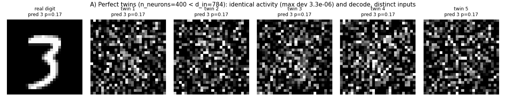
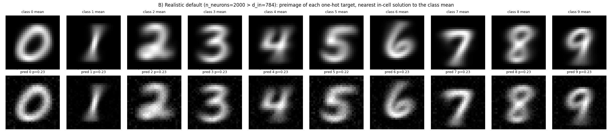
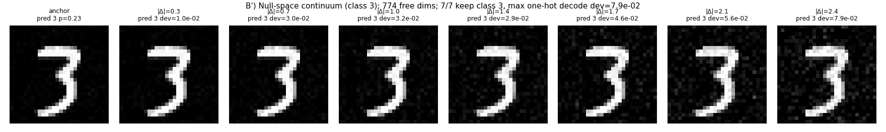
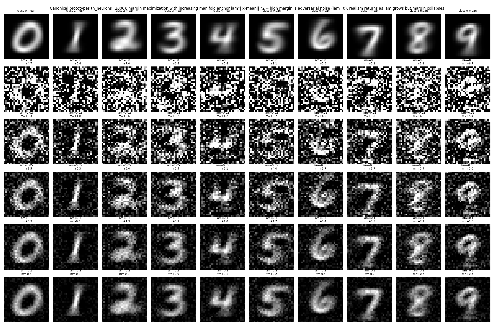
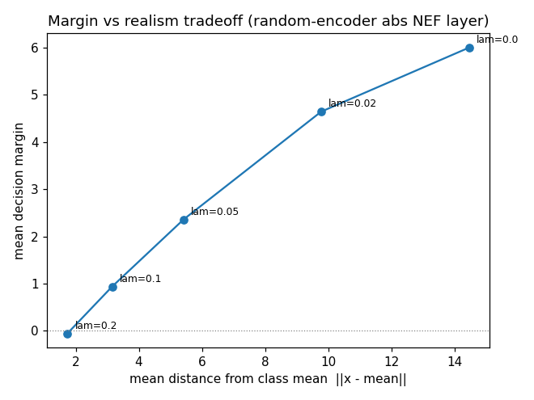
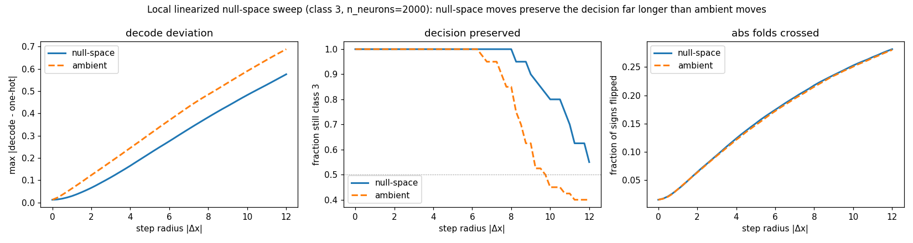
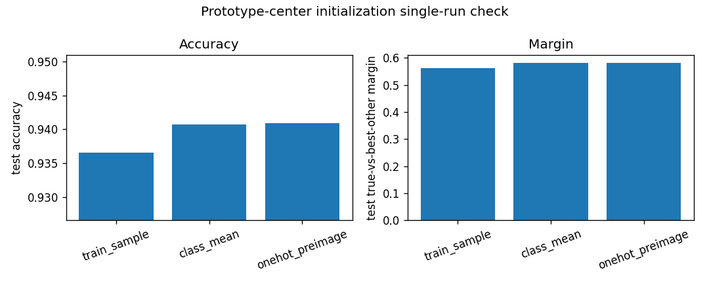

# Abs Folds and Preimage Geometry in Analytic NEF Layers

## An adjunct note to the SSUP sufficient-statistics paper series

Nikša Bosnić<br>
nikeke@otpisani.net[^ai]

[^ai]: GitHub Copilot (powered by Anthropic Claude and OpenAI GPT large
language models) was used extensively during code development,
drafting, editing, and analysis for this work. All final content,
judgments, and errors remain the author's responsibility.

---

## Abstract

The leenef supervised-learning stack uses fixed encoders, data-driven
biases, an elementwise absolute-value activation, and an analytic
least-squares decoder. This adjunct note studies the inverse geometry of
that specialization. If $z = Wx+b$, $a = |z|$, and $\hat y = D^\top a$,
then each sign pattern $s \in \{\pm 1\}^n$ defines a linear cell
$a=s\odot(Wx+b)$. This creates a sharp distinction between two
preimage mechanisms. Arbitrary activity-level sign twins are guaranteed
only under the rank condition $\mathrm{rank}(W)=n$; in MNIST with
$d_{\mathrm{in}}=784$, an underdetermined $n=400$ sign solve realizes
random sign flips to median $2.2\times10^{-6}$ relative activity error,
while a realistic $n=2000$ over-complete frame rejects them with median
error $6.1\times10^{-1}$. Class-level targets behave differently: in a fixed
sign cell, the one-hot equation is only $10$ linear constraints in $784$
pixel variables, yielding a high-dimensional linearized
decoder-null-space family whose exact preimages are the sign-consistent
subset. A single prototype-center pilot found no statistically
detectable difference among sampled, class-mean, and linearized one-hot
center schemes. The results clarify what the `abs` activation
contributes: a folded representation with exact sign symmetries in
underdetermined sign solves, thin folded activity manifolds in
over-complete frames, and class-target candidate families supplied by the
decoder rather than by arbitrary sign freedom.

---

## §1 - Motivation and contributions

The SSUP paper series (Bosnić, 2026a,b,c) treats analytic decoder fitting
over fixed neural activities as the central primitive of leenef. This
adjunct note isolates one geometric detail that the main papers use but
do not dwell on: the absolute-value activation. A default static layer
computes

$$
z = Wx+b,\qquad a=|z|,\qquad \hat y = D^\top a,
$$

where $W=\mathrm{diag}(g)E$ stacks gain-scaled fixed encoders, $b$ is the
data-driven bias vector, $a$ is the activity vector, and $D$ is the
analytically fitted decoder. The map is neither a generic neural network
nor a ReLU network. It is an affine map followed by a coordinatewise fold.

This note makes four contributions.

1. It gives the exact linear-cell description of the `abs` layer and
   separates two preimage questions: activity preimages and class-target
   preimages.
2. It shows that the tempting $2^n$ sign multiplicity is an exact
   activity-preimage multiplicity only when $W$ has full row rank. This
   holds in an underdetermined MNIST sign solve and fails in the usual
   over-complete NEF frame.
3. It shows that one-hot class targets have a large linearized candidate
   family: within a sign cell, the decoder equation has null-space
   dimension $d_{\mathrm{in}}-n_{\mathrm{classes}}$ under the usual
   full-row-rank decoder-cell condition, while exactness additionally
   requires staying in the cell.
4. It tests a small center-initialization loop in which linearized
   one-hot candidates are used as centers for a second layer. The single
   run shows no detectable advantage over sampled or class-mean centers.

The analysis is mechanism-level rather than benchmark-level evidence.
All empirical numbers are single-seed MNIST checks designed to expose the
geometry, not to establish a new default configuration.

---

## §2 - The `abs` cell decomposition

For any fixed sign vector $s \in \{\pm1\}^{n}$, define the cell

$$
\mathcal{C}_s = \{\,x : \mathrm{sign}(Wx+b)=s\,\}.
$$

Zeros are assigned to $+1$ in the code. Inside $\mathcal{C}_s$,

$$
a(x)=s\odot(Wx+b)
$$

and the class-logit map is affine:

$$
\hat y(x)=D^\top \bigl(s\odot(Wx+b)\bigr)
         = M_s x + c_s,
\qquad
M_s = D^\top \mathrm{diag}(s)W,
\qquad
c_s = D^\top(s\odot b).
$$

This is the key difference from a generic smooth network: every inverse
problem considered below reduces to a linear solve once a sign cell is
fixed. It is also different from ReLU. ReLU clamps a whole negative
half-line to zero, while `abs` preserves magnitude and discards only
sign. The resulting multiplicity is discrete at the activity level but
cellwise affine at the class-logit level.

---

## §3 - Activity preimages: when sign twins are exact

Let $a^*\ge 0$ be a target activity. Each sign vector $s$ gives an
algebraic preactivation target

$$
z_s=s\odot a^*
$$

and the corresponding input candidate is the least-squares solution of

$$
Wx = s\odot a^* - b.
$$

This candidate is an exact activity preimage if and only if
$s\odot a^* - b \in \mathrm{col}(W)$. Therefore:

- If $\mathrm{rank}(W)=n$ and $n\le d_{\mathrm{in}}$, every right-hand
  side is realizable and all $2^n$ sign choices are exact.
- If $n>d_{\mathrm{in}}$, $\mathrm{col}(W)$ is a thin
  $d_{\mathrm{in}}$-dimensional subspace of $\mathbb{R}^n$, so arbitrary
  sign choices almost always leave the realizable activity manifold.

The MNIST check uses $d_{\mathrm{in}}=784$ and the default `abs` layer
construction.

| regime | sample sign err | class-mean sign err | random sign err | random signs -> class 3 |
|---|---:|---:|---:|---:|
| $n=400\le 784$ | $1.3\times10^{-6}$ | $1.1\times10^{-6}$ | median $2.2\times10^{-6}$ | 200 / 200 |
| $n=2000>784$ | $1.7\times10^{-6}$ | $2.0\times10^{-1}$ | median $6.1\times10^{-1}$ | 34 / 200 |

The measured ranks were $400/400$ in the underdetermined sign solve and
$784/784$ in the over-complete frame, using the default tolerance of
`torch.linalg.matrix_rank`. The real-sample natural-sign column uses a
real sample's activity and is therefore realizable in both regimes. The
class-mean-sign and random-flip columns use the same class-mean activity
target. The structured class-mean sign is closer than random signs in the
over-complete frame, but it is still not exactly realizable; only the
underdetermined full-row-rank case makes every sign right-hand side exact
up to floating-point least-squares residual. These are real-valued
algebraic preimages in $\mathbb{R}^{784}$, not pixel-box-constrained
images.



**Figure 1. Perfect twins in an underdetermined sign solve.** A real
MNIST digit and five random sign-flipped preimages are visually unrelated.
The collision and identical decode hold for the underlying unclamped
least-squares vectors up to floating-point residual; the displayed panels
are clamped to the pixel range only for visualization.

---

## §4 - One-hot preimages: decoder null spaces, not arbitrary signs

The class-target inverse is a different problem. A naive first step would
invert the decoder and ask for a nonnegative activity $a$ such that
$D^\top a=e_c$. The minimum-norm decoder inverse is not generally
realizable as an `abs` activity; in the MNIST run, about 29--31 percent
of its entries are negative.

Fixing a sign cell avoids that invalid activity inverse. Within cell $s$,
the exact one-hot equation is

$$
M_s x = e_c-c_s,
\qquad
M_s=D^\top\mathrm{diag}(s)W.
$$

For MNIST, $M_s$ has at most $10$ rows and $784$ columns. When it has
rank $10$, the linearized affine solution set has null-space dimension
$774$. Exact one-hot preimages are the intersection of that affine space
with the sign cell $\mathcal{C}_s$, so the exact region is local and
constrained by cell-validity inequalities. The scripts therefore track
both the linear residual and the true nonlinear decode deviation after
applying `abs` again.



**Figure 2. Class-mean anchored one-hot candidates.** Each lower-row
image is the closest solution to the corresponding class mean under the
linearized sign cell. The displayed panels are clamped for visualization.
These candidates are not obtained by arbitrary sign flipping; they arise
from the underdetermined decoder equation inside a local piecewise-linear
region, not from the over-complete encoder sign solve.



**Figure 3. A local null-space family for class 3.** Moving along the
right null space of $M_s$ changes the image while largely preserving the
class-3 decode. The linear null-space dimension is $784-10=774$ in the
full-rank cell case; exact in-cell preimages occupy the sign-consistent
subset of that affine family. Panels are clamped for visualization.

---

## §5 - Margin prototypes and the realism tradeoff

The one-hot target $e_c$ is not a high-confidence target under softmax:
if the logits hit $e_c$ exactly, with target logit $1$ and all other
logits $0$, its probability is $e/(e+9)\approx0.23$. A separate
prototype objective is therefore to maximize the class margin

$$
m_c(x)=\mathrm{logit}_c(x) -
\log\sum_{j\ne c}\exp(\mathrm{logit}_j(x))
$$

over the pixel box $x\in[0,1]^{784}$. To study realism, the benchmark
also adds a class-mean anchor $\lambda\lVert x-\bar x_c\rVert^2$.

| anchor $\lambda$ | mean margin | mean $\lVert x-\bar x_c\rVert$ | argmax equals class |
|---:|---:|---:|---:|
| class mean | $-1.43$ | 0.00 | 100 % |
| 0.00 | $+6.02$ | 14.49 | 100 % |
| 0.02 | $+4.68$ | 9.83 | 100 % |
| 0.05 | $+2.35$ | 5.41 | 100 % |
| 0.10 | $+0.93$ | 3.16 | 100 % |
| 0.20 | $-0.06$ | 1.74 | 100 % |

Unconstrained margin maximization produces high-margin images far from
the class means. Increasing the anchor returns the images toward
digit-like templates but collapses the margin. In this random-encoder
layer and with only a weak class-mean prior, high-margin optima move far
from the class means.



**Figure 4. Margin-maximized prototypes.** Rows interpolate from class
means to unconstrained and anchored margin optima. The high-margin row is
visually adversarial; stronger anchoring restores digit structure while
reducing the margin.



**Figure 5. Margin-realism frontier.** The mean decision margin decreases
monotonically as the optimized image is forced closer to the class mean.

---

## §6 - How far the null-space continuum extends

Starting from an exact or near-exact class-3 linearized one-hot
candidate, the radius sweep compares random directions in the right null
space of $M_s$ against random ambient image-space directions. The local
null-space directions preserve the class decision throughout the tested range
($r\le 12$), while ambient moves cross the 50 percent class-retention
threshold near $r=10$.

The notable point is that null-space and ambient moves cross a similar
fraction of sign boundaries. The decision survives not because the path
stays in a single cell, but because the local null-space directions
empirically remain decision-preserving beyond the original cell. The
neuron-level reason for this persistence is not measured here and remains
a follow-up diagnostic.



**Figure 6. Null-space radius sweep.** Null-space directions preserve the
decision longer than ambient directions even though both cross similar
fractions of abs sign boundaries.

---

## §7 - Prototype-center initialization pilot

The preimage construction suggests a possible feedback loop: generate
class-level linearized one-hot candidates, then use them as centers for a
second layer's data-driven biases. A single controlled run compares three
center sources for a new $n=1000$ layer with shared encoders and gains:

| center source | test accuracy | test margin | mean true probability |
|---|---:|---:|---:|
| sampled training images | 0.9366 | 0.5628 | 0.1928 |
| repeated class means | 0.9407 | 0.5805 | 0.1955 |
| repeated linearized one-hot candidates | 0.9409 | 0.5804 | 0.1954 |

On a 10000-example test set at approximately 94 percent accuracy, the
binomial standard error is about 0.24 percentage points. The observed
0.41--0.43 percentage-point gap between sampled centers and class-level
centers is therefore only about 1.7 standard errors, and the
0.02 percentage-point gap between class means and linearized one-hot
candidates is negligible. The useful signal is conservative: this pilot
does not detect a meaningful difference, and center-source effects need a
multi-seed sweep before they can be treated as configuration guidance.

The mean true probability is low for all three rows because the
least-squares one-hot decoder produces low-magnitude logits; it should be
read as a relative diagnostic here, not as calibrated confidence.

The generated centers in this pilot are linearized-cell preimages rather
than strictly in-cell exact preimages: the maximum true nonlinear
one-hot-decode deviation was 0.065, with at most 4.3 percent of signs
flipped. This is sufficient for a center-placement probe, but it is not
evidence that the exact in-cell condition usually holds for class means.



**Figure 7. Prototype-center pilot.** The three center choices are not
distinguishable from this single run; class means and linearized one-hot
candidates are effectively tied.

---

## §8 - Literature context

The encoder-decoder split follows the Neural Engineering Framework of
Eliasmith and Anderson (2003), where fixed population encoders represent
vectors and linear decoders compute functions of those represented
vectors. The SSUP paper series studies leenef as a rate-based, analytic
least-squares specialization of that idea rather than a spiking Nengo
model: Part I covers supervised learning (Bosnić, 2026a), Part II covers
continual learning (Bosnić, 2026b), and Part III covers reinforcement
learning (Bosnić, 2026c). This adjunct note supplies a local geometric
analysis for the `abs` activation used by the supervised-learning stack.

The preimage questions connect to two older literatures. Network
inversion and feature visualization ask what inputs realize a target
activation or class score; examples include Mahendran and Vedaldi's work
on inverting deep representations, activation maximization and DeepDream,
and the feature-visualization synthesis popularized by Olah and
collaborators. Those methods usually solve a nonconvex optimization
problem through a deep network. Here the fixed `abs` layer gives a
cellwise linear inverse problem.

The cellwise-linear formulation also overlaps directly with the
piecewise-linear neural-network literature. Linear-region counting and
geometry for ReLU-like networks were studied by Montufar et al. (2014)
and Serra et al. (2018), and the tropical-geometry view of neural
networks was developed by Zhang, Naitzat, and Lim (2018). The present
`abs` layer is simpler than a deep ReLU network but belongs to the same
family of linear-region analyses.

The margin prototypes also resemble adversarial and fooling-image
phenomena. Szegedy et al. and Goodfellow et al. showed that high
confidence can be achieved by perturbations or directions that do not
match human perception, and Nguyen et al. showed that networks can assign
high confidence to unrecognizable images. The present results are not a
new adversarial benchmark, but they give an explicit linear-algebraic
mechanism for similar behavior in a random-feature analytic classifier:
high-margin regions can lie far from simple class-mean image priors.

Finally, the sign-fold geometry is related to phase retrieval and
magnitude-only measurements: the activity $|Wx+b|$ preserves projection
magnitudes while discarding signs. The bias term and decoder change the
class-target problem, but the activity-preimage multiplicity has the same
basic source: magnitude observations identify a folded quotient of the
affine encoder space.

## §9 - Limitations and further directions

The empirical work here is intentionally small: one seed, MNIST, and
single-layer static classifiers. The exact statements are linear-algebraic
and conditional on rank and sign-cell validity; the measured numbers are
illustrative, not adopted benchmark results.

Three next steps are most natural.

1. **Multi-seed center sweeps.** The prototype-center pilot should be
   repeated across seeds, widths, alpha policies, and center-allocation
   rules before treating class-level centers as a configuration option.
2. **Activation contrasts.** Running the same analysis for `square`,
   `relu`, and other activations would separate effects due to evenness,
   piecewise-linearity, and magnitude-only coding.
3. **Manifold-aware priors.** Margin prototypes need stronger data priors
   than an L2 class-mean anchor. PCA-whitened penalties, denoisers, or
   density models could test whether high confidence and realism are
   intrinsically in tension for random encoders or only for weak priors.

---

## Appendix A - Reproducibility and artifacts

The source repository is `https://github.com/nikeke/leenef`. In the
linked worktree used for this note, the sibling checkout provides the
virtual environment and data directory:

```bash
cd ../leenef-abs-preimages
source ../leenef/venv/bin/activate
export LEENEF_DATA_ROOT=../leenef/data

python benchmarks/abs_preimages/sign_freedom_experiment.py
python benchmarks/abs_preimages/visualize_preimages.py
python benchmarks/abs_preimages/canonical_prototypes.py
python benchmarks/abs_preimages/nullspace_radius_sweep.py

OMP_NUM_THREADS=2 MKL_NUM_THREADS=2 OPENBLAS_NUM_THREADS=2 \
  python benchmarks/abs_preimages/prototype_initialization_experiment.py
```

Reusable tensor helpers live in `src/leenef/preimages.py`; benchmark
drivers and the prototype pilot live in `benchmarks/abs_preimages/`;
figures live in `docs/figures/abs_preimages/`; provenance-bearing JSON
results live in `results/abs_preimages/`. Each result JSON records the
source code identity, thread/runtime metadata, MNIST raw and processed
hashes, the deterministic training-subset hash, script configuration,
diagnostics, plotted arrays, and generated figure paths. The recorded
source identity is the code commit used at run time; later commits that
only add or refresh generated artifacts can therefore differ from the
JSON `code_identity.head` without changing the source audited by the run.

---

## References

- Bosnić, N. (2026a). *Sufficient Statistics as a Universal Primitive?
  (Part I): Supervised Learning via the Neural Engineering Framework*.
  GitHub location: https://github.com/nikeke/leenef, `docs/SSUP-I.md`.
- Bosnić, N. (2026b). *Sufficient Statistics as a Universal Primitive?
  (Part II): Continual Learning Without Forgetting, by Construction*.
  GitHub location: https://github.com/nikeke/leenef, `docs/SSUP-II.md`.
- Bosnić, N. (2026c). *Sufficient Statistics as a Universal Primitive?
  (Part III): Reinforcement Learning as Target Construction*.
  GitHub location: https://github.com/nikeke/leenef, `docs/SSUP-III.md`.
- Candes, E. J., Strohmer, T., & Voroninski, V. (2013). PhaseLift:
  Exact and stable signal recovery from magnitude measurements via
  convex programming. *Communications on Pure and Applied Mathematics*.
- Eliasmith, C., & Anderson, C. H. (2003). *Neural Engineering:
  Computation, Representation, and Dynamics in Neurobiological Systems*.
  MIT Press.
- Goodfellow, I. J., Shlens, J., & Szegedy, C. (2015). Explaining and
  harnessing adversarial examples. *International Conference on Learning
  Representations*.
- Mahendran, A., & Vedaldi, A. (2015). Understanding deep image
  representations by inverting them. *IEEE Conference on Computer Vision
  and Pattern Recognition*.
- Montufar, G. F., Pascanu, R., Cho, K., & Bengio, Y. (2014). On the
  number of linear regions of deep neural networks. *Advances in Neural
  Information Processing Systems*.
- Mordvintsev, A., Olah, C., & Tyka, M. (2015). Inceptionism: Going
  deeper into neural networks. Google Research Blog.
- Nguyen, A., Yosinski, J., & Clune, J. (2015). Deep neural networks are
  easily fooled: High confidence predictions for unrecognizable images.
  *IEEE Conference on Computer Vision and Pattern Recognition*.
- Olah, C., Mordvintsev, A., & Schubert, L. (2017). Feature
  visualization. *Distill*.
- Serra, T., Tjandraatmadja, C., & Ramalingam, S. (2018). Bounding and
  counting linear regions of deep neural networks. *International
  Conference on Machine Learning*.
- Simonyan, K., Vedaldi, A., & Zisserman, A. (2014). Deep inside
  convolutional networks: Visualising image classification models and
  saliency maps. *International Conference on Learning Representations
  Workshop*.
- Szegedy, C., Zaremba, W., Sutskever, I., Bruna, J., Erhan, D.,
  Goodfellow, I., & Fergus, R. (2014). Intriguing properties of neural
  networks. *International Conference on Learning Representations*.
- Zhang, L., Naitzat, G., & Lim, L.-H. (2018). Tropical geometry of deep
  neural networks. *International Conference on Machine Learning*.
