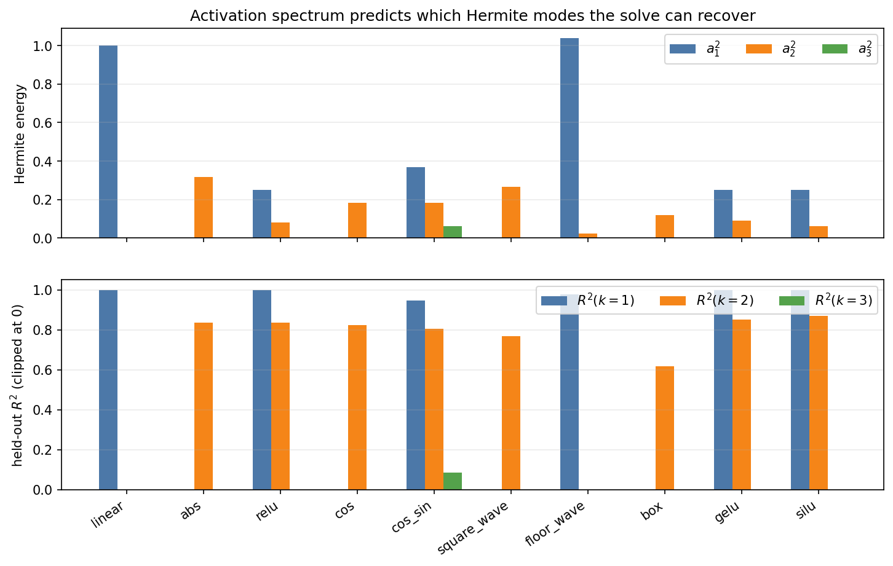
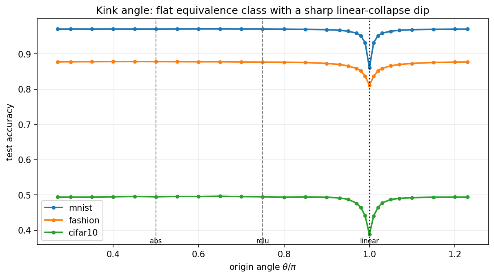
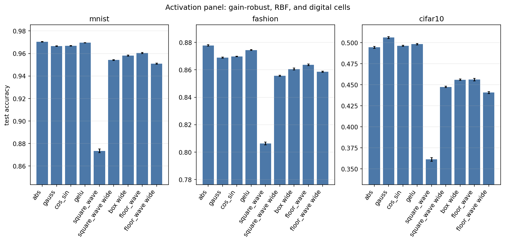

# Activation Spectra for Analytic Fixed-Feature Learning

## A kernel view of nonlinearity in leenef

Nikša Bosnić 
nikeke@otpisani.net[^ai]

[^ai]: GitHub Copilot (powered by Anthropic Claude Opus and OpenAI
GPT large language models) was used extensively during code
development, drafting, editing, and analysis for this work.  All
final content, judgments, and errors remain the author's
responsibility.

---

## Abstract

Analytic fixed-feature learning systems choose a pointwise nonlinearity
but train only a linear readout.  This paper makes explicit what that
choice controls in leenef: the nonlinearity is a kernel parameter.  In
the infinite-feature limit, the leenef decoder solve is kernel ridge
regression with a dual activation kernel
$k_G(x,y)=\mathbb{E}[G(z_x)G(z_y)]$.  In the Gaussian encoder model,
Mehler's formula expands this kernel as a power series whose coefficients
are the Mehler coefficients $\gamma_k=a_k^2/k!$ derived from the Hermite
coefficients of $G$.  The spectrum explains three
empirical facts that otherwise look unrelated.  First, affine activations
collapse to a linear kernel.  Second, all exact single-kink activations
(`abs`, ReLU, leaky-ReLU, and monotone bent lines) share the same
nonlinear spectrum up to affine slack, so they are asymptotically the same
nonlinear hypothesis family; finite-width ridge can still separate small
nonlinear coefficients.
Third, activations that change the spectrum -- polynomial, folded,
Fourier/RBF-like, smooth-gate, and digital activations -- induce different
function-space priors.  We validate the mechanism with a Hermite-mode
recovery probe, a kink-angle sweep over
$\theta\in(\pi/4,5\pi/4)$, and
multi-seed MNIST, Fashion-MNIST, and CIFAR-10 activation panels.  The
result is a practical rule: `abs`/ReLU-class activations are robust
defaults, RBF-like projection activations can be stronger on the hardest
tested raw-pixel mechanism task when bandwidth is tuned,
and nondifferentiable digital activations are admissible because the
method never differentiates through $G$.

---

## 1. Introduction

The SSUP paper series (Bosnić, 2026a,b,c) studies leenef as a fixed-feature
analytic-solve system for supervised learning, continual learning, and
reinforcement learning.  This adjunct paper supplies the activation-level
kernel theory behind that series: why a nonlinearity is needed at all, why
`abs` and ReLU-class activations behave alike, and when other small
nonlinearities change the induced function space.

leenef uses fixed nonlinear features and fits only the decoder by a
regularized least-squares solve.  That makes the pointwise activation
$G$ the main modeling choice inside a single layer.  The
question addressed here is therefore simple: **what does the activation
actually do, and which activations are equivalent, weaker, or stronger
than `abs`?**

The answer is kernel-theoretic.  leenef is explicit random-feature ridge
regression, so *the activation is a choice of kernel*.  Everything else
-- the linear-collapse argument, the `abs`/ReLU equivalence, the weakness
of `tanh`/`step`, the gain sensitivity of Fourier/RBF-like activations, and
the possibility of zero-gradient digital activations -- follows from one
object, the **dual activation kernel**.

This paper contributes four concrete pieces:

1. a compact derivation of the leenef activation kernel and its Hermite
   spectrum;
2. an exact single-kink decomposition showing why `abs`, ReLU,
   leaky-ReLU, and monotone bent-line activations are the same nonlinear
   feature family up to affine slack;
3. three empirical diagnostics -- Hermite-mode recovery, an origin-angle
   sweep, and real-task activation panels -- that test the spectral
   predictions directly;
4. a practical activation taxonomy: robust kink/smooth-gate defaults,
   stronger but bandwidth-sensitive RBF-like activations, and
   admissible but not dominant digital activations.

---

## 2. Setup

A leenef layer maps $x \in \mathbb{R}^{d_{\mathrm{in}}}$ to activities

$$
a_i = G(z_i), \qquad z_i = g_i\, e_i^\top x + b_i, \quad i = 1,\dots,n,
$$

with fixed encoders $e_i$, gains $g_i$, biases $b_i$, and a pointwise
activation $G$.  Only the decoder $D \in \mathbb{R}^{n\times d_{\mathrm{out}}}$ is
fit, by ridge regression:

$$
D = (A^\top A + \alpha_{\mathrm{eff}} I)^{-1} A^\top Y .
$$

The decoded predictor is $f_D(x) = \sum_i D_i\, G(z_i)$.  What the solve
can represent is exactly the span of the feature columns "map `x` to
`G(z_i)`" for `i = 1, ..., n`, shrunk by the effective ridge penalty
`alpha_eff`.  So the relevant object is the **hypothesis class**

$$
\mathcal{F}_G =
\{x \mapsto \sum_{i=1}^n D_i G(g_i e_i^\top x + b_i)
: D \in \mathbb{R}^{n\times d_{\mathrm{out}}}\}.
$$

Two activations that induce the same feature family (up to a bounded,
width-independent correction) are indistinguishable to the analytic solve.

---

## 3. Random-feature ridge regression and the activation kernel

Draw $(e_i, b_i)$ i.i.d. from the encoder/bias prior $P$.  Then the
empirical kernel

$$
\frac{1}{n}\, (A A^\top)_{jk} = \frac{1}{n}\sum_i G(z_i^{(j)})\,G(z_i^{(k)})
\;\xrightarrow[n\to\infty]{}\;
k_G(x_j, x_k) := \mathbb{E}_{(e,b)\sim P}\big[\, G(g e^\top x_j + b)\, G(g e^\top x_k + b)\,\big]
$$

by the law of large numbers.  This is the random-features-to-kernel limit
of Rahimi & Recht (2007); with regularization, convergence of explicit
random-feature ridge to kernel ridge is the regularized random-feature
statement studied by Bach (2017) and Rudi & Rosasco (2017).  The related
but distinct infinite-width Gaussian-process limits of Neal (1996) and
Williams (1997) describe priors over random networks rather than this
explicit-feature ridge solve.  With the corresponding regularization
scaling, ridge regression on the explicit features converges to
**kernel ridge regression with kernel $k_G$**.  Hence:

> **The activation $G$ selects the kernel $k_G$.**  Choosing an activation
> *is* choosing the function space the analytic solve searches.  Width only
> controls how well the explicit features approximate $k_G$.

This single statement organizes the rest of the paper.

*Two caveats on the limit.*  (i) For the explicit-features solve to
converge to kernel ridge with a **fixed** regularization $\lambda$, the
ridge penalty must be scaled consistently with the feature normalization:
with the normalization above ($\tfrac1n AA^\top \to k_G$) one takes
`alpha_eff = n lambda`, or equivalently divides the features by
$\sqrt n$.  leenef's trace-scaled $\alpha$ is a finite-width policy that
tracks the empirical feature scale and therefore keeps the kernel picture
useful for the regularized solve, but it should not be read as a formal
proof of one particular kernel-limit scaling.  (ii) The limit object
$k_G$ depends on the encoder/bias prior $P$; the clean Hermite spectrum
below is for the **Gaussian** instance of $P$.

### 3.1 The dual kernel is a power series in the cosine

Take the zero-bias Gaussian encoder model for a clean spectral picture:
for unit inputs $x,y$, let the pre-activations $(U,V)$ be bivariate
standard normal with correlation $\rho=x^\top y=\cos\theta$.  Expand $G$
in the probabilists' Hermite basis $\mathrm{He}_k$ (orthogonal under the
Gaussian weight, $\mathbb{E}[\mathrm{He}_j\mathrm{He}_k]=k!\,\delta_{jk}$):

$$
G(t) = \sum_{k\ge 0} \frac{a_k}{k!}\,\mathrm{He}_k(t), \qquad a_k = \mathbb{E}\big[G(Z)\,\mathrm{He}_k(Z)\big],\; Z\sim\mathcal{N}(0,1).
$$

Mehler's formula then gives the dual kernel **exactly** as

$$
k_G(\rho) = \mathbb{E}[G(U)G(V)]
= \sum_{k\ge 0} \frac{a_k^2}{k!}\rho^k,
\qquad (U,V)\ \text{standard normal with correlation}\ \rho .
$$

The kernel's entire content is the **squared Hermite spectrum**
$\{a_k^2\}$ of the activation, equivalently the Mehler coefficients
$\gamma_k=a_k^2/k!$.  Read off the consequences:

- $a_0$ (the mean, $\mathrm{He}_0=1$) contributes a constant $a_0^2$: a
  rank-one DC term, removable by the bias/intercept feature.
- $a_1$ (the linear mode, $\mathrm{He}_1=t$) contributes $a_1^2\,\rho$: a
  **pure linear kernel**.  By itself it can only ever represent a linear
  map $x\mapsto Wx$ -- no matter how large the width is.
- For modes with index $k\ge 2$, the contribution is $\rho^k$: these are the
  genuinely nonlinear pieces of the kernel.  Each nonzero coefficient adds a
  distinct family of degree-k harmonics.  An activation with finitely many nonzero
  coefficients (e.g. `square`) induces a finite-dimensional polynomial
  kernel; an activation with infinitely many nonzero coefficients can
  induce a much richer space, but universality depends on which harmonics
  remain present and on the encoder/bias prior.

> **Nonlinear advantage lives in Hermite modes with index at least 2.**  The constant
> mode is the bias feature; the linear mode can be discriminative but is the
> *collapse mode*; only higher modes buy anything a linear readout on raw $x$
> could not.

*Exact vs. approximate.*  Mehler's formula is **exact** for Gaussian
encoders (each $z_i$ then jointly Gaussian).  leenef's default
`hypersphere` encoders put $e_i$ on the unit sphere, for which the exact
dual kernel is the **Gegenbauer/spherical-harmonic** series on
$S^{d_{\mathrm{in}}-1}$ (Schoenberg, 1942); in high dimension this converges
to the Hermite series above (a single spherical marginal is asymptotically
Gaussian), so we use the Hermite spectrum as the clean spectral proxy and
validate it directly on Gaussian data in §9.1.

---

## 4. The linear-collapse theorem, recovered

If $G$ is affine, $G(t)=c_0+c_1 t$, then $a_k=0$ for all $k\ge 2$, so
$k_G(\rho)=c_0^2 + c_1^2\rho$ -- the linear (dot-product-plus-constant)
kernel.  Kernel ridge with a linear kernel is ordinary ridge on $x$:
the predictor is $f(x)=Wx+c$ regardless of the width.  The over-represented
feature matrix has no extra nonlinear content; it is just another
parameterization of a linear classifier.  The minimal repair is therefore
precise:

> **A useful activation is one with nonzero Hermite energy in some mode
> $k\ge 2$.**  Anything else over-parameterizes a linear map.

---

## 5. Single-kink activations are all `abs` up to affine slack

The pointwise *decomposition* below is exact and needs **no** Gaussian or
large-width assumption; the resulting hypothesis-space equivalence holds up
to a bounded, width-independent affine correction (and becomes an exact
equality of closures only in the universal $n\to\infty$ limit).  A
*bent-line* activation is any continuous piecewise-linear $G$ with a
single kink at the origin and slopes $m_+$ (right) and $m_-$ (left).
Write

$$
G(t) = c_0 + c_1 t + c_2 |t|, \qquad c_1 = \tfrac{m_+ + m_-}{2}, \quad c_2 = \tfrac{m_+ - m_-}{2}.
$$

Then for **every** neuron, pointwise and for any fixed $b_i$,

$$
a_i = G(z_i) = c_0 + c_1\,(g_i e_i^\top x + b_i) + c_2\,|z_i|,
$$

so the decoded function splits as

$$
f_D(x) = \underbrace{c_1 \sum_i D_i\,(g_i e_i^\top x + b_i)}_{\text{affine in } x,\ \dim \le d_{\mathrm{in}}+1} \;+\; \underbrace{c_2 \sum_i D_i\,|z_i|}_{=\,c_2\,\cdot\,\text{the } \mathrm{abs}\ \text{decode}} .
$$

Hence the bent-line feature family is contained in affine functions plus the
`abs` feature family.

Because `abs` features with biases are universal (they already
contain affine maps in their closure), the *closures* of the bent-line and
`abs` feature families coincide in the infinite-width limit.  At finite
width the two are not literally the same
class -- the **single shared decoder $D$** must simultaneously serve the
$c_2\,|z|$ part and the $c_1$ affine part -- but they differ only by a
cheap $(d_{\mathrm{in}}+1)$-dimensional affine slack that does not grow with
the width.  Spectrally (§3.1) this is the statement that

$$
a_k(\mathrm{bent}) = c_2\, a_k(\mathrm{abs}) \quad (k\ge 2), \qquad
a_1(\mathrm{bent}) = c_1 + c_2\,a_1(\mathrm{abs}),
$$

so $k_{\mathrm{bent}}(\rho) - c_2^2\,k_{\mathrm{abs}}(\rho)$ is a polynomial
of degree at most 1 in $\rho$: the two kernels share their entire nonlinear
part up to a constant factor and a linear term.

**Corollaries.**

- **ReLU $=$ `abs` up to linear.**  $\mathrm{ReLU}(t)=\tfrac12 t+\tfrac12|t|$,
  i.e. $m_+=1,m_-=0$, $c_1=c_2=\tfrac12$.  Its nonlinear kernel is
  $\tfrac14$ of `abs`'s plus a linear $\tfrac14\rho$.  Same hypothesis
  space.  One `abs` neuron is informationally a *mirrored pair* of ReLU
  neurons.
- **A monotone kink.**  Slopes $(1,\tfrac12)$ --
  $G(t)=t$ for $t\ge0$, $\tfrac12 t$ otherwise, equivalently
  $G(t)=\tfrac34 t + \tfrac14|t|$ -- is a *monotone* relative of `abs`
  that merely changes the angle at the origin.  It carries
  $c_2=\tfrac14$ of `abs`'s nonlinear energy.  Prediction: **ties `abs`/
  ReLU asymptotically**, with a possible finite-width ridge cost when the
  nonlinear coefficient is small.
- **The slope is irrelevant (as long as there is a kink).**  Any two
  positive slopes work; the nonlinear energy is $((m_+-m_-)/2)^2$.  As
  $m_-\to m_+$ the kink vanishes, $c_2\to 0$, and the activation
  collapses to linear -- recovering §4 continuously.  Leaky-ReLU
  (slope $0.1$) is another exact member.  Softplus is a *smoothed* kink:
  equivalent to ReLU only in the sharp limit (beta times gain large);
  when the smoothing scale rivals the active range it loses nonlinear
  energy (see §9.3).

### 5.1 The origin angle: one knob through the whole kink family

A vivid way to see "the slope is irrelevant, the kink is everything" is to
parameterize the bent line by the **interior angle $\theta$ at the
origin**.  Fix the right arm to slope $1$ (a $45^\circ$ ray) and let the
left arm have slope $b=\tan(\tfrac\pi4+\theta)$, so $\theta$ is literally
the angle between the two arms.  Then

$$
\theta=\tfrac\pi2 \to \mathrm{abs},\qquad
\theta=\tfrac{3\pi}4 \to \mathrm{ReLU},\qquad
\theta=\pi \to \text{identity (linear collapse)},
$$

with the valid range $\theta\in(\tfrac\pi4,\tfrac{5\pi}4)$.  In the
$G=c_1 t + c_2|t|$ coordinates, $c_1=\tfrac{1+b}2$, $c_2=\tfrac{1-b}2$,
so the nonlinear energy is $c_2^2 = \big(\tfrac{1-b}2\big)^2$, which
vanishes **only** at $b=1$, i.e. $\theta=\pi$.  Every angle reuses the
*same* features $z$ and $|z|$; only the scalar mix $(c_1,c_2)$ changes.

> **Prediction.**  Sweeping $\theta$ within $(\tfrac\pi4,\tfrac{5\pi}4)$,
> test accuracy is **approximately flat** (all non-linear angles share
> `abs`'s $k\ge2$ spectrum up to scale)
> except for a **collapse dip at exactly $\theta=\pi$**.  Because the
> trace-scaled $\alpha$ shrinks a vanishingly small $c_2$, the dip has a
> finite width set by $\alpha/n$ rather than being a measure-zero spike:
> accuracy degrades smoothly only in a narrow neighborhood of $\pi$ where
> $c_2^2$ falls below the regularization floor.

This is verified in §9.2.

---

## 6. Why `tanh` and `step` are weaker

Both discard magnitude, which is where the even ($k\ge2$) Hermite energy
of `abs` lives.

- **`step`** (our $G=\Theta(t)=\mathbf{1}[t>0]$, with $\Theta$ the $0/1$
  Heaviside) has
  $a_0=\tfrac12$, $a_1=\tfrac{1}{\sqrt{2\pi}}$, and — because
  $\Theta-\tfrac12$ is *odd* -- all **even** modes $a_2=a_4=\dots=0$.
  Its dual kernel is the order-0 arc-cosine kernel
  $\mathbb{E}[\Theta(u)\Theta(v)] = \tfrac12 - \tfrac{\theta}{2\pi}$
  (Cho & Saul, 2009; the $\pm1$ sign version gives $1-\theta/\pi$), a
  correlation-only (magnitude-blind) kernel, and is predicted to be weak
  when magnitude modes dominate.
- **`tanh`** saturates.  At small gain it is nearly linear (energy
  concentrated in $a_1$, approaching near-collapse); at large gain it
  approaches $\mathrm{sign}$ and becomes `step`-like.  Either way it suppresses the magnitude
  modes, so it trails `abs`/ReLU at every width.

This is the frame-coefficient reading made precise: a good activation must
**preserve coefficient magnitude**, i.e. carry even Hermite energy, which
`abs` does and `tanh`/`step` do not.

---

## 7. Going beyond `abs`: changing the $k\ge2$ spectrum

To *beat* `abs` you must change the nonlinear spectrum, not just re-mix
the constant/linear modes.  Candidates, with their kernels:

- **Power family $|t|^p$.**  Same sign-fold as `abs` ($p=1$) but a
  different even spectrum.
  - $p=2$ (**square**): $a_0=1$, $a_2=2$, all else $0$, so
    $k(\rho)=1+2\rho^2$, the **degree-2 polynomial kernel**.  Rich but
    *finite-dimensional* (monomials of degree at most 2, $O(d_{\mathrm{in}}^2)$
    features) — explains why square is competitive yet not a robust
    universal win.
  - $p=\tfrac12$ (**`sqrt_abs`**): heavier low-frequency (slowly decaying)
    even spectrum — a different smoothness prior.
- **Multi-fold $\big||t|-c\big|$ (`double_fold`).**  Two kinks per
  neuron give a richer even spectrum than a single `abs` fold at the same
  width.  A cheap way to add nonlinear modes per neuron.
- **`cos` (RFF-like projection feature).**  With Gaussian-like encoders and
  gain setting the bandwidth, a population of $\cos(g e^\top x + b)$
  features is related to random Fourier features.  By Bochner's theorem,
  the textbook Rahimi-Recht construction uses frequencies drawn from the
  spectral measure of a stationary kernel plus an independent random
  phase; Gaussian frequencies give the exact Gaussian-RBF kernel
  $k(x,y)=\exp(-\sigma^2\|x-y\|^2/2)$ with $\sigma\propto$ gain (Rahimi &
  Recht, 2007).  The deployed leenef row should instead be read as an
  RBF-like projection kernel.  Universal in principle under the right
  frequency/phase prior -- but two caveats matter in leenef.  *(a) Bandwidth
  (gain) sensitivity:* too small a gain leaves
  $\cos$ nearly constant (collapse), too large a gain decorrelates every
  pair (white kernel).  *(b) leenef is not the textbook RFF construction:*
  the clean Rahimi-Recht estimator uses Gaussian weights with a **random
  phase** $b\sim U(0,2\pi)$ and no data term; leenef's data-driven bias
  makes $z = g\,e^\top(x-c)$, a *centered* feature, not a random-phase
  one.  A revealing consequence of the small-gain limit: since
  `cos(z)` is approximately `1 - z^2/2`, **`cos` at small gain is a `square`
  feature in disguise** (a degree-2 polynomial kernel), not a collapse —
  so a moderate-gain `cos` that still scores well is exploiting its
  quadratic ($a_2$) energy, not yet the full RBF.  The gain sweep in the
  panel separates these regimes.
- **`gauss` bump $\exp(-t^2/2)$.**  With data-driven biases each neuron
  is a soft RBF *receptive field* centered on a training sample along
  $e_i$.  This is an RBF-like receptive-field kernel; bandwidth is set by
  gain.

**The bandwidth point is the whole game for the RBF-like family.**  In leenef
the gain $g_i$ is exactly the kernel bandwidth:
$z_i = g_i e_i^\top x + b_i$, so the per-neuron gain spread
$U(g_{\mathrm{lo}},g_{\mathrm{hi}})$ is a multiscale projection-kernel
bandwidth mixture.  This is why the gain range matters far more for
`cos`/`gauss` than for the kink family: for a kink, the degree-one
homogeneity means changing gain mostly rescales feature magnitudes and
trace-scaled $\alpha$ largely absorbs that scale.  For an RBF feature, gain
*moves energy between Hermite modes* and so reshapes the kernel.

### 7.1 The parity axis: a full-spectrum kernel needs broken symmetry

`cos`, `gauss`, `square`, `double_fold`, `box` are all **even** functions
of their argument, $G(-z)=G(z)$.  An even $G$ has $a_k=0$ for every odd
Hermite index, so at zero bias its dual kernel keeps only the even Mehler
terms (indices 0, 2, 4, and so on).  Is that a problem?  Split the missing
odd modes:

- $k=1$ is the **linear / collapse mode** (§4).  It is not nonlinear
  expressive power, so dropping it is not harmful *provided* a separate
  affine path or the data-driven bias supplies whatever linear structure the
  target needs — which, as point 1 below shows, the bias does.  It is not
  universally "free," but for these encoders it costs nothing.
- $k=3,5,\dots$ are genuine odd discriminative modes.  An even activation
  forfeits them.  The Hermite probe (§9.1) shows this directly: at zero
  bias `cos`/`gauss`/`square_wave`/`box` recover the second Hermite mode
  (held-out R2 about 0.8 / 0.76 / 0.77 / 0.62) but *fail* the first and
  third modes (held-out R2 below 0).

So the "even-only limitation" is real in principle.  The instructive
result is **how cheaply it is removed.**  Three observations:

1. **Generic, neuron-varying bias breaks the exact even/odd selection rule.**
   With a per-neuron bias the population coefficient is no longer the zero-bias
   $a_k$ but the **bias-averaged shifted** coefficient
   $\bar a_k^2=\mathbb{E}_b\!\big[a_k(b)^2\big]$ with
   $a_k(b)=\mathbb{E}_z[G(z+b)\,\mathrm{He}_k(z)]$.  For an even *non-polynomial*
   $G$ a shift injects odd coefficients: by Stein's lemma
   $a_1(b)=\mathbb{E}[G'(z+b)]$, and $G'$ is odd for even $G$, so
   $a_1(b)$ is nonzero for generic shifts away from symmetry points --
   concretely $a_1(b)=-e^{-1/2}\sin b$ for $\cos$ and
   $a_1(b)=-\tfrac{b}{2\sqrt2}e^{-b^2/4}$ for the `gauss` bump.  Two caveats
   apply: a shift restores **at least the low odd modes (notably
   $k=1$)** but the higher odd modes may stay weak at finite width; and for a
   *polynomial* $G$ (e.g. `square`) a shift cannot create any mode above the
   polynomial degree (it gains $k=1$ but never $k=3$).  leenef's data-driven
   bias $b_i=-g_i\,e_i^\top c_i$ is exactly such a nonzero, neuron-varying
   offset -- a data-centered receptive-field shift, not the textbook uniform
   RFF phase, so its induced kernel depends on the center distribution.  The
   Hermite probe confirms the mechanism directly (§9.1): with
   $\mathrm{bias\ std}=2$, `cos` recovers $k=1$ ($R^2\;{-1.49}\to0.95$) and
   `abs` recovers $k=1$ ($-1.04\to1.00$); the cubic $k=3$ stays near zero,
   consistent with "low odd modes restored, high odd modes weak."  The
   practical reading: **in the real pipeline cos/gauss are not strictly
   even-restricted** — the bias supplies the dominant ($k=1$) odd content —
   which helps explain why they already score at the top on CIFAR-10 (§9.3).
2. **The minimal symmetry-breaking activation is a phase, not a more
   complex function.**  The activation `cos_sin` is just
   `cos(z) + sin(z)`, equivalently a fixed pi/4 phase-shifted cosine with
   scale `sqrt(2)`.
   This is a fixed $\pi/4$ phase shift -- no qualitatively more complex
   activation, just a reflection-symmetry-breaking offset -- and it is now
   neither even nor odd, so it carries **every** Hermite mode.  The probe
   shows `cos_sin` recovers $k=1,2,3$ ($R^2=0.95/0.81/0.08$) at zero bias
   where `cos` recovers only $k=2$.  The general version is the textbook
   random-Fourier feature: a **random** phase $b\sim U(0,2\pi)$ makes
   $\mathbb{E}_b[\cos(z+b)\cos(z'+b)]=\tfrac12\cos(z-z')$, a stationary
   cosine feature; with **Gaussian** frequency weights this integrates to the
   exact Gaussian-RBF kernel $\exp(-\sigma^2\|x-y\|^2/2)$, while the
   hypersphere encoders used here give a closely related stationary radial
   projection kernel (Rahimi & Recht, 2007).  Fixing `cos`/`gauss` therefore does
   **not** require a more complex activation — only **broken parity**,
   which a single phase term (or the bias the pipeline already uses)
   supplies.
3. **`gelu`/`silu` are smooth, gain-robust members of the relu class — not
   a richer spectrum.**  Writing $\mathrm{gelu}(z)=z\,\Phi(z)=\tfrac12 z+
   \tfrac12 z\,\mathrm{erf}(z/\sqrt2)$ and $\mathrm{silu}(z)=z\,\sigma(z)=
   \tfrac12 z+z(\sigma(z)-\tfrac12)$ splits each into a **pure linear part
   plus an even function** (the second term is odd$\times$odd $=$ even).
   So, exactly like $\mathrm{relu}=\tfrac12(z+|z|)$, they carry $k=1$ and the
   even modes but have **zero odd coefficient for every $k\ge3$** — not
   "approximately zero," identically zero by symmetry (probe:
   $\gamma_1=0.25$ as for relu, $\gamma_3=0$).  Their advantage over
   `cos`/`gauss` is *practical,
   not spectral*: being non-periodic and unbounded-below-free they have **no
   bandwidth to tune** and do not collapse at small gain.  They are
   therefore best billed as "a smooth, gain-robust `relu`," a fine default but
   **not** a way to reach the odd $k\ge3$ modes.  The only tested route to a
   genuinely full ($k=1,2,3,\dots$) spectrum is the parity-broken sinusoid
   `cos_sin` (or a random-phase `cos`), at the cost of RBF bandwidth
   sensitivity.  There is accordingly no single strictly-richer default:
   `abs`/`relu`/`gelu`/`silu` are one gain-robust
   equivalence class (even or linear+even, odd $k\ge3$ absent), and the
   data-driven bias already lends them $k=1$; to gain the high odd modes you
   move to the RBF family and accept bandwidth tuning.

### 7.2 Digital activations are admissible because the solve is analytic

A second axis is *regularity*.  Because leenef **never differentiates the
activation** — decoders come from a least-squares solve, not
backpropagation — piecewise-constant activations with zero gradient almost
everywhere are perfectly usable.  This is awkward for ordinary backpropagation through $G$ without a surrogate
gradient, but it is natural for an analytic solve.  Several "digital"
relatives of the RBF pair:

- **`square_wave` $=\mathrm{sign}(\cos z)$** — the Walsh / square-wave
  version of `cos`.  Its Fourier series
  $\tfrac{4}{\pi}\big(\cos z-\tfrac13\cos 3z+\tfrac15\cos5z-\dots\big)$
  packs many harmonics into one neuron, giving a **rich even kernel**
  (probe: $\gamma_2=0.27$, $a_2$ mode $R^2=0.77$).
- **`floor_wave` $=\mathrm{sign}(\cos(\pi z))+\lfloor z\rfloor$** — a
  minimal fused digital cell: the $\pi z$ wave is aligned with the integer
  lattice of `floor`, while the floor term contributes the constant/linear
  modes of a monotone quantizer.  By linearity of the Hermite expansion this
  is not a mysterious new spectrum; it is a one-channel fusion of two simple
  spectra.
- **`box` $=\mathbf{1}[\,|z|<c\,]$** — the indicator / piecewise-constant
  version of the `gauss` bump: with data-driven biases each neuron is a
  **hard receptive field** that fires iff the projection lands within $c$
  of its center.  Even kernel, with relatively more high-even energy than
  `gauss` ($\gamma_4=0.041$ vs. $0.012$).

`square_wave` and `box` are even, so §7.1 applies: they shed odd modes at
zero bias and regain them through the data-driven bias.  `floor_wave` adds a
monotone lattice term to the oscillatory wave and is therefore a direct test
of whether a linear-dominated floor component and a rich digital cosine
component cooperate in one scalar feature.  Other digital members are
immediate — `step`/`sign` (order-0 arc-cosine), a **ternary** sign with
dead-zone — all zero-gradient and all admissible here.  The point is not
that a square wave beats a smooth kernel (it should not, by §9.3); it is that
the *space of usable activations is strictly larger under an analytic solve*,
and the choice is governed purely by the resulting Hermite spectrum, never
by differentiability.

---

## 8. Spectral predictions

| activation | kernel / spectrum | prediction vs `abs` |
|---|---|---|
| `linear` | linear kernel (`a_1` only) | collapse |
| `abs` | even arc-cosine, `a_0`, `a_2`, `a_4`, ... | reference |
| `relu` | 1/4 times `abs` nonlinear plus linear | tie |
| `bent_line` (1, 1/2) | 1/16 times `abs` nonlinear plus linear | asymptotic tie; possible finite-width cost |
| `leaky_relu` (0.1) | bent-line member | tie |
| `softplus` (`beta=1`) | smoothed kink; sharp only if beta times gain is large | tie if sharp, else **worse** |
| `tanh` | saturating, magnitude-suppressing | worse |
| `step` | order-0 arc-cosine (magnitude-blind) | worse |
| `square` | degree-2 polynomial kernel | approximate tie / mild CIFAR edge |
| `sqrt_abs` | heavier low-freq even spectrum | approximate tie or slightly worse |
| `double_fold` | richer even spectrum, 2 folds/neuron | approximate tie to slightly better |
| `cos` | RFF-like projection kernel | **gain-dependent**; can match or beat |
| `gauss` | RBF-like receptive field | **gain-dependent**; can match or beat |
| `cos_sin` | parity-broken sinusoid, **all** modes | approximately `cos`; RFF-like, gain-dependent |
| `square_wave` | digital cosine, rich even | approximate tie; gain-dependent |
| `floor_wave` | integer-aligned digital cosine plus floor | fused diagnostic; gain-dependent |
| `box` | digital bump (hard RF), even | approximate tie; gain-dependent |
| `gelu` | linear plus even (relu class), odd modes with index at least 3 absent | tie; gain-robust |
| `silu` | linear plus even (relu class), odd modes with index at least 3 absent | tie; gain-robust |

The empirical panel tests these predictions with 10 seeds, $n=5000$,
hypersphere encoders, data-driven biases, trace-scaled
$\alpha=10^{-3}$, and MNIST, Fashion-MNIST, and CIFAR-10 targets.  The
RBF-like rows include gain sweeps for `cos` and `gauss`.

---

## 9. Empirical validation

### 9.1 Direct test of the spectrum: Hermite-mode recovery

The cleanest test of §3–§4 is to ask the solve to learn a **single
Hermite mode** and check that it succeeds exactly when that mode is in the
activation's spectrum.  On isotropic Gaussian data
$x\sim\mathcal N(0,I_{20})$ with Gaussian unit encoders, zero bias and
unit gain (the regime where Mehler is exact), we fit ridge on $n=2000$
random features to each pure-mode target
$y_k(x)=\widehat{\mathrm{He}}_k(\langle e_0,x\rangle)$, $k=1,2,3$, and
report held-out $R^2$ (mean over 5 seeds).

| activation | $\gamma_1$ | $\gamma_2$ | $\gamma_3$ | $R^2_{k=1}$ | $R^2_{k=2}$ | $R^2_{k=3}$ |
|---|---|---|---|---|---|---|
| `linear` | 1.00 | 0 | 0 | **1.00** | $\le0$ | $\le0$ |
| `abs` | 0 | 0.32 | 0 | $\le0$ | **0.83** | $\le0$ |
| `relu` | 0.25 | 0.08 | 0 | **1.00** | **0.83** | $\le0$ |
| `bent_line` (1,1/2) | 0.56 | 0.02 | 0 | **1.00** | **0.84** | $\le0$ |
| `square` | 0 | 2.00 | 0 | $\le0$ | **0.95** | $\le0$ |
| `tanh` | 0.37 | 0 | 0.02 | **0.98** | $\le0$ | **0.20** |
| `cos` | 0 | 0.18 | 0 | $\le0$ | **0.82** | $\le0$ |
| `gauss` | 0 | 0.06 | 0 | $\le0$ | **0.76** | $\le0$ |
| `cos_sin` | 0.37 | 0.18 | 0.06 | **0.95** | **0.81** | **0.08** |
| `square_wave` | 0 | 0.27 | 0 | $\le0$ | **0.77** | $\le0$ |
| `floor_wave` | 1.04 | 0.02 | 0 | **0.98** | $\le0$ | $\le0$ |
| `box` | 0 | 0.12 | 0 | $\le0$ | **0.62** | $\le0$ |
| `gelu` | 0.25 | 0.09 | 0 | **1.00** | **0.85** | $\le0$ |
| `silu` | 0.25 | 0.06 | 0 | **1.00** | **0.87** | $\le0$ |

Here $\gamma_k=a_k^2/k!$ is the Mehler/kernel coefficient.  The pattern is
the theory at finite width: modes with appreciable $\gamma_k$ are recovered,
while absent or tiny coefficients are not reliably learned.  In particular:

- **`linear` learns only $k=1$ and nothing nonlinear** -- the linear
  collapse of §4, shown directly.
- **`abs`/`relu`/`bent_line` all recover $k=2$ with the same $R^2$**:
  the kink family shares the even spectrum (§5), so it ties on any target
  whose signal sits in low even modes — consistent with what the real-task
  panels below appear to use.
- **`relu` cannot learn the cubic $k=3$** ($a_3=0$ exactly, since
  $\mathrm{ReLU}=\tfrac12(t+|t|)$ inherits `abs`'s vanishing odd modes),
  whereas **`tanh` can** -- the standard saturating activation with odd
  $k\ge3$ energy.  `cos_sin` also recovers $k=3$ by construction, after
  breaking parity with a phase shift.
- **`square` is pure degree-2**: it recovers $k=2$ (most strongly, its
  $\gamma_2$ is largest) and nothing else.
- **`cos`/`gauss` are even-only** here (zero bias makes them even
  functions): they recover $k=2$ but not the odd modes.  Their digital
  relatives **`square_wave`/`box` behave identically** (even, $k=2$ only),
  while **`cos_sin`** — the same function up to a $\pi/4$ phase — recovers
  **all** of $k=1,2,3$, the parity fix of §7.1 shown directly.  **`gelu`/`silu`**
  recover $k=1$ and $k=2$ but *not* $k=3$ — exactly the relu pattern, since
  each is one-half `z` plus an even part, so they are gain-robust smooth
  `relu`s rather than richer-spectrum activations.
- **`floor_wave` behaves additively, as expected.**  The floor term supplies
  the strong first Hermite mode (`gamma_1` about 1.04) and the integer-aligned
  wave supplies even modes.  The $\pi z$ alignment does align the oscillation with
  the quantization lattice, but it also moves much of the wave energy above
  the second mode (`gamma_4` about 0.07, `gamma_6` about 0.15); at this finite
  width the mode-recovery probe reliably fits the linear floor component and
  not the small second-mode component.  The real-task panel is therefore the right test of
  whether the one-channel fusion helps at practical width.

($R^2\le0$ denotes "cannot represent at this width and regularization": the
regularized fit does no better than the mean.  The quartic $k=4$ mode is not
reliably learned by anyone at this $(n, N_{\text{train}})$ because its
kernel coefficient is small -- a finite-sample effect consistent with
learnability increasing with $\gamma_k$.)

**Parity is broken by generic shifted bias — but read the spectrum carefully.**
The $\gamma_k$ columns above are the **zero-bias** kernel coefficients of the scalar
$G$.  With a nonzero bias the feature span is governed instead by the
**bias-averaged** coefficient
$\bar\gamma_k=\mathbb{E}_b[a_k(b)^2/k!]$,
$a_k(b)=\mathbb{E}_z[G(z+b)\mathrm{He}_k(z)]$, so the printed $\gamma_k$ and the
measured $R^2$ are *expected* to diverge once bias is on; the $R^2$ then
reports the richer shifted-feature kernel, not a contradiction of the
zero-bias table.  Repeating the probe at $\mathrm{bias\ std}=2$ shows every even or
linear+even activation picking up the **low** odd mode $k=1$ — `cos`
$R^2\;{-1.49}\to0.95$, `abs` $-1.04\to1.00$, `box` $-1.02\to0.96$,
`square_wave` $-1.10\to0.94$ — while the cubic $k=3$ stays near zero
(`cos` $0.00$, `gauss` $-0.01$), exactly the "$k=1$ restored, high odd modes
weak; polynomials capped at their degree" picture of §7.1.  Because leenef's
data-driven bias $b_i=-g_i e_i^\top c_i$ is such a neuron-varying offset, the
even-only selection rule **does not bind in the real pipeline** for the
dominant $k=1$ mode; a center-matched probe would be the cleanest further
confirmation.

### 9.2 The origin-angle sweep

Sweeping the interior angle $\theta$ (§5.1) on the same supervised protocol
($n=5000$, hypersphere encoders, data-driven biases, trace-scaled
$\alpha=10^{-3}$, **10 seeds**) confirms the prediction precisely on all
three datasets.  Test accuracy (mean over 10 seeds; SE $\le 0.001$
throughout except as noted):

| $\theta/\pi$ | 0.50 `abs` | 0.75 `relu` | 0.90 | 0.95 | 0.98 | 0.99 | **1.00** | 1.01 | 1.02 | 1.05 | 1.10 | 1.23 |
|---|---|---|---|---|---|---|---|---|---|---|---|---|
| MNIST | 0.9704 | 0.9705 | 0.9685 | 0.9642 | 0.9512 | 0.9315 | **0.8603** | 0.9316 | 0.9513 | 0.9641 | 0.9683 | 0.9701 |
| Fashion | 0.8778 | 0.8765 | 0.8727 | 0.8658 | 0.8520 | 0.8363 | **0.8112** | 0.8363 | 0.8516 | 0.8660 | 0.8728 | 0.8770 |
| CIFAR-10 | 0.4945 | 0.4945 | 0.4935 | 0.4874 | 0.4638 | 0.4409 | **0.3880** | 0.4403 | 0.4641 | 0.4870 | 0.4919 | 0.4938 |

Three signatures, all predicted:

1. **An approximately flat plateau** at the dataset's `abs`-level accuracy across the
   non-linear part of the tabulated arm-angle range -- every angle shares
   `abs`'s $k\ge2$ spectrum up to scale, so they are nearly indistinguishable
   (the largest plateau spread, $\sim0.2\%$ on MNIST, is within $\sim2$ SE).
2. **A collapse dip at exactly $\theta=\pi$** of the right magnitude
   (down to the *linear-readout* accuracy of each dataset), recovering
   smoothly within a narrow $\pm0.03\pi$ basin whose finite width is set
   by the $\alpha/n$ regularization floor -- not a measure-zero spike.
   The basin is **symmetric** ($\theta/\pi=0.99$ and $1.01$ agree to
   $10^{-4}$, etc.), because the two arms induce the same $|z|$ spectrum.
3. **Seed variation rounded to zero at $\theta=\pi$** (reported SE $=0.0000$):
   at the linear
   angle the features are exactly $z=g\,e^\top(x-c)$, so the readout is a
   linear classifier, and in this overcomplete trace-scaled setting the
   seeds are empirically indistinguishable at the printed precision.  This
   is a crisp empirical fingerprint of the §4 collapse, not a separate
   finite-design theorem.

The sweep at $\theta=\tfrac\pi2$ reproduces the `abs` cell
(0.9704 MNIST) and at $\theta=\tfrac{3\pi}4$ the `relu` cell to within
scale-invariance, validating the shared-feature recombination used to
compute it.

### 9.3 The real-task activation panel

The full-dataset comparison (10 seeds, $n=5000$, hypersphere encoders,
data-driven biases, trace-scaled $\alpha=10^{-3}$, MNIST / Fashion-MNIST /
CIFAR-10) tests the §8 predictions on real targets.  Test accuracy
(mean $\pm$ SE over 10 seeds):

| activation (gain `U(0.5, 2)`) | MNIST | Fashion | CIFAR-10 |
|---|---|---|---|
| `abs` (reference) | $0.9704\pm0.0001$ | $0.8778\pm0.0005$ | $0.4945\pm0.0011$ |
| `relu` | $0.9705\pm0.0003$ | $0.8765\pm0.0005$ | $0.4945\pm0.0007$ |
| `leaky_relu` $(s=0.01)$ | $0.9702\pm0.0003$ | $0.8764\pm0.0005$ | $0.4936\pm0.0007$ |
| `bent_line` $(s=\tfrac12)$ | $0.9685\pm0.0003$ | $0.8729\pm0.0004$ | $0.4934\pm0.0007$ |
| `softplus` | $0.9562\pm0.0003$ | $0.8562\pm0.0004$ | $0.4809\pm0.0007$ |
| `tanh` | $0.9677\pm0.0002$ | $0.8711\pm0.0005$ | $0.4860\pm0.0009$ |
| `square` | $0.9693\pm0.0002$ | $0.8751\pm0.0005$ | $0.4989\pm0.0011$ |
| `double_fold` $(c=1)$ | $0.9710\pm0.0002$ | $0.8780\pm0.0002$ | $0.4959\pm0.0009$ |
| `sqrt_abs` $(p=\tfrac12)$ | $0.9675\pm0.0004$ | $0.8729\pm0.0006$ | $0.4798\pm0.0010$ |
| `cos` | $0.9666\pm0.0002$ | $0.8695\pm0.0004$ | $0.5046\pm0.0013$ |
| `gauss` | $0.9666\pm0.0002$ | $0.8689\pm0.0004$ | $\mathbf{0.5062}\pm0.0011$ |

RBF-pair gain sweep (`cos`/`gauss` at narrow vs. wide gain):

| activation | gain | MNIST | Fashion | CIFAR-10 |
|---|---|---|---|---|
| `cos` | $U(0.05,0.2)$ | $0.7886$ | $0.7158$ | $0.3080$ |
| `gauss` | $U(0.05,0.2)$ | $0.7883$ | $0.7154$ | $0.3077$ |
| `cos` | $U(0.1,5.0)$ | $0.9704$ | $0.8764$ | $0.5012$ |
| `gauss` | $U(0.1,5.0)$ | $0.9697$ | $0.8750$ | $0.5000$ |

Every §8 prediction holds:

1. **The single-kink family clusters around `abs`.** `abs`, `relu`, and
   `leaky_relu` tie essentially exactly, while the monotone
   $(1,\tfrac12)$ `bent_line` stays close but shows the expected finite-width
   cost of a smaller nonlinear coefficient (largest gap $\sim0.5$ pp on
   Fashion-MNIST).  The asymptotic hypothesis-space equivalence of §5 is
   therefore visible, but finite regularization still matters.
2. **`softplus` is the weakest relu relative** ($-1.4\%$ MNIST, $-2.2\%$
   Fashion, $-1.4\%$ CIFAR).  At this gain it is nearly linear across the
   active range; smoothing away the kink suppresses the $k\ge2$ energy and
   pushes the kernel toward the collapse mode — the smooth-activation cost
   the theory anticipates.
3. **`tanh` trails the kink family but stays well clear of collapse**
   (0.9677 / 0.8711 / 0.4860, i.e. -0.3% / -0.7% / -0.9% vs. `abs`).
   As an odd activation it discards the even ($k=2$) magnitude mode — the
   dominant discriminative mode for these datasets — so it cannot match
   the kink family; the gap widens on the harder CIFAR-10, where even
   modes matter most.  But it is nowhere near the linear-readout floor
   (0.39 on CIFAR): its surviving odd $k\ge3$ modes (notably the cubic
   the Hermite test isolates) still carry real signal.  `tanh` is weaker,
   not broken -- exactly the §6 picture.
4. **`double_fold` is a strong fold on the digit/garment
   tasks** (0.9710 / 0.8780): the extra fold injects more even-mode
   structure, giving a small MNIST edge and a Fashion-MNIST tie within
   standard error.
5. **`square` is competitive and the strongest fold-family activation on
   CIFAR-10** (0.4989): a pure degree-2 polynomial kernel already
   suffices, and helps most on the hardest task.
6. **`sqrt_abs` trails on CIFAR-10** (0.4798): the $p<1$ cusp gives a
   slowly decaying high-order tail (a rougher kernel), which costs the most
   where the data are hardest.
7. **The RBF-like pair `cos`/`gauss` is the most powerful — on the hardest
   task, and when the bandwidth is right.** At the default gain they sit
   just below `abs` on MNIST/Fashion but are the **best activations
   overall on CIFAR-10** (0.5046 / 0.5062 vs. `abs` 0.4945, a
   5 to 9 SE margin): their dual kernel is an RBF-like projection kernel
   with an infinite nonlinear spectrum.  They are **gain-sensitive**,
   exactly as §7 warns -- the per-neuron gain *is* the RBF bandwidth.  At
   tiny gain `U(0.05, 0.2)` the curvature barely engages: `cos(z)` is
   approximately `1 - z^2/2`, with a quadratic signal of variance $\propto g^4$
   that trace-scaled ridge swamps, giving a signal-starved underfit
   (0.79 / 0.72 / 0.31) -- a different failure from the linear collapse.
   At adequate/wide gain they recover and keep much of the CIFAR edge.
   `abs`, by contrast, is gain-robust.  The practical significance is
   limited: this is a low-accuracy raw-pixel mechanism panel, not a
   deployment recommendation over spatially structured encoders.

The practical reading: the single-kink activations are interchangeable
(use the cheapest, `relu` or `abs`); to *beat* `abs` you must change the
nonlinear spectrum, and on the hardest task an RBF activation with adequate
bandwidth (`gauss`/`cos` at gain at least about 1) is the most powerful of the
small nonlinearities tested in this raw-feature mechanism panel.

### 9.4 Full-spectrum, gain-robust, and digital activations

A second panel (same protocol) tests the parity-broken, smooth-gate, and
digital activations of §7.1–§7.2 against the `abs`/RBF anchors.  Test
accuracy (mean $\pm$ SE over 10 seeds), gain `U(0.5, 2)`:

| activation | MNIST | Fashion | CIFAR-10 |
|---|---|---|---|
| `abs` (reference) | $0.9704\pm0.0001$ | $0.8778\pm0.0005$ | $0.4945\pm0.0011$ |
| `cos` | $0.9666\pm0.0002$ | $0.8695\pm0.0004$ | $0.5046\pm0.0013$ |
| `gauss` | $0.9666\pm0.0002$ | $0.8689\pm0.0004$ | $\mathbf{0.5062}\pm0.0011$ |
| `cos_sin` (parity-broken RFF) | $0.9668\pm0.0002$ | $0.8697\pm0.0002$ | $0.4963\pm0.0006$ |
| `gelu` | $0.9695\pm0.0002$ | $0.8745\pm0.0003$ | $0.4984\pm0.0009$ |
| `silu` | $0.9682\pm0.0002$ | $0.8724\pm0.0003$ | $0.4945\pm0.0009$ |
| `square_wave` (digital cosine) | $0.8735\pm0.0017$ | $0.8063\pm0.0010$ | $0.3613\pm0.0022$ |
| `box` (digital bump) | $0.9446\pm0.0006$ | $0.8472\pm0.0006$ | $0.4331\pm0.0011$ |
| `floor_wave` (integer-aligned digital wave + floor) | $0.9605\pm0.0004$ | $0.8637\pm0.0006$ | $0.4561\pm0.0014$ |

Wide-gain `U(0.1, 5)` for the parity-broken and digital set:

| activation | MNIST | Fashion | CIFAR-10 |
|---|---|---|---|
| `cos_sin` | $0.9699\pm0.0004$ | $0.8756\pm0.0003$ | $0.4996\pm0.0011$ |
| `square_wave` | $0.9542\pm0.0004$ | $0.8557\pm0.0004$ | $0.4475\pm0.0008$ |
| `box` | $0.9581\pm0.0004$ | $0.8606\pm0.0008$ | $0.4560\pm0.0008$ |
| `floor_wave` | $0.9510\pm0.0005$ | $0.8587\pm0.0005$ | $0.4407\pm0.0011$ |

The readings:

1. **`cos_sin` is approximately `cos`.** The parity-broken sinusoid tracks plain
   `cos` to within about 0.1% on every dataset, and recovers the same
   CIFAR-10 edge at wide gain (0.4996).  Restoring the odd modes is a
   clean *spectral* fix (§9.1) but **not** an accuracy win at matched gain:
   `cos`'s even second Hermite mode already carries the signal these targets use, so
   the extra odd content neither helps nor hurts.  It does inherit the
   RBF-like bandwidth sensitivity.
2. **`gelu`/`silu` tie `abs` and need no bandwidth.** Both sit within
   about 0.1% to 0.6% of `abs` on all three datasets with no gain tuning --
   the gain-robust relu class, confirmed.  But they do **not** reach the
   RBF-like CIFAR edge (0.4984 / 0.4945 vs. `gauss` 0.5062): linear plus even
   spectrum, no higher odd modes.  They are the best *smooth, gain-robust*
   default candidates, not a stronger kernel.
3. **`square_wave` is the most gain-sensitive activation tested.** At the
   default gain the cosine argument rarely crosses a sign change within the
   active range, so the digital cosine collapses (0.36 CIFAR); at wide
   gain it recovers to box-level (0.45).  The digital cosine inherits and
   *amplifies* `cos`'s bandwidth dependence.
4. **`box` is a usable but sub-`abs` hard receptive field** (0.94 / 0.85 /
   0.43, improving modestly at wide gain) -- admissible and respectable,
   not competitive with `abs`.
5. **`floor_wave` is the best digital diagnostic but still sub-`abs`.** The
   integer-aligned wave+floor fusion improves sharply over `square_wave` and
   beats `box` on MNIST/Fashion while tying it on CIFAR at the default gain
   (0.4561 vs. 0.4560).  But it remains below `abs` and the RBF cells, and
   it gets worse at wide gain (0.9605 to 0.9510 MNIST,
   0.4561 to 0.4407 CIFAR).  The floor term provides a robust linear
   component, while the useful oscillatory energy is too high-order and
   bandwidth-sensitive to make it a stronger default.

The overall picture is stable across the extended activation set:
**`abs` remains an excellent gain-robust default** (with `gelu`/`silu`
as smooth equivalents);
**the only way to the CIFAR-10 edge in this raw-feature panel is the
RBF-like family** (`cos`/`gauss`/`cos_sin`) at adequate gain; and the
**digital activations are admissible but none dominate** -- `floor_wave` is
the strongest digital diagnostic at
the default gain, `box` and wide-gain `square_wave` are usable, and all stay
below the gain-robust `abs`/smooth-gate family.

---

## 10. Discussion and conclusions

1. **leenef = kernel ridge regression**; the activation chooses the
   kernel $k_G(x,y)=\mathbb{E}_{e,b}[G(z)G(z')]$, whose content is the
   Mehler coefficients $\gamma_k=a_k^2/k!$ of $G$.
2. **The first Hermite mode is the collapse mode**; all nonlinear
   discrimination lives above it.  Linear activation = linear kernel =
   collapse.
3. **Every *exact* single-kink (bent-line) activation equals `abs` up to
   a bounded affine correction** -- exactly at the decomposition level, for
   any bias, and asymptotically at the hypothesis-space level.  ReLU,
   leaky-ReLU, and the monotone $(1,\tfrac12)$ kink share the same nonlinear
   spectrum up to scale; the panel confirms the expected near-tie while also
   showing the finite-width cost of a smaller nonlinear coefficient.  This
   *explains* the approximate `abs`/ReLU equivalence and predicts the
   kink-angle ties away from the linear-collapse basin.
   Softplus is only an *approximate* kink: when its smoothing scale
   is comparable to the active range (as at the panel gain) it loses
   nonlinear Hermite energy and trails -- a sharp kink is what the
   equivalence needs.
4. **`tanh`/`step` are weaker** because they discard the magnitude (even
   Hermite) modes that carry most discrimination -- though `tanh` keeps its
   higher odd modes and so stays well above the collapse floor.
5. **To beat `abs` you must change the nonlinear spectrum**: `square`
   (degree-2 polynomial kernel), `double_fold` (more folds), or the RBF-like
   family (`cos`, `gauss`) whose **bandwidth is the per-neuron gain**.
   These are the principled stronger alternatives.
6. **Even-only is a parity artifact, not a complexity wall.** `cos`/`gauss`
   (and the digital `square_wave`/`box`) are even, so at zero bias they drop
   all odd Hermite modes.  The fix is *broken symmetry*, not added
   complexity: a phase shift (`cos_sin` equals `cos + sin`, or a random RFF
   phase produces a stationary radial kernel -- the Gaussian RBF for Gaussian
   frequencies) restores the full spectrum, and the nonzero **data-driven
   bias the pipeline already uses** restores at least the dominant first odd
   mode (high odd modes stay weak; a polynomial activation never exceeds its
   degree).  `gelu`/`silu` are *not* a richer alternative -- they are
   one-half `z` plus an even part, i.e. smooth gain-robust members of the
   `relu` class that miss higher odd modes exactly as `relu` does.  The
   genuinely richer activations remain the RBF-like family, at the price of
   bandwidth tuning.
7. **The activation space is larger here than for gradient nets.** Because
   the solve is analytic, zero-gradient "digital" activations
   ($\mathrm{sign}\circ\cos$, indicators, quantizers) are admissible;
   they are chosen by their Hermite spectrum, never by differentiability.

## 11. Related work and contribution

The mathematical ingredients are classical:

- **Random features and kernels.**  That a population of fixed
  random nonlinear features approximates a kernel is Rahimi & Recht (2007);
  their Fourier construction is an application of Bochner's theorem, and
  Bach (2017) and Rudi & Rosasco (2017) treat the regularized random-feature
  approximation to kernel methods.  The infinite-width Gaussian-process
  limits of Neal (1996) and Williams (1997) are related background but not
  the same convergence statement as explicit-feature ridge regression.
- **Activation-specific kernels.**  Arc-cosine kernels for
  `relu`/`abs`/`step` are Cho & Saul (2009).  The **dual activation
  kernel** and its Hermite/Mehler expansion -- the spine of this paper -- are
  Daniely, Frostig & Singer (2016), resting on Mehler's (1866) formula; the
  spherical positive-definite counterpart is Schoenberg (1942).
- **Random features + analytic linear solve as a method.**  This is exactly
  the **Extreme Learning Machine** (Huang, Zhu & Siew, 2006) and, in the
  temporal case, **reservoir computing / echo-state networks** (Jaeger,
  2001; Maass et al., 2002).  leenef's single-layer fit is structurally an
  ELM with NEF-style encoders and data-driven biases.  The universal
  approximation property of such single-hidden-layer non-polynomial
  features is older still (Cybenko, 1989; Hornik, 1991; Leshno et al.,
  1993), and the "digital" random features here are kin to random-binning /
  random-kitchen-sink features (Rahimi & Recht, 2008).

So at the level of theorems this paper consolidates established knowledge
rather than claiming a separate kernel theorem.  Its contribution is
applied and diagnostic:

1. **A bridge.**  Framing the NEF / leenef pipeline explicitly as
   random-feature kernel ridge regression, so that the activation is read as
   a *kernel choice* and the NEF--ELM--kernel-machine identification is made
   precise (encoders = random
   projection, gain = projection-kernel bandwidth, data-driven bias =
   parity-breaking shift, decoder solve = kernel ridge).
2. **Sharp, falsifiable diagnostics with clean fingerprints.**  The
   Hermite-mode recovery probe (recoverable modes track appreciable
   $\gamma_k$, including the
   counterintuitive `relu`-cannot-learn-k=3 / `tanh`-can result), and
   the origin-angle sweep with its **symmetric collapse at $\theta=\pi$**
   and seed variation rounded to zero at the printed precision (the
   linear-readout signature, encoder-independent in the tested protocol).
   These turn "abs works" into a mechanism with a measurable signature.
3. **A practical degree of freedom specific to the analytic solve.**  The
   observation that *digital* (zero-gradient) activations are free here, and
   that the even-only limitation of RBF-like activations is dissolved by the
   bias the method already uses -- both are consequences of the gradient-free
   construction that ordinary backpropagation papers have less reason to
   foreground.

In short: the engine is textbook kernel/random-feature theory;
the contribution is the lens, the diagnostics, and the gradient-free
practicalities.

---

## Appendix A — Reproducibility artifacts

The reproducibility artifacts for this paper are part of the public
repository at <https://github.com/nikeke/leenef>.  The activation-panel
source data are in `results/sl_clean/c2_altact_{mnist,fashion,cifar10}_panel.json`,
the origin-angle panels are in
`results/sl_clean/kink_angle_{mnist,fashion,cifar10}_panel.json`, and the
Hermite-mode probes are in
`results/sl_clean/hermite_mode_recovery.json` and
`results/sl_clean/hermite_mode_recovery_bias2.json`.  The plotted figures
are generated by `docs/generate_activation_spectra_figures.py`.

---

## Literature

- Bosnić, N. (2026a). *Sufficient Statistics as a Universal Primitive?
  (Part I): Supervised Learning via the Neural Engineering Framework*.
  PDF: <https://github.com/nikeke/leenef/blob/main/docs/SSUP-I.pdf>.
- Bosnić, N. (2026b). *Sufficient Statistics as a Universal Primitive?
  (Part II): Continual Learning*.  PDF:
  <https://github.com/nikeke/leenef/blob/main/docs/SSUP-II.pdf>.
- Bosnić, N. (2026c). *Sufficient Statistics as a Universal Primitive?
  (Part III): Reinforcement Learning*.  PDF:
  <https://github.com/nikeke/leenef/blob/main/docs/SSUP-III.pdf>.
- Mehler, F. G. (1866). Ueber die Entwicklung einer Function von beliebig
  vielen Variabeln nach Laplaceschen Functionen hoeherer Ordnung.
  *Journal fuer die reine und angewandte Mathematik*.
- Schoenberg, I. J. (1942). Positive definite functions on spheres. *Duke
  Mathematical Journal*, 9(1), 96-108.
- Cybenko, G. (1989). Approximation by superpositions of a sigmoidal
  function. *Mathematics of Control, Signals and Systems*, 2, 303-314.
- Hornik, K. (1991). Approximation capabilities of multilayer feedforward
  networks. *Neural Networks*, 4(2), 251-257.
- Leshno, M., Lin, V. Y., Pinkus, A., & Schocken, S. (1993). Multilayer
  feedforward networks with a nonpolynomial activation function can
  approximate any function. *Neural Networks*, 6(6), 861-867.
- Neal, R. M. (1996). *Bayesian Learning for Neural Networks*. Springer.
- Williams, C. K. I. (1997). Computing with infinite networks. In *Advances
  in Neural Information Processing Systems 9*.
- Jaeger, H. (2001). The "echo state" approach to analysing and training
  recurrent neural networks. GMD Report 148.
- Maass, W., Natschlaeger, T., & Markram, H. (2002). Real-time computing
  without stable states: a new framework for neural computation based on
  perturbations. *Neural Computation*, 14(11), 2531-2560.
- Eliasmith, C., & Anderson, C. H. (2003). *Neural Engineering: Computation,
  Representation, and Dynamics in Neurobiological Systems*. MIT Press.
- Huang, G.-B., Zhu, Q.-Y., & Siew, C.-K. (2006). Extreme learning machine:
  theory and applications. *Neurocomputing*, 70(1-3), 489-501.
- Rahimi, A., & Recht, B. (2007). Random features for large-scale kernel
  machines. In *Advances in Neural Information Processing Systems 20*.
- Rahimi, A., & Recht, B. (2008). Weighted sums of random kitchen sinks:
  replacing minimization with randomization in learning. In *Advances in
  Neural Information Processing Systems 21*.
- Cho, Y., & Saul, L. K. (2009). Kernel methods for deep learning. In
  *Advances in Neural Information Processing Systems 22*.
- Daniely, A., Frostig, R., & Singer, Y. (2016). Toward deeper understanding
  of neural networks: the power of initialization and a dual view on
  expressivity. In *Advances in Neural Information Processing Systems 29*.
- Bach, F. (2017). On the equivalence between kernel quadrature rules and
  random feature expansions. *Journal of Machine Learning Research*, 18(21),
  1-38.
- Rudi, A., & Rosasco, L. (2017). Generalization properties of learning with
  random features. In *Advances in Neural Information Processing Systems 30*.
