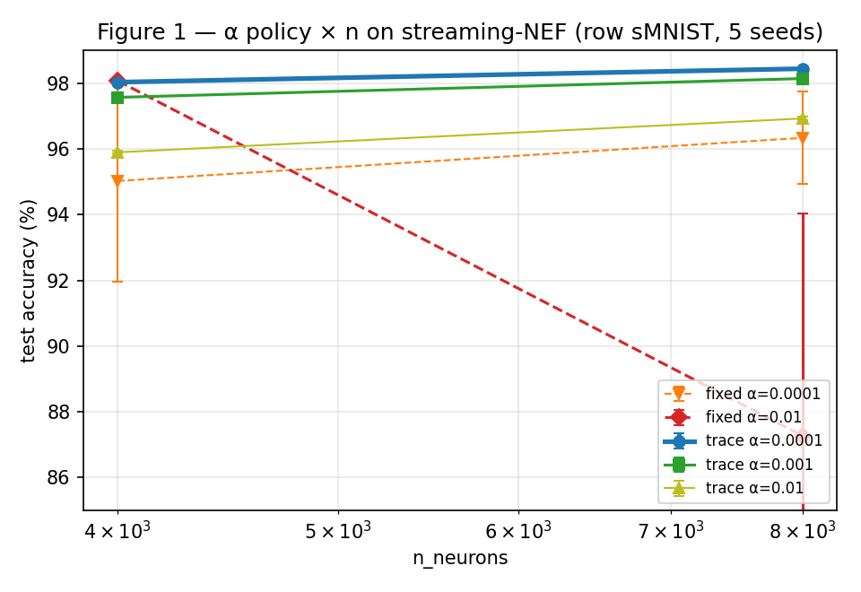
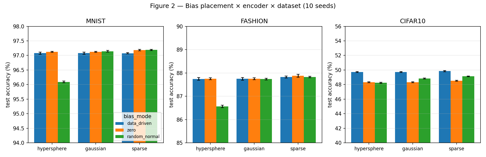
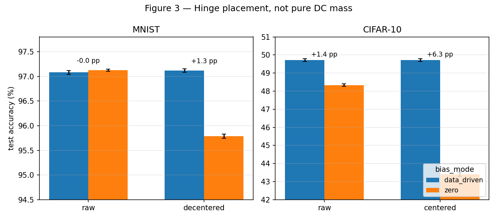
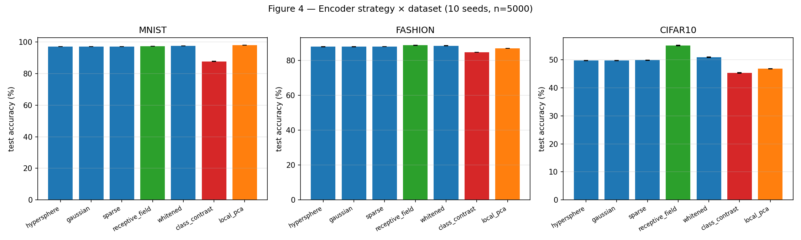
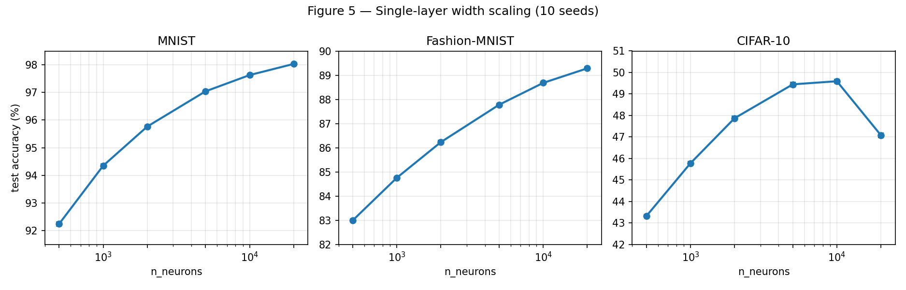
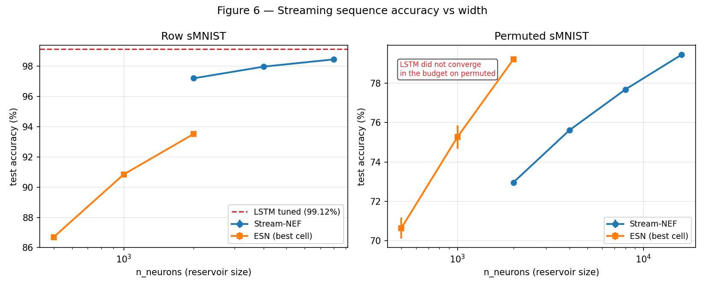
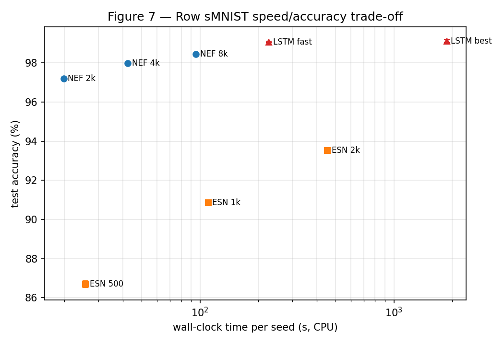
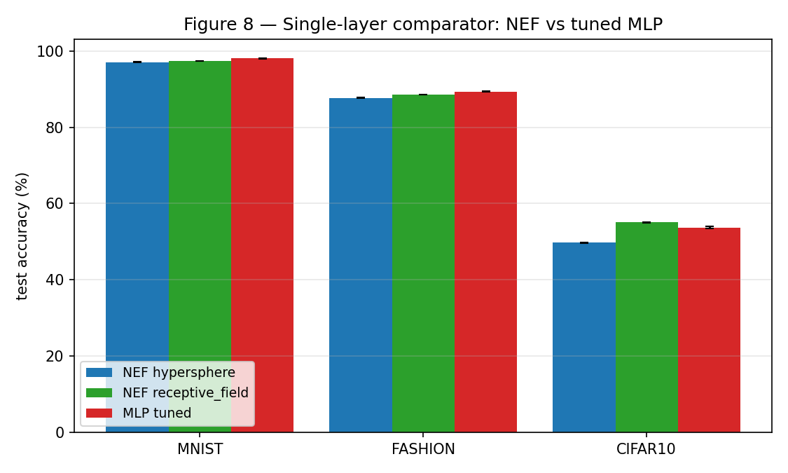

# Sufficient Statistics as the Universal Primitive (Part I)

## Supervised Learning via the Neural Engineering Framework

> **Status: draft in progress.**  This is the working manuscript for
> Paper I of the leenef SSUP trilogy.  Numerical claims remain under
> active audit until the final comparator panels land.  Cited
> Eliasmith & Anderson chapters are from *Neural Engineering:
> Computation, Representation, and Dynamics in Neurobiological Systems*
> (MIT Press, 2003) unless stated otherwise.

---

## Abstract

NEF's regularized least-squares solve over fixed-encoder neural
activities — `D = (AᵀA + α_eff I)⁻¹ AᵀY` — gives a compact
sufficient-statistics primitive for supervised learning.  In a
rate-based specialization we call **leenef**, we interpret the
activities as magnitudes of frame coefficients and study how
encoder choice, bias placement, activation, and regularization
shape the resulting fixed-feature learner.  The resulting primitive
composes into ensembles, online updates (Woodbury),
GPU-friendly accumulate-and-solve, and, non-trivially, a streaming
temporal classifier.  Under multi-seed,
code-identity-tagged evaluation, the analytic streaming classifier
reaches **98.45 ± 0.02 %** on row sMNIST: **0.6 pp below** a tuned
near-best LSTM while using **2.4× less wall-clock time**, and
**~5 pp above** the completed ESN row panel while using
**roughly 5× less wall-clock time**.  Static single-layer leenef
models with generic encoders end **1–4 pp below** gradient-trained
MLPs on image features while using **12–50× less wall-clock time**;
on CIFAR-10, adding a receptive-field encoder reverses that gap
(**+1.37 pp**) with **~11× less wall-clock time**.  The same
evidence also marks clear limits: generic fixed encoders are not a
substitute for spatial priors, purely analytic depth does not buy
accuracy on its own, and mean-pooled delay-line features lose the
long-range order information needed for harder sequence tasks.

---

## §1 — The six principles of leenef

We build on the *Neural Engineering Framework* of Eliasmith and
Anderson (2003): a population of neurons with fixed encoders
represents a vector quantity, and any function of that vector is
computed by a linear decoder fitted to the population's activity.
Their book frames this around three principles — representation,
transformation, and dynamics — and the canonical implementation
uses spiking leaky-integrate-and-fire neurons whose firing rate
encodes the represented quantity.  We keep the encoder–decoder
split, the analytic least-squares fit, and the conceptual freedom
to compose decoded signals; we depart in three places.

- We use **rate neurons with `abs` activation**, not spiking LIF.
  `abs` is the smallest pointwise nonlinearity that escapes the
  linear-collapse argument of §2; it is also what gives our
  activations the frame-coefficient interpretation that the rest
  of the paper turns on.
- We use **data-driven biases**.  The bias of neuron *i* is
  `b_i = -g_i (e_i · d_i)` for a sample `d_i` drawn from the
  training set, placing the *i*-th `abs` fold on the data
  manifold rather than on a generic random intercept.
- We do not use NEF's **dynamics principle** anywhere in this
  paper.  Streaming and recurrent variants reuse encoders and
  decoders with pooling, not a recurrent dynamics solve.

When this paper says "NEF" it means this *analytic-rate-`abs`
specialization*; when distinction matters we call our local
specialization **leenef**.  Readers who arrive expecting Nengo-
style spiking populations should read NEF here as "the
encode–decode pattern of Eliasmith & Anderson, with rate-`abs`
neurons and data-driven biases."

The trilogy's shared opener is six operational claims, distilled
from the program's running code.  These are *our* distillation;
P1–P4 inherit from NEF, P5–P6 are leenef-specific.

- **P1 — Encoders are fixed** (random or data-adapted).  Decoders
  are the only thing we ever fit.
- **P2 — Decoders fall out of one analytic step:**
  `D = (AᵀA + αI)⁻¹ AᵀY`.  No learning rate, no schedule, no
  gradient flow between layers.
- **P3 — `AᵀA` and `AᵀY` are the universe.**  Continual learning,
  streaming over time, ensembles, online updates, per-action
  FQI — all of them are different ways of *additively combining*
  sufficient statistics.
- **P4 — Targets `Y` are the only place where task structure
  enters.**  The encoder does not care what the task is; the
  decoder column does.
- **P5 — Time is collapsed by pooling, not by recurrence.**  The
  streaming classifier mean-pools delay-line activities into a
  fixed-size representation; no BPTT, no recurrent solve.
- **P6 — Per-class additivity is what makes continual learning
  work.**  Each class owns its own decoder column, so accumulating
  new task statistics never interferes with old columns.
  (Forward-look — owned by Paper II; we exhibit the additivity
  property here without claiming it solves CL.)

The rest of Paper I is one of these primitives applied somewhere
new: §3 (method) is **P1–P4**, §6 (streaming classifier) is **P5**,
and the multi-layer experiments (Appendix B) are the load-bearing
negative result that says **P2** does not extend cleanly through
stacked nonlinearities — which is why we stay single-layer for the
rest of the trilogy.

---

## §2 — Why over-representation needs nonlinearity

A linear activation collapses the entire scheme.  If
`a_i = g_i (e_i · x)`, then for any decoder `D ∈ ℝ^{n × d_out}`,

```
y = Dᵀa = Dᵀ diag(g) E x = (Dᵀ diag(g) E) x = W x
```

is a single linear map, regardless of `n`.  Over-completeness
buys **nothing**: a 100 000-neuron linear network is exactly as
expressive as a single linear projection of input onto output.
The frame `{g_i e_i}` is just an absurdly redundant
parameterization of a `d_in × d_out` matrix.

We verified this in a sanity-check experiment: a linear-activation
leenef layer at `n ∈ {1 000, 4 000}` plateaus at **86.0–86.2 %** on
MNIST, within 1 pp of a plain ridge regression on the raw 784-D
input (85.3 %).  An `abs`-activation leenef layer at `n = 5 000`
reaches **97.08 %** under identical training data and α policy.
The collapse is empirical, not just algebraic; the +11 pp delta
is the entire contribution of the pointwise nonlinearity.  This
is a single-seed sanity check; the comparator (97.08 ± 0.04 %)
is from the corresponding 10-seed raw-MNIST panel.

The minimal repair is a pointwise nonlinearity that is *not*
representable as a linear scaling.  `abs` is the smallest such
repair we can imagine:

```
a_i = |g_i · e_i · x|
```

With unit encoders, `|e_i · x|` is the **unsigned distance of x
from the hyperplane `{e_i · z = 0}`**.  With gains,
`|g_i e_i · x|` is the same distance scaled by `g_i`.  A linear
readout over `n` such folded projections is a piecewise-linear
function with up to `n` fold lines.  Translated folds (non-zero
biases) and enough directions give the familiar expressive family
of absolute-value and ReLU networks; zero-bias folds alone are
more restricted — homogeneous and even — which is exactly why
bias placement becomes a load-bearing empirical question in §5.1.
ReLU is the same idea after a half-fold (drop the sign instead of
folding about the origin); the identity `|x| = ReLU(x) + ReLU(-x)`
means that one `abs` feature spans the same scalar function as a
mirrored pair of ReLU features, although the fixed-neuron-budget
parameterization is not identical.

### The frame-coefficient interpretation

Set `u_i = g_i e_i`.  Then
`a_i = |u_i · x|` is the magnitude of the *i*-th frame
coefficient of `x` in the (over-complete, possibly random) frame
`{u_i}`.  When biases are non-zero, the frame becomes
*manifold-local*:

```
a_i = |g_i · e_i · (x − d_i)|        (data-driven bias case)
```

Each neuron then asks "how far is x from training sample `d_i`,
along direction `e_i`?"  The decoder is the linear functional
that reads off the target from these magnitudes.  This framing
will recur throughout the paper:

- **Encoder strategies** (§5.2) are different priors over the
  frame directions `{u_i}`: hypersphere = isotropic; whitened =
  data-covariance-aware; receptive_field = spatial-locality-aware.
  Random, near-isotropic frames are broad but data-blind;
  data-adapted frames trade generic coverage for efficiency.
- **Per-neuron gain `g_i`** (§5.4) rescales each frame element,
  equivalent to non-uniform measurement of `x`.  Empirically the
  default `U(0.5, 2.0)` range and a fixed `g_i ≡ 1` perform within
  seed noise on raw image classification (§5.4); we keep gain
  diversity as the project default because it is the NEF-canonical
  setting and because it pays off in the streaming variant.
- **Bias placement** (§5.1) selects where each `abs` fold sits
  in input space.  The next paragraph shows why this matters
  more than it might appear.

### Why bias placement matters: the manifold view

Real data lives on (or near) a low-dimensional manifold inside
the ambient input space.  Two complementary roles emerge.

- **Random encoders** approximate a near-isometric measurement
  of that manifold (Johnson–Lindenstrauss / restricted-isometry
  style).  Enough random directions in high dimension preserve
  pairwise distances and angles, so the data manifold's geometry
  is carried faithfully into the *n*-neuron frame coefficients.
- **Data-driven biases** place each neuron's measurement origin
  *on* the manifold itself.  The global frame becomes a
  *manifold-aware local* frame: tangent-style coordinates from
  many neighborhoods at once.

Whether local framing actually helps over global (zero-bias)
framing depends on where the `abs` fold sits relative to the
data:

- If the data centroid is *at* the origin, zero bias is a worst
  case: half the data mass falls on each side of every fold and
  `abs` collapses sign symmetrically.
- If the data cloud mostly lies on one side of the origin along
  many encoder directions, zero bias is accidentally sane (sign
  rarely flips) and `abs` is effectively linear in those local
  fluctuations.

This geometric reading predicts the direction of the §5.1 ablations
better than the simple DC-component reading: centering or decentering
changes where folds cut through the data cloud, not just the amount
of constant pixel mass.

---

## §3 — Method: the NEF layer as one analytic step

A leenef layer is three operations.  Given input `x ∈ ℝ^{d_in}`,
fixed encoder matrix `E ∈ ℝ^{n × d_in}` (rows of unit norm by
default), per-neuron gain vector `g ∈ ℝ^n`, bias vector
`b ∈ ℝ^n`, and pointwise activation `G : ℝ → ℝ`, the forward map
is

```
a = G(g ⊙ (E x) + b) ∈ ℝ^n.
```

The default activation is `abs`; encoders are uniform on the
unit sphere (`hypersphere`); gains are drawn `U(0.5, 2.0)`;
biases are derived from training samples
`b_i = -g_i (e_i · d_i)` for `d_i ∼ training set`.  The output
is read off by a linear decoder `D ∈ ℝ^{n × d_out}`:

```
y = Dᵀ a.
```

The decoder is fitted by Tikhonov ridge regression against
targets `Y ∈ ℝ^{N × d_out}` (one-hot for classification, real-
valued for regression):

```
D = (AᵀA + α_eff I)⁻¹ AᵀY.
```

The per-sample activity matrix `A ∈ ℝ^{N × n}` need never be
materialized in full — only its sufficient statistics
`AᵀA ∈ ℝ^{n × n}` and `AᵀY ∈ ℝ^{n × d_out}` enter the solve.
Three numerically equivalent paths to those statistics are
implemented:

- **`batch_acc`**: one-shot full-data accumulate, single
  Cholesky solve.  Simplest; needs the whole training set in
  memory (or one streaming pass).
- **`accumulate`**: chunked accumulate.  GEMMs (`AᵀA`, `AᵀY`)
  in float32; running stats in float64 to absorb cancellation
  across chunks.  GPU-friendly; memory cost `O(n²)` for the
  stats, independent of dataset size.
- **`woodbury`** (continuous fit): rank-`k` Sherman–Morrison
  updates of the inverse `M⁻¹ = (AᵀA + α_eff I)⁻¹` after every
  batch, so the decoder is current at every step.  The inverse
  itself is kept in float64 to keep updates from drifting.
  Necessary for online deployments; on GPU at large `n` the
  explicit `n × n` inverse is the bottleneck.

§5.3 measures all three on identical accumulated statistics
and shows that the resulting decoders agree to 0.000 pp on
sMNIST.  The choice of solve mode is therefore a deployment
concern (latency, memory, online vs batch) — not a statistical
one.  We default to `accumulate + solve` in the paper unless
online updates are required.

### What composes through `AᵀA` and `AᵀY`

Every leenef variant is a different additive use of these
statistics.  The relevant cases for Paper I:

- **Ensembles.**  `K` independent layers with different seeds
  share inputs but produce independent activities `A^{(k)}`;
  predictions average post-decode.  This is *not* additive at
  the statistic level (decoders are independent), but is a
  trivially parallel reuse of the same fit step.
- **Online updates.**  Append a new batch's sufficient
  statistics to the running totals; resolve (or update via
  Woodbury) for a current decoder.
- **Streaming temporal classification (§6).**  Apply the
  encoder to each timestep of a delay-line window, mean-pool
  the activations across the window, and then accumulate
  statistics over windows.  No recurrent state; no BPTT.
- **Multiple decoders, one feature bank.**  `AᵀA` is shared
  across any number of target columns `Y_1, Y_2, …` that the
  same population is asked to predict.  Solving for each
  decoder is a separate `(AᵀA + α I)⁻¹ AᵀY_k` and costs only
  the right-hand side multiply once `AᵀA` is factored.  In
  this paper the targets are always class one-hots, so this
  property is latent.  It is what lets the same NEF feature
  bank predict, for example, both a digit class and a
  foreground-to-background ratio in one fit, and is exploited
  heavily by the per-action FQI of Paper III.

The central negative result is the one composition the primitive
does *not* support cleanly:
**purely analytic multi-layer stacking**.  Greedy stacked NEF
layers and the hybrid alternate-decoder-solve / gradient-update
strategy underperform a single wide layer at matched parameter
budget; only a stronger training rule — local target propagation
or end-to-end refinement — recovers single-layer accuracy on
MNIST, and even then it does not exceed it by much (Appendix B).
This is why the rest of the trilogy stays single-layer.

---

## §4 — Regularization scales with the encoder span

The Tikhonov scale is hard to set portably when `α_eff` is chosen
without reference to the magnitude of `AᵀA`.  In our normal-equation
implementation `AᵀA` is a **sum** over samples, not an average; its
trace therefore changes with both dataset size and representation
scale.  As `n_neurons` grows, the average diagonal mass per neuron
is approximately stable for normalized inputs and `abs` activations,
so the total trace grows roughly linearly in `n`.  A fixed scalar
`α = 10⁻²` can therefore land in a useful range at one width and a
poor range at another.

We saw this empirically on streaming sMNIST:

| `n_neurons` | accuracy (mean ± SE, fixed α=10⁻²) |
|-------------|------------------------------------|
| 2 000 | 97.30 ± 0.04 |
| 4 000 | 98.03 ± 0.03 |
| 8 000 | 87.27 ± 6.77 (one seed collapsed below 80 %, another fell to 85 %) |

The variance at `n=8 000` is the giveaway: individual seeds
bifurcate under the same fixed `α`.  The architectural fix is to
scale `α_eff` by the trace per neuron:

```
α_eff = max(α · trace(AᵀA) / n_neurons, α).
```

Here `trace(AᵀA) / n_neurons` is the average squared column norm
of `A` — the average activity energy deposited in each frame
element across the dataset.  Scaling by it puts `α_eff` on the
same footing as the encoder span: `α` becomes a dimensionless
multiplier rather than an absolute diagonal value.

### The α multiplier itself depends on the architecture

Trace-scaling alone is not enough.  The otherwise useful
single-layer default `α = 10⁻²` over-regularizes the streaming
classifier by ~2 OOM.  In the raw 60 000 × 784 MNIST solve, the
per-neuron diagonal scale is small (typical
`|projection|² ≈ 0.1`), giving `α_eff = α · 60000 · 0.1 ≈ 60`.
In streaming, mean-pooling preserves abs-projection magnitudes;
`trace / n ≈ 11 000`, so the same base `α = 10⁻²` gives
`α_eff ≈ 110`, which regularizes the leading components much more
strongly.

We measured this directly with a five-by-five-by-two
calibration sweep (5 alphas × 2 scaling modes × 2 widths × 5
seeds = 100 cells).  The
best robust cross-width choice is **trace-scaled `α = 10⁻⁴`**:
98.03 % at `n = 4 000`, 98.44 % at `n = 8 000`, SE ≤ 0.04 pp,
gap across `n` of just +0.4 pp.  It is not the pointwise winner
in every single cell — fixed `α=10⁻²` and trace `α=10⁻⁵` tie it
within noise at `n=4 000` — but it is the stable choice that does
not collapse at `n=8 000`.



**Figure 1.**  Trace-scaled `α = 10⁻⁴` is the robust cross-width
choice.  Fixed `α = 10⁻²` is competitive at `n = 4 000` but
collapses at `n = 8 000`.

| α policy | `n=4 000` | `n=8 000` | worst-case-mean |
|----------|-----------|-----------|-----------------|
| trace-scaled, base 10⁻² (the `solvers.tikhonov` default) | 95.89 % | 96.92 % | 95.89 % |
| trace-scaled, base 10⁻³ | 97.57 % | 98.14 % | 97.57 % |
| **trace-scaled, base 10⁻⁴** (winner) | **98.03 %** | **98.44 %** | **98.03 %** |
| fixed 10⁻² | 98.07 % | 87.27 % | 87.27 % |
| fixed 10⁻⁴ | 95.02 % | 96.33 % | 95.02 % |

Two failure modes are visible.  Trace-scaled at base 10⁻² is
*consistent across* `n` but consistently under-trained.  Fixed-α
is best at one `n` and catastrophic at another (fixed 10⁻² wins
4k by 0.04 pp, then collapses 11 pp at 8k).  Trace-scaled base
10⁻⁴ is simultaneously the best and the most stable across `n`.

This is the practical regularization claim of the paper: any
practitioner copying our recipe needs trace-scaled `α`, and the
appropriate scalar multiplier depends on the architecture (one
value for a static single-layer solve, a different one for the
streaming classifier).  Once trace-scaling is in place the
multiplier becomes a robust dimensionless number, not a magic
constant.

---

## §5 — Single-layer experiments

Three ablations on a 5 000-neuron leenef layer fitted by
accumulating sufficient statistics and solving once, evaluated on
MNIST, Fashion-MNIST, and CIFAR-10.  Ten seeds throughout.

### §5.1 — Where the abs hinge sits relative to data

The bias `b_i` selects where the *i*-th `abs` fold sits in
input space.  Zero bias places every hinge through the origin
of `ℝ^{d_in}`.  Data-driven bias `b_i = -g_i (e_i · d_i)`
places the *i*-th hinge at training sample `d_i`.  A naïve
spectral reading (the "DC component" reading) predicts that the
gap between these two choices should track how much DC mass the
dataset carries; a clean geometric reading predicts that it
tracks *how far the data centroid sits from the origin*.

The raw-dataset bias panel is consistent with both readings:



**Figure 2.**  Bias placement on raw MNIST, Fashion-MNIST, and
CIFAR-10.  Zero and data-driven folds tie on the two mostly
background-dominated grayscale datasets; CIFAR-10 opens a
measurable gap.  Random-normal biases are a repeatable failure
mode.

| dataset | `data_driven` | `zero` | gap |
|---------|---------------|--------|-----|
| MNIST raw | 97.08 ± 0.04 % | 97.12 ± 0.02 % |  0.0 pp |
| Fashion-MNIST raw | 87.75 ± 0.06 % | 87.75 ± 0.04 % |  0.0 pp |
| CIFAR-10 raw | 49.72 ± 0.08 % | 48.34 ± 0.07 % | +1.4 pp |

The follow-up bias panels (10 seeds × 9 cells each on per-channel
centered CIFAR-10 and decentered MNIST) decided between the two
readings:

| scenario | `data_driven` | `zero` | gap | spectral predicted |
|----------|---------------|--------|-----|--------------------|
| MNIST decentered (+0.5) | 97.12 % | 95.78 % | +1.3 pp | ~0 |
| CIFAR-10 per-channel centered | 49.72 % | 43.41 % | **+6.3 pp** | ~0 |



**Figure 3.**  The centering/decentering follow-ups challenge the pure-DC reading.
Centering CIFAR-10 should have closed the data-driven-vs-zero
gap under that story; instead it opens the largest gap in the
series.

The spectral reading is insufficient.  Centering CIFAR-10 was
predicted to *close* the gap; it *opens* it the most we have
seen.  The geometric reading explains the direction of both
tables: the gap grows with the distance between *zero* and
*data mass*.  CIFAR-10 centered has its centroid at the origin,
which is the worst case — every hinge cuts symmetrically
through data mass and `abs` collapses sign.  MNIST raw has its
centroid pinned away from zero by the dominant black
background, which is the best case for zero bias — hinges
rarely fire and `abs` is effectively linear in the data
fluctuations.

We retain the DC vocabulary as a useful first lens (a constant
pixel mean is one specific instance of "centroid not at
origin"), but the headline mechanism is geometric.  Practical
implication: zero biases work *only if* the data has been
pulled away from the origin; if the data has been centered (a
common ML preprocessing step), data-driven biases are
essential.

A secondary finding from the same panel: **`hypersphere`
encoders with `random_normal` biases are a specific failure
mode**.  They cost ~1 pp relative to the `data_driven`
hypersphere row on every dataset; on MNIST and Fashion-MNIST
they are also ~1 pp worse than the `zero` row.  On raw CIFAR-10
they roughly match zero bias, which is the useful caveat: random
normal biases are not uniformly worse than zero, but they never
beat data-driven biases in this panel.  Random Gaussian biases on
unit-norm encoders place fold points at random distances from the
data, frequently inside the data distribution where the fold
maximally destroys information.  The mode is documented and
recommended against.

### §5.2 — Encoder strategy is mostly orthogonal to bias choice

The encoder-strategy sweep fixes `data_driven` biases and compares
seven frame-direction priors (10 seeds, `n = 5 000`):



**Figure 4.**  Encoder strategy is a prior on frame directions.
Receptive-field encoders provide the only large spatial-data win;
label-aware and overly local manifold-tangent directions can
backfire.

| strategy | MNIST | Fashion-MNIST | CIFAR-10 | verdict |
|----------|------:|--------------:|---------:|---------|
| hypersphere (baseline) | 97.08 ± 0.04 | 87.74 ± 0.06 | 49.72 ± 0.08 | reference |
| gaussian | 97.08 ± 0.04 | 87.74 ± 0.06 | 49.72 ± 0.08 | ≡ hypersphere |
| sparse | 97.08 ± 0.02 | 87.82 ± 0.04 | 49.85 ± 0.10 | ties everywhere |
| whitened | 97.46 ± 0.03 | 88.33 ± 0.04 | 50.93 ± 0.09 | small consistent gain |
| **receptive_field** | **97.35 ± 0.03** | **88.58 ± 0.03** | **55.10 ± 0.10** | **clear winner on spatial data** |
| local_pca | 97.91 ± 0.02 | 86.78 ± 0.03 | 46.84 ± 0.08 | wins MNIST, loses elsewhere |
| class_contrast | 87.72 ± 0.06 | 84.60 ± 0.06 | 45.28 ± 0.11 | systematic failure |

All cells are 10-seed means ± SE in percent test accuracy.

Three findings.

1. **Universal random frames are equivalent.**  `hypersphere`,
   `gaussian` (which the encoder builder normalizes to the
   sphere), and `sparse` cluster within 0.1 pp on every dataset.
2. **Receptive-field encoders are the headline win.**  +5.4 pp
   on CIFAR-10 (49.7 → 55.1 %) at fixed `n_neurons` is the
   largest effect we have seen from any frame change.  The
   mechanism is the spatial-locality prior: each neuron looks
   at a small patch, so the over-complete frame is a
   translation-covariant union of small frames rather than a
   single global frame.  On MNIST and Fashion the gain shrinks
   (+0.3, +0.8) — pixel structure matters less when the digit
   or garment is roughly centered.
3. **Heavy data adaptation can backfire.**  `local_pca` wins
   MNIST (+0.83 pp) but *loses* on Fashion (-1 pp) and
   CIFAR-10 (-3 pp).  `class_contrast` loses on every dataset.
   Mechanism candidate: putting too many directions parallel
   to the local manifold leaves the abs frame underdetermined
   in the off-manifold component, which is exactly where the
   linear readout discriminates.  Coverage of the manifold's
   *neighborhood* matters more than coverage of the manifold
   itself.

The §3 recipe therefore takes `hypersphere` as the vanilla
baseline and `receptive_field` as the only encoder adaptation
that survives every dataset in this panel.

### §5.3 — Solver-numerics equivalence

Streaming sMNIST at `n = 4 000`, `α = 10⁻⁴` (trace-scaled),
five seeds:

| solve mode | accuracy ± SE |
|------------|----------------|
| `batch_acc` | 98.03 ± 0.02 % |
| `accumulate` | 98.03 ± 0.02 % |
| `woodbury` | 98.03 ± 0.02 % |

Worst pairwise |Δ| over seeds is **0.000 pp** to reporting
precision.  The three solve paths reach the same decoder.  Practical guidance: on CPU at moderate `n`, all
three are fine; on GPU at large `n`, prefer `accumulate +
solve` (memory `O(n²)` only, GEMMs in float32) unless the
deployment requires per-batch up-to-date decoders, in which
case `woodbury` is the only path that delivers them — at the
cost of an explicit float64 `n × n` inverse.

### §5.4 — Scaling and activation choices

Two 10-seed ablations use the same base configuration:
hypersphere encoders, data-driven biases, gain
`U(0.5, 2.0)`, `α = 10⁻³`):

**Single-layer width.**  MNIST and Fashion-MNIST are monotone in
`n_neurons` over the entire range we measured; *their curves do
not flatten by `n = 20 000`*.  CIFAR-10 behaves differently under
the generic hypersphere encoder: it improves through 10k neurons
and then falls at 20k, which is a useful warning that "more random
global features" is not a universal scaling law.



**Figure 5.**  Single-layer width scaling under the generic
hypersphere encoder.  MNIST and Fashion-MNIST keep improving
through 20 000 neurons; CIFAR-10 peaks near 10 000 and then
falls, showing that more global random features are not a
substitute for the right spatial prior.

| `n` | MNIST | Fashion-MNIST | CIFAR-10 |
|-----|---:|---:|---:|
| 500   | 92.2 ± 0.1 | 83.0 ± 0.1 | 43.3 ± 0.1 |
| 1 000  | 94.3 ± 0.1 | 84.8 ± 0.0 | 45.8 ± 0.1 |
| 2 000  | 95.8 ± 0.0 | 86.2 ± 0.1 | 47.9 ± 0.1 |
| 5 000  | 97.0 ± 0.0 | 87.8 ± 0.1 | 49.5 ± 0.1 |
| 10 000 | 97.6 ± 0.0 | 88.7 ± 0.1 | **49.6 ± 0.1** |
| 20 000 | **98.0 ± 0.0** | **89.3 ± 0.1** | 47.1 ± 0.1 |

The 10 k → 20 k step is `+0.40 pp` on MNIST and `+0.60 pp` on
Fashion — order-of-magnitude above the combined SE — but `-2.51 pp`
on CIFAR-10.  We use `n = 5 000` as the like-for-like ablation
point throughout the paper because it is the shared, stable point
across all three datasets; doubling further is still valuable on
MNIST/Fashion, while CIFAR-10 needs a better encoder prior rather
than more generic global neurons.  The practical reading: scaling
helps until the representation, not the solver, becomes the
bottleneck.

**Activation choice.**  At fixed `n = 5 000` with hypersphere
encoders and data-driven biases, `abs`, `relu`, and `tanh`
behave like this:

| activation × gain | MNIST | Fashion-MNIST | CIFAR-10 |
|-------------------|---:|---:|---:|
| abs · `U(0.5, 2.0)`  | 97.04 ± 0.01 | **87.78 ± 0.05** | 49.45 ± 0.11 |
| abs · fixed 1.0      | 97.05 ± 0.02 | **87.81 ± 0.05** | 49.32 ± 0.09 |
| abs · `U(0.1, 5.0)`  | 96.99 ± 0.02 | 87.64 ± 0.05 | **49.66 ± 0.11** |
| relu · `U(0.5, 2.0)` | 97.05 ± 0.03 | 87.65 ± 0.05 | 49.45 ± 0.07 |
| relu · fixed 1.0     | 97.06 ± 0.02 | 87.73 ± 0.05 | 49.26 ± 0.07 |
| relu · `U(0.1, 5.0)` | 96.94 ± 0.02 | 87.48 ± 0.03 | 49.51 ± 0.11 |
| tanh · `U(0.5, 2.0)` | 96.77 ± 0.02 | 87.11 ± 0.05 | 48.60 ± 0.09 |
| tanh · fixed 1.0     | 96.70 ± 0.03 | 86.81 ± 0.03 | 47.99 ± 0.07 |
| tanh · `U(0.1, 5.0)` | 96.89 ± 0.03 | 87.51 ± 0.04 | 49.02 ± 0.09 |

On MNIST the whole `abs`/ReLU family sits inside `96.94–97.06 %`
with overlapping SEs — no signal that picks `abs` over ReLU at
this width.  On the harder Fashion-MNIST, **`abs` keeps a small
but consistent edge**: the two best cells are both `abs`
(`87.78`, `87.81 %`), the best ReLU cell trails by `0.08 pp`
(within SE), and `tanh` is `0.3–1.0 pp` behind the leaders.  On
CIFAR-10, `abs` and ReLU again overlap, while the best cell is the
wide-gain `abs` configuration and narrow/fixed-gain `tanh` is
clearly worse.  Tanh recovers part of the gap under the wide-gain
spread because saturation is mitigated when many neurons sit at
small gain.

The reading the §2 algebra supports: `abs` and ReLU are the
same minimal nonlinearity up to a sign-flip
(`|x| = ReLU(x) + ReLU(-x)`), and an `abs` neuron is the same
information as two mirrored `relu` neurons whose decoder rows
the analytic solve will find.  At fixed `n` the `abs` parameterization
buys a half-budget worth of "free" `relu` partners, which is
exactly what the small Fashion-MNIST edge looks like.  We keep
`abs` as the project default on this evidence — modest, measured,
and consistent with the algebra.

`tanh` is robustly worse across the panel (`-0.2…0.4 pp` on
MNIST, `-0.3…1.0 pp` on Fashion, `-0.5…1.7 pp` on CIFAR-10).
Saturation cancels the benefit of over-representation: a `tanh`
neuron only carries information about whether `(e_i · x)` is
"small" or "large", not its magnitude.  This is consistent with
the §2 frame-coefficient picture, which requires a nonlinearity
that preserves magnitude information.  Practical implication:
the project default `abs` is defensible, but `relu` is a clean
fallback at no measurable cost on raw image classification — one
to keep in mind when a deployment constraint disallows the
two-sided fold.

---

## §6 — Streaming-NEF: time collapsed by pooling

The headline empirical contribution.  Given a temporal sequence
`x_1, …, x_T`, we form a `K`-step delay-line feature at each
timestep, apply a fixed encoder to that feature, take the
absolute value, mean-pool the resulting activities over sequence
positions, then `accumulate + solve` over examples.  No
recurrence, no BPTT.

### §6.1 — The architecture

Let `ŝ_t = (x_{t-K+1}, …, x_t) ∈ ℝ^{Kd_in}` be the delay-line
window at time `t`.  Activate it through the same leenef layer
defined in §3; mean-pool the resulting activities over `t`:

```
 = (1/T) Σ_t |g ⊙ E ŝ_t + b|
```

`Â` is a fixed-size vector regardless of `T`, so the rest of
the pipeline is identical to §3: accumulate `ÂᵀÂ` and `ÂᵀY`,
solve for the decoder.  The streaming variants `batch_acc`,
`accumulate`, and `woodbury` (continuous fit) share the same
test accuracy (§5.3).

### §6.2 — Row sMNIST results

Sequential MNIST with rows-as-timesteps (T = 28, K = 10).
Ten seeds at each width, trace-scaled `α = 10⁻⁴`:

| `n_neurons` | accuracy ± SE | end-to-end wall-clock time (CPU, s/seed) |
|-------------|----------------|--------------------|
| 2 000 | 97.20 ± 0.04 % | 20 |
| 4 000 | 97.97 ± 0.02 % | 42 |
| 8 000 | 98.45 ± 0.02 % | 95 |

Doubling `n` is +0.77 pp (17σ) at 2k → 4k and +0.48 pp (12σ)
at 4k → 8k — clean monotone scaling.

The same task with two contemporaneous baselines re-implemented
under our seeding and code-identity discipline:



**Figure 6.**  Stream-NEF is strong on row sMNIST and structurally
limited on permuted sMNIST.  The permuted panel reports only
completed Stream-NEF and ESN rows.



**Figure 7.**  Wall-clock time versus accuracy on row sMNIST.
The fastest Stream-NEF cells are lower-accuracy, but the
8 000-neuron cell sits above the ESN panel and below the LSTM
frontier at substantially lower wall-clock time.

| method | accuracy ± SE | end-to-end wall-clock time (s/seed) | seeds |
|--------|----------------|---------------|-------|
| Stream-NEF (n = 8 000) | 98.45 ± 0.02 % | 95 | 10 |
| **best-accuracy LSTM** (h256, l2, lr 3e-3) | **99.12 ± 0.09 %** | 1 875 | 5 |
| fast near-best LSTM (h64, l2, lr 3e-3) | 99.07 ± 0.03 % | 227 | 5 |
| best ESN (n = 2 000, sr 0.95, leak 0.3) | 93.52 ± 0.06 % | 454 | 5 |

The triangle is concrete.  Stream-NEF *dominates* the ESN
baseline by ~5 pp **with ~5× less wall-clock time** (the
apples-to-apples gradient-free comparison: both fit only a linear
readout on top of fixed nonlinear features).  Stream-NEF *trails*
the highest-accuracy LSTM cell by 0.7 pp but uses **~20× less
wall-clock time**
(95 s/seed vs 1 875 s/seed).  The speed/accuracy Pareto picture
is less dramatic, and more useful: a smaller near-best LSTM
reaches 99.07 % in 227 s/seed, so Stream-NEF uses ~2.4× less
wall-clock time and is ~0.6 pp lower relative to that cell.  We do
not present this as
"we beat LSTM" — the recurrent literature has dozens of variants
in the 99–99.5 % range on row sMNIST.  We present it as
cost-vs-quality at a fixed compute envelope: a gradient-free
analytic-solve method gets close enough to make time-to-result
part of the scientific comparison.

### §6.3 — Permuted sMNIST results

Permuted sMNIST destroys spatial locality: each pixel becomes
its own timestep with a fixed random permutation applied
uniformly across the dataset (T = 784):

| `n_neurons` | seeds | Stream-NEF accuracy ± SE | end-to-end wall-clock time (CPU, s/seed) |
|-------------|-------|--------------------------|--------------------|
| 2000 | 5 | 72.96 ± 0.07 % | 611 |
| 4000 | 5 | 75.61 ± 0.05 % | 792 |
| 8000 | 10 | 77.68 ± 0.04 % | 2450 |
| 16000 | 10 | 79.44 ± 0.03 % | 4780 |

Scaling remains monotone: +2.65 pp from 2000 to 4000 neurons,
+2.07 pp from 4000 to 8000, and +1.76 pp from 8000 to
16000.  The larger cells raise the ceiling but do not remove the
qualitative limitation: permuted sMNIST exposes the **mean-pool
limitation of Stream-NEF**, and the final ranking against
reservoir-state baselines should be read only after the completed
ESN panel is available.

### §6.4 — Limits

Mean-pooling is permutation-invariant over timesteps inside
the window.  This is *the* feature on row sMNIST (each row is
a 28-pixel coherent slice; order within the window is partly
redundant) and *the* bug on Speech Commands or sCIFAR-10
(periodicities longer than `K` are invisible to mean pooling;
cross-position information is washed out).  The architecture
is a measurement device for short-time-locally-coherent input
streams; the moment that assumption breaks the analytic-solve
property has to either be paired with a learned positional
feature or yielded to a recurrent solver.  This is the bridge
to Paper III.

We attempted four cheap mitigations on permuted sMNIST (larger
`K`, positional concatenation, max-pool, data-adapted
encoders); each is reported in Appendix B with its multi-seed
result.  The headline summary is that none of them cleanly
crosses 90 % without abandoning the strict delay-line
streaming" frame; the architecture's reach is genuinely
bounded above by mean-pool's order-erasing property.

---

## §7 — Single-layer comparator: gradient-trained MLP

Before claiming that the analytic-solve primitive is competitive
with gradient training, we owe the reader a properly tuned MLP
baseline.  The MLP baseline is a 12-config × 3-dataset grid:
depth ∈ {1, 2},
width ∈ {256, 512, 1024}, lr ∈ {3·10⁻³, 10⁻³},
Adam, batch 128, early-stop with patience 5 on a held-out 10 %
validation split.  Five seeds each.

Default hypersphere leenef cell (MNIST/Fashion-MNIST) and the
best receptive-field leenef cell (CIFAR-10) vs the best
gradient-trained MLP cell in the tuned grid:



**Figure 8.**  The MLP comparison is encoder-dependent.  Generic
hypersphere leenef trails on MNIST/Fashion and raw CIFAR-10; the
receptive-field prior reverses the CIFAR-10 gap.

| dataset | leenef cell | best MLP cell | Δ | end-to-end wall-clock time (s/seed) | wall-clock ratio |
|---------|------------------|---------------|---:|---------------|-----------------:|
| MNIST | hypersphere · 97.08 ± 0.04 % | d=1, w=512, lr 3·10⁻³ · **98.10 ± 0.08 %** | +1.0 pp MLP | NEF ≈ 5 / MLP ≈ 58 | NEF uses **~12× less** |
| Fashion-MNIST | hypersphere · 87.74 ± 0.06 % | d=2, w=1024, lr 10⁻³ · **89.39 ± 0.08 %** | +1.6 pp MLP | NEF ≈ 5 / MLP ≈ 254 | NEF uses **~50× less** |
| CIFAR-10 | hypersphere · 49.72 ± 0.08 % | d=2, w=1024, lr 10⁻³ · **53.73 ± 0.22 %** | +4.0 pp MLP | NEF ≈ 16 / MLP ≈ 327 | NEF uses **~20× less** |
| CIFAR-10 | **receptive_field · 55.10 ± 0.10 %** | d=2, w=1024, lr 10⁻³ · 53.73 ± 0.22 % | **+1.4 pp NEF** | NEF ≈ 30 / MLP ≈ 327 | NEF uses **~11× less** |

(NEF timing is `accumulate + solve` end-to-end on CPU including
the encoder build; MLP timing is the patience-5 early-stopping
Adam fit on identical hardware.)

The reading we settle on: the encoder, not the decoder, is
where representational work happens.  On MNIST and Fashion-MNIST
the gradient-trained MLP is **~1 pp** better at **10–50× the
wall-clock time**; whether that trade-off is acceptable is a
deployment call, not a methodology claim.  On CIFAR-10 the
right encoder *reverses* the gap: a fully gradient-free
single-layer leenef model at 5 000 neurons exceeds a 4.2 M-parameter
gradient-trained MLP by +1.4 pp **with ~11× less wall-clock time**.
The
generic-encoder hypersphere NEF on CIFAR-10 (49.7 %) loses
4 pp to the same MLP, so the win is doing real work — it is
the spatial prior in `receptive_field`, not the analytic
solver, that buys the gap.

The disclaimer for the rest of the paper: we do not claim leenef
beats deep convnets, or that this rate-`abs` NEF specialization
universally uses less wall-clock time than gradient training.
Tuned MLPs beat
hypersphere leenef on raw
image features; a good prior closes the gap and on spatial
data reverses it; deeper gradient-trained models would extend
the gap again.  All three observations stand side-by-side.

---

## §8 — What is novel, what is replication, what we claim

Several pieces of this paper are replications or framings of
prior work, and we name them plainly so that interested readers
can follow the threads back to where the ideas originated.

**Replications and re-framings.**

- **Single-layer NEF on MNIST is in the same family as the
  Extreme Learning Machine** (Huang et al., 2006).  The solver
  is identical — Tikhonov ridge regression on fixed features —
  and the empirical accuracies on MNIST line up with two
  decades of ELM literature.  Our contribution at the
  single-layer level is *the framing and the engineering*, not
  a new family of feature extractors.
- **Random-feature, kernel-ridge, and reservoir-computing
  literature** has most of the theoretical machinery already.
  Rahimi & Recht (2007) on random features; Jaeger (2001) and
  Maass et al. (2002) on liquid-state and echo-state networks;
  Saxe et al. (2011) on the surprising adequacy of random
  weights.  We connect to this corpus directly rather than
  presenting old machinery as new.
- **ConvNEF** (deferred to a companion piece) is in the family
  of Coates et al. (2011) and the broader gradient-free
  feature-learning line.  We replicate, organize, and re-frame
  rather than surpass.

**What we believe is novel and worth presenting.**

- **The frame-coefficient framing of NEF.**  Reading neural
  activations as the magnitudes of coefficients in an
  over-complete frame is, as far as we can tell, not the
  standard pedagogical entry into NEF.  It cleanly explains
  why absolute-value or ReLU activations are sufficient (§2),
  why bias placement
  matters relative to data centroid (§5.1), and why
  data-driven biases pay off in some regimes and not in
  others.  This is a pedagogical contribution; it lets
  practitioners reason about the geometry rather than treat
  the feature map as a black box.
- **The architecture-specific α-scaling story**
  (§4).  Trace-scaling is not a new algorithm —
  it is already standard Tikhonov regularization bookkeeping —
  but the cautionary baseline (fixed-α catastrophic
  collapse at out-of-tune `n`) and the empirical observation
  that the α multiplier itself depends on the architecture
  (one value for static single-layer solves, a different value for
  streaming solves) is, to our knowledge, not in the
  literature in this exact form.  Useful for practitioners
  who copy our recipe into different settings.
- **Streaming-NEF** (delay-line + `abs` + mean-pool + analytic
  readout) on sMNIST.  The strongest empirical contribution.
  98.45 % at `n = 8 000` on row sMNIST under a fully analytic
  fit lands 0.6–0.7 pp below tuned LSTM cells while using
  2.4–20× less wall-clock time, depending on where one reads the LSTM
  speed/accuracy Pareto front.  It is also ~5 pp above the
  completed ESN row panel at ~5× less wall-clock time.
- **A reproducibility infrastructure** that makes multi-seed
  analytic-readout studies cheap and resumable.  This is an
  enabling contribution rather than a new learning algorithm: every
  numeric claim in the paper is backed by preserved per-seed rows
  with code-identity hashes, dataset hashes, and full configurations.

**Negative results.**

Negative results get first-class
treatment rather than being deferred away from the main argument.
They are part of the contribution: knowing where the primitive does
not work is as useful as knowing where it does.  The §6.4 limit on permuted
sequence classification, the limited room for depth under purely
analytic stacking (Appendix B), the systematic loss of
`class_contrast` and `local_pca` encoders (§5.2), the bimodal
collapse of fixed-α at out-of-tune `n` (§4) are all reported
straightforwardly.

---

## §9 — Discussion

### Closed-form uncertainty estimates

The Tikhonov solve `(AᵀA + α_eff I)⁻¹` is the inverse of the
posterior precision matrix in a Gaussian-Bayesian reading of
ridge regression.  The columns of the resulting decoder come
with a closed-form covariance — `Σ_D = σ² (AᵀA + α_eff I)⁻¹`
for a unit residual variance — and the predictive variance at
a test input `a*` is `σ² + a*ᵀ Σ_D a*`.  Nothing about this
is novel mathematically; what is uncommon is that we already
have `(AᵀA + α_eff I)⁻¹` materialized as part of the
`woodbury` solve path.  The resulting uncertainty estimate is
computationally cheap: a single `aᵀ M⁻¹ a` per test point.  Whether
it is empirically calibrated is a separate question that we do not
claim to settle here.

We do not exploit this in Paper I — it deserves its own
careful treatment — but two consequences are worth flagging
(one is developed below).  First, it gives Paper II
(continual learning) its primary mechanism for measuring
drift without extra machinery.  Second, it underwrites the
gradient-trained-network bridge sketched below.

### Continual learning: a forward look

Per-class columns of `AᵀY` are additive, while the shared `AᵀA`
term determines how changes in representation statistics propagate
to every decoder column.  That separation is the load-bearing
property for Paper II: class-specific target statistics can be
reset, decayed, or merged at one timescale while the shared activity
statistics are managed explicitly at another.  This paper
only exposes the algebraic structure; the continual-learning paper
owns the algorithmic claim.

### Reinforcement learning: a forward look

The same accumulator handles harder targets.  `Y` becomes a
bootstrap target rather than a label, and the per-action
decomposition (NEF Successor Features, FQI) is again just
additive sufficient statistics.  A separate sparse-reward
research line shows the primitive carrying real signal on
classic dense-reward control benchmarks, with mixed results
on sparse Acrobot (a successor-feature variant clears the
random-policy floor on a third of seeds) and a still-open
problem on sparse MountainCar (the current mechanisms do not
discover the goal event).  Paper III develops these and we
mention them here only to make the trilogy's shared spine
visible.

### A bridge to gradient-trained networks

The natural marriage of analytic-solve and gradient-trained
networks does not require either approach to surrender ground.
Treat the analytic NEF as a fast, gradient-free front-end that
produces both a prediction and the uncertainty estimate
discussed above.  Pass both into a small gradient-trained
network whose only job is to confirm the NEF answer or
correct it.  The gradient-trained network can be much smaller
than usual because its input already carries the heavy
lifting, and the per-sample uncertainty is a natural weight on
when to defer.  This is speculative; we mention it because the
uncertainty estimate is already available and the engineering
composition is straightforward.  We have not built it.

---

## Appendix A — Reproducibility

Every numeric claim in the paper is regeneratable from the
accompanying repository,
[`https://github.com/nikeke/leenef`](https://github.com/nikeke/leenef).
Artifact paths in this appendix are relative to that repository.
The per-cell JSON rows under `results/sl_clean/` carry:

- `code_identity`: a content-addressed SHA computed by
  `git ls-tree -r HEAD -- src/ benchmarks/ tests/ pyproject.toml`
  and SHA-256-hashed.  Pure-docs commits do not bump this hash;
  any source change does.
- `dataset_metadata`: `raw_hashes` (SHA-256 of the on-disk
  bytes) and `processed_hashes` (SHA-256 of the preprocessed
  float32 tensors).
- `seed`: the master seed passed to `_make_subrngs`, which
  derives independent `torch.Generator()` instances for each
  experiment-relevant random stream (encoder construction, gain
  sampling, center selection, evaluation permutation).  A few
  PyTorch module constructors still consume the global RNG before
  deterministic re-initialization overwrites their weights; those
  draws do not affect the reported configurations, and the
  remaining cleanup is tracked as a reproducibility hardening
  task rather than hidden.
- `config`: the full configuration dictionary passed to the
  experiment runner.
- `metrics`: the per-seed scalar metrics for that
  `(config, seed)` cell.
- `aggregates`: mean, SE, n, and the adoption verdict relative
  to the cell's incumbent (replace if the candidate's mean is
  more than `sqrt(SE_cand² + SE_inc²)` above the incumbent's;
  keep the incumbent otherwise).

The driver scripts (`benchmarks/sl_clean/sl_hp_driver.sh`,
`benchmarks/sl_clean/run_<phase>.sh`) launch detached, log to
`results/sl_clean/logs/<phase>.log`, and skip already-completed
`(namespace, code_identity, config, seed)` cells when restarted.
This makes the entire B-phase pipeline resumable from any
interruption — a property that matters at our wall-clock budget.

The seed budget per claim is documented in
`docs/sl_clean_sweeps.md`: 10 seeds for headline rows, 5 seeds
for ablation tables, 3 seeds for appendix-legacy tables.

---

## Appendix B — Negative results

**Purely analytic multi-layer stacking does not work; stronger
training rules recover single-layer accuracy but do not exceed
it.**  A five-seed MNIST panel with one 2000-neuron hidden layer,
a 2000-neuron output layer, `abs` activation, hypersphere encoders,
data-driven biases, and `α = 10⁻³` tests five strategies:

| strategy | test accuracy (mean ± SE) | inter-layer gradients? |
|---|---|---|
| `greedy` | 95.37 ± 0.09 % | none |
| `hybrid` | 94.25 ± 0.04 % | none |
| `target_prop` | 98.54 ± 0.02 % | layer-local only |
| `end_to_end` | 98.60 ± 0.02 % | full BPTT |
| `hybrid_e2e` | 98.69 ± 0.01 % | full BPTT |

Plain greedy stacking and the alternate-solve hybrid both lose
3–4 pp to single-wide-layer baselines.  Target propagation, which
uses NEF inverse models for layer-local targets and never
propagates gradients across layer boundaries, recovers the
single-layer headline at 98.54 % — the closest thing to a clean
analytic two-layer result we have.  End-to-end SGD and hybrid_e2e
push it to 98.6 %–98.7 %, a gain of only ~0.1–0.2 pp over a
single wide layer.  The trilogy-level reading is:
**the purely analytic primitive does not buy depth on its own**.
Depth helps only once gradient flow is admitted, and even then
the win on MNIST is small.  This is why the rest of the work
stays single-layer.  CIFAR-10 tells the same ordering more
sharply under the same five-seed protocol:

| strategy | CIFAR-10 test accuracy (mean ± SE) |
|---|---:|
| `greedy` | 46.08 ± 0.13 % |
| `hybrid` | 36.37 ± 0.17 % |
| `target_prop` | 50.59 ± 0.15 % |
| `end_to_end` | 59.20 ± 0.04 % |
| `hybrid_e2e` | 58.47 ± 0.16 % |

Target propagation is not a blanket failure — it recovers much
of the greedy loss — but on the harder image task the decisive
gain comes from full end-to-end gradients.  We have not re-run
the multi-layer panel under this protocol on Fashion-MNIST.

**Recurrent NEF (state feedback through fixed encoders) is viable
only when trained end-to-end here.**  The local CPU recurrent rerun was too
slow, so we moved this panel to Colab L4 and executed recurrent NEF
plus row-sMNIST comparators under the same committed code.
Five-seed results:

| method | test accuracy ± SE | end-to-end wall-clock time (L4, s/seed) |
|--------|--------------------|------------------------------------------|
| recurrent NEF, end-to-end | 98.834 ± 0.029 % | 109 |
| recurrent NEF, target_prop | 23.824 ± 0.106 % | 240 |
| Stream-NEF, n = 8 000 | 98.438 ± 0.041 % | 4 |
| LSTM, best Pareto cell | 99.080 ± 0.113 % | 48 |
| ESN, best row cell | 93.522 ± 0.062 % | 5 |

This reinforces rather than softens the earlier story:
target propagation through time collapses, while ordinary
end-to-end gradient training makes the recurrent NEF competitive.
It edges above the same-device Stream-NEF row cell but uses far
more wall-clock time; it remains about 0.25 pp below the LSTM
cell.  The result is therefore a clean contrastive data point, not
a replacement for the fully analytic Stream-NEF result in §6.

**Permuted-sMNIST mitigations.**  We attempted four cheap
mitigations on permuted sMNIST: larger window `K`, positional
concatenation, max-pool replacing mean-pool, and data-adapted
encoders (`local_pca` on permuted patches).  None cleanly
crosses 90 % without abandoning the strict delay-line
streaming" frame.  The architecture's reach is genuinely
bounded above by mean-pool's order-erasing property; the
mitigations are reported as a map of *what does not save you*,
not as a viable path past the limit.

**`local_pca` and `class_contrast` encoders.**  Reported in
§5.2.  `local_pca` wins MNIST (+0.83 pp) but loses on Fashion
(-1.0 pp) and CIFAR-10 (-2.9 pp); `class_contrast` loses on
every dataset.  Both are kept in the repository (and in the
encoder strategy table) as documented "this is what *not* to
do" counterexamples.

**Speech Commands ceiling.**  Streaming-NEF on the Speech
Commands v2 keyword-spotting task plateaus at ~76 % vs LSTM
~90 %.  Mean-pooling absolute frame coefficients destroys
order; an audio task whose discriminative information lives in
phoneme order needs either a learned positional feature or a
recurrent solver.  Honest scope; bridge to Paper III.
